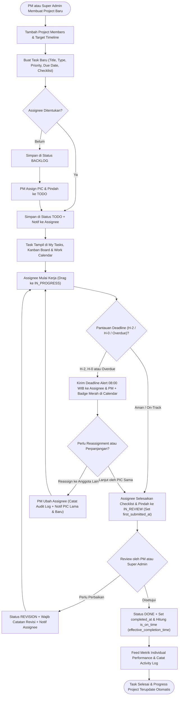
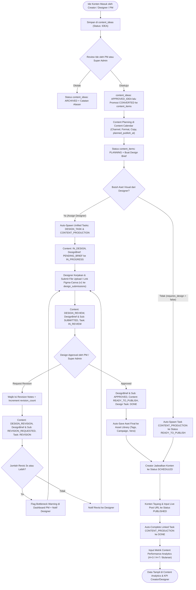
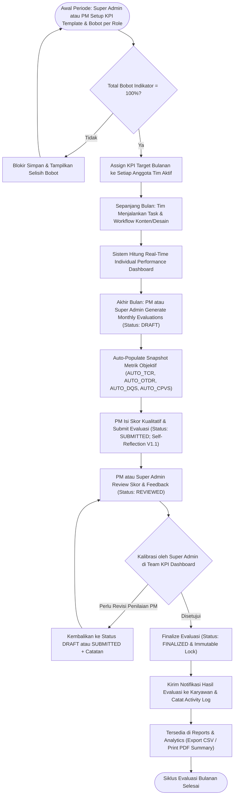
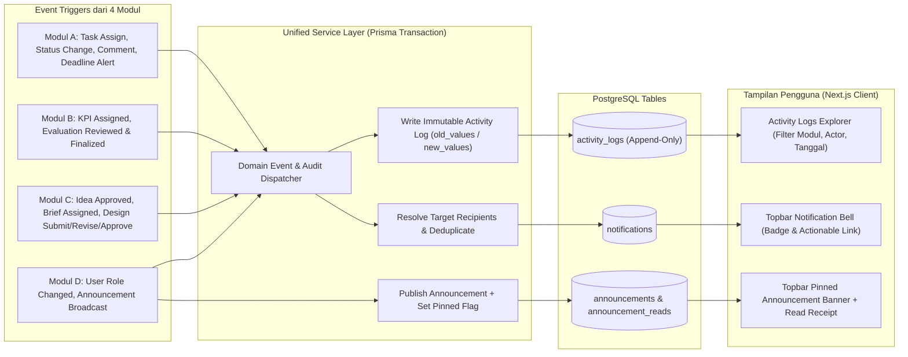

# KREVIA TEAM MANAGEMENT SYSTEM (KTMS) — PAKET PRESENTASI EKSEKUTIF DEMO GATE 1 (HARI 4)

> **Krevia Digital — *Build Smarter. Operate Better.***  
> **Dokumen Keputusan Eksekutif (*Pre-Coding Blueprint & Design Sign-Off*)**

| Atribut Rapat | Spesifikasi Resmi Gate 1 |
| :--- | :--- |
| **Agenda Utama** | **Demo Gate 1: Pre-Coding Blueprint, Figma Prototype & V1 Scope Sign-Off** |
| **Jadwal Pelaksanaan** | **Hari ke-4, Pukul 14:00 WIB** *(Durasi Terstruktur: 45 Menit)* |
| **Peserta Wajib** | **Leadership Krevia Digital** (*Project Sponsor / `SUPER_ADMIN`*), **Mhd Yoga Andhika** (*Track A Lead*), **Nta** (*Track B Lead*) |
| **Dokumen Sumber Kanonik** | [KREVIA_TMS_MASTER_BLUEPRINT.md](./KREVIA_TMS_MASTER_BLUEPRINT.md) *(6.624 baris — Cross-Verified lintas 4 disiplin)* |
| **Tujuan Keputusan (*Outcome*)** | Persetujuan resmi **Go / No-Go Gate 1** untuk mengunci Scope V1, Tech Stack, Formula & Bobot KPI Default, Pembagian Track A/B, serta Jadwal 3 Demo Gate sebelum **Repo Init Hari ke-5** |

---

### Peta Agenda Presentasi 45 Menit (`Slide 1` – `Slide 7`)

| Slot Waktu | Slide | Topik Presentasi & Fokus Keputusan | Tautan Blueprint Sumber |
| :---: | :---: | :--- | :--- |
| **00–05 mnt** | [Slide 1](#slide-1--konteks-bisnis-before-vs-after-visi--target-adopsi-v1) | Masalah Operasional (*Before vs After*), Visi KTMS & Metrik Adopsi (`PKPI-01`–`PKPI-06`) | [Bagian I §1](./KREVIA_TMS_MASTER_BLUEPRINT.md#L165-L216) |
| **05–13 mnt** | [Slide 2](#slide-2--ringkasan-arsitektur-terpadu--perbandingan-objektif-tech-stack) | Arsitektur 4 Modul, 4 Role RBAC (42 Permissions), Hybrid Storage & Justifikasi Tech Stack | [Ringkasan Arsitektur](./KREVIA_TMS_MASTER_BLUEPRINT.md#L57-L70) · [Bagian III §1](./KREVIA_TMS_MASTER_BLUEPRINT.md#L2266-L2363) |
| **13–21 mnt** | [Slide 3](#slide-3--moscow-matrix-mos-01mos-37--v1-scope-guardrails) | **MoSCoW Freeze:** 19 Must-Have (`14,00` dev-days), V1.1/V2, Out-of-Scope & Emergency De-Scoping | [Bagian I §1.4 & §4](./KREVIA_TMS_MASTER_BLUEPRINT.md#L1084-L1192) |
| **21–31 mnt** | [Slide 4](#slide-4--4-end-to-end-operational-user-flows-alur-kerja-harian-krevia) | **4 End-to-End Operational User Flows:** Task, Social/Design Loop, KPI & Governance | [Bagian II §2](./KREVIA_TMS_MASTER_BLUEPRINT.md#L1379-L1759) |
| **31–37 mnt** | [Slide 5](#slide-5--penguncian-formula--paket-bobot-kpi-default-per-role) | **Penguncian KPI:** Formula `AUTO_TCR`/`OTDR`/`DQS`/`CPVS`, `N/A` Re-Norm, Grades A–D & Bobot Role | [Bagian I §2.2](./KREVIA_TMS_MASTER_BLUEPRINT.md#L385-L505) |
| **37–41 mnt** | [Slide 6](#slide-6--pembagian-kerja-yoga-track-a--nta-track-b--tata-kelola-demo-gate) | Pembagian Kerja Track A/B, Roadmap 14 Hari, EOD 17:30 WIB, 3 Demo Gates & Mitigasi Risiko | [Bagian IV §3](./KREVIA_TMS_MASTER_BLUEPRINT.md#L6422-L6575) |
| **41–45 mnt** | [Slide 7](#slide-7--lampiran-lembar-persetujuan-gate-1-go--no-go-sign-off--input-leadership-hari-411) | **Input Leadership (Hari 4–11)** & Penandatanganan Resmi **Gate 1 Sign-Off Checklist** | [Lampiran Gate 1](./KREVIA_TMS_MASTER_BLUEPRINT.md#L6578-L6624) |

---

## Slide 1 — Konteks Bisnis (*Before vs After*), Visi & Target Adopsi V1

> **Pesan Utama Eksekutif:** KTMS menggantikan spreadsheet konten, koordinasi tugas di grup chat, folder file tanpa versi, dan rekap KPI manual menjadi **satu pusat kendali operasional terpadu (*Single Source of Truth*)** dalam 14 hari kerja.

### 1.1 Masalah Saat Ini & Transformasi Operasional (*Before vs After*)

Saat ini operasional Krevia Digital menghadapi tiga kerugian bisnis utama: **(1) hilangnya visibilitas eksekutif** atas beban kerja & risiko keterlambatan, **(2) inefisiensi duplikasi input** antara jadwal konten, brief desain, dan pelacakan tugas, serta **(3) subjektivitas & keterlambatan evaluasi KPI bulanan**.

| Dimensi Operasional | Kondisi Saat Ini (*Before* — Fragmented Tools) | Kondisi Target (*After* — KTMS V1) | Dampak Bisnis Terukur |
| :--- | :--- | :--- | :--- |
| **Pelacakan Tugas & Proyek** | Penugasan tersebar di chat (WhatsApp/Slack) & daftar pribadi; progres *real-time* sulit dipantau. | Terpusat di **Modul A** (`Project Management`, `My Tasks`, `Kanban Board`, `Work Calendar`) dengan status & deadline baku. | Memangkas waktu *status-checking* harian dan mencegah tugas terlewat. |
| **Produksi Konten Media Sosial** | Spreadsheet manual rentan konflik versi dan terputus dari penugasan tim. | **Content Calendar**, **Content Ideas**, & **Content Planning** di **Modul C** otomatis melahirkan tugas produksi. | Menghilangkan **100%** ketergantungan pada spreadsheet jadwal konten terpisah. |
| **Alur Brief, Revisi & Aset Desain** | Brief lewat chat; penamaan file kacau (`final_v2_revisi.png`); aset final terpencar. | **Design Workspace** menyimpan brief terstruktur, versi `v1..vN`, loop revisi tercatat, & **Asset Library** auto-arsip desain `APPROVED`. | Memangkas revisi berulang akibat brief kabur & mempercepat pencarian aset final. |
| **Evaluasi Kinerja & KPI Bulanan** | Rekap manual 2–3 hari di akhir bulan; ketepatan waktu & jumlah revisi berbasis perkiraan. | **Modul B** menghitung otomatis `TCR`, `OTDR`, `DQS`, & `CPVS` dari aktivitas nyata untuk **Monthly Evaluation** teraudit. | Evaluasi objektif berbasis data (*data-driven*) dengan waktu rekap turun dari hari ke menit. |
| **Kontrol Akses & Tata Kelola** | Akses file tanpa pemisahan wewenang ketat; tidak ada riwayat siapa mengubah apa. | **Modul D** menerapkan RBAC 4 peran, **Notification Center**, **Announcements**, & **Activity Logs** (*immutable*). | Menjamin integritas data, pemisahan wewenang (*Separation of Duties*), & akuntabilitas. |

### 1.2 Visi Produk & 4 Profil Pengguna Internal (4 Role Kanonik)

> **Visi Produk:** *"Menjadikan KTMS sebagai pusat kendali operasional internal Krevia Digital yang menyatukan perencanaan, eksekusi kreatif, dan pengukuran performa tim secara transparan, objektif, dan terotomatisasi — selaras dengan prinsip Build Smarter. Operate Better."*

* **`SUPER_ADMIN` (Leadership / Super Admin):** Pengawasan kinerja seluruh tim & proyek, penetapan kebijakan KPI, finalisasi evaluasi bulanan (`FINALIZED`), penerbitan pengumuman strategis, manajemen user/RBAC, dan audit aktivitas sistem.
* **`PROJECT_MANAGER` (Project Manager):** Mengelola proyek, mendistribusikan tugas, memonitor deadline & workload, menyetujui ide konten & hasil desain, serta me-review evaluasi KPI bulanan tim.
* **`STAFF_CREATOR` (Staff / Content Creator):** Mengeksekusi tugas harian, mengajukan ide konten, menyusun content plan & brief desain, menjadwalkan publikasi, menginput performa konten, dan memantau KPI pribadi.
* **`DESIGNER` (Designer):** Menerima brief & tugas desain terintegrasi, mengunggah/menautkan versi desain (`v1..vN`) di Design Workspace, menindaklanjuti catatan revisi hingga `APPROVED`, dan memantau skor kualitas desain (`DQS`).

### 1.3 Target Metrik Keberhasilan Adopsi V1 (*Product KPIs*)

| ID | Metrik Keberhasilan | Baseline (Pra-KTMS) | Target 30 Hari Pasca Go-Live | Target 90 Hari Pasca Go-Live |
| :---: | :--- | :---: | :---: | :---: |
| `PKPI-01` | **Migrasi Content Calendar** (% konten aktif di KTMS vs spreadsheet) | 0% | **100%** konten aktif | **100%** (spreadsheet lama diarsipkan) |
| `PKPI-02` | **Daily Active Internal Users (DAU)** ($\ge 4$ hari kerja/minggu) | 0% | **$\ge 85\%$** anggota tim aktif | **$\ge 95\%$** anggota tim aktif |
| `PKPI-03` | **Task Traceability Rate** (% tugas operasional & kreatif di KTMS) | Tidak terukur | **$\ge 80\%$** pekerjaan proyek & konten | **$\ge 95\%$** seluruh pekerjaan tim |
| `PKPI-04` | **Efisiensi Rekap Evaluasi Bulanan** (`DRAFT` $\rightarrow$ `FINALIZED`) | 2–3 hari kerja/bulan | **$\le 2$ jam/bulan** | **$\le 1$ jam/bulan** |
| `PKPI-05` | **Penurunan Keterlambatan Tugas** (*Overdue Task Ratio*) | Tidak terukur | Baseline tercatat di bulan 1 | Penurunan **$\ge 25\%$** dari bulan 1 |
| `PKPI-06` | **Keandalan Sistem Produksi** (*Uptime* 08:00–20:00 WIB) | N/A | **$\ge 99,0\%$** uptime | **$\ge 99,5\%$** uptime |

*Referensi Lengkap Blueprint:* [Bagian I §1 — Ringkasan Eksekutif & PKPI](./KREVIA_TMS_MASTER_BLUEPRINT.md#L165-L216)

---

## Slide 2 — Ringkasan Arsitektur Terpadu & Perbandingan Objektif Tech Stack

> **Pesan Utama Eksekutif:** Arsitektur KTMS V1 telah terverifikasi silang (*cross-verified*) lintas 4 disiplin agar cepat dibangun oleh 2 developer dalam 14 hari, kuat untuk analitik KPI & audit log, serta tetap aman diekstrak saat skala Krevia Digital membesar di V2+.

### 2.1 Peta Arsitektur Terpadu KTMS V1

| Dimensi Arsitektur | Spesifikasi Kanonik KTMS V1 |
| :--- | :--- |
| **4 Modul & 25 Sub-Fitur V1** | **Modul A — Task Management (7):** Project Management, My Tasks, Kanban Board, Work Calendar, Task Assignment, Progress Tracking, Deadline Management · **Modul B — Team & KPI (6):** Team Directory, Individual Performance, KPI Management (+ *Clone Previous Month*), Team Performance Dashboard, Monthly Evaluation (*immutable snapshot*), Reports & Analytics (CSV / Print-PDF) · **Modul C — Social Media & Design (7):** Content Calendar, Content Ideas, Content Planning (*auto-spawn tasks*), Design Workspace (`v1..vN`), Design Approval & Revision Loop, Asset Library (*auto-promote*), Content Performance Analytics (`ER%` & `CTR%`) · **Modul D — System Management (5):** User Management, Role & Permission (RBAC), Notification Center, Announcements (maks. 3 pinned + *read receipts*), Activity Logs (*immutable JSONB*) |
| **Tulang Punggung Lintas Modul** | **Unified Task Core (`tasks`):** Content Plan & Design Brief otomatis membuat/menautkan task bertipe `CONTENT_PRODUCTION` dan `DESIGN_TASK` dalam satu transaksi atomik (`prisma.$transaction()`), langsung muncul di My Tasks, Kanban, Work Calendar, dan otomatis memasok metrik KPI. |
| **Keamanan & RBAC (42 Permissions)** | **4 Role Kanonik** (`SUPER_ADMIN`, `PROJECT_MANAGER`, `STAFF_CREATOR`, `DESIGNER`) dikontrol oleh **42 atomic permissions** (`module:resource:action`). **Pemisahan Wewenang (*Separation of Duties*):** `SUPER_ADMIN` eksklusif untuk `kpi:evaluation:finalize`, `kpi:evaluation:reopen`, `system:user:manage`, & `system:rbac:manage`; `SUPER_ADMIN`/`PROJECT_MANAGER` eksklusif untuk `design:submission:approve`; larangan *self-evaluation* di level DB (`chk_monthly_eval_no_self`); *soft-delete* + `token_version` *instant session revocation*. |
| **6 Status Enum Utama** *(dari 21 PostgreSQL ENUMs)* | `TaskStatus` (`BACKLOG`, `TODO`, `IN_PROGRESS`, `IN_REVIEW`, `REVISION`, `DONE`, `CANCELLED`) · `TaskType` (`GENERAL`, `CONTENT_PRODUCTION`, `DESIGN_TASK`) · `TaskPriority` (`LOW`, `MEDIUM`, `HIGH`, `URGENT`) · `ContentStatus` (`IDEA`, `APPROVED_IDEA`, `PLANNING`, `IN_DESIGN`, `DESIGN_REVIEW`, `DESIGN_REVISION`, `READY_TO_PUBLISH`, `SCHEDULED`, `PUBLISHED`, `ARCHIVED`) · `DesignSubmissionStatus` (`PENDING_BRIEF`, `IN_PROGRESS`, `SUBMITTED`, `REVISION_REQUESTED`, `APPROVED`) · `EvaluationStatus` (`DRAFT`, `SUBMITTED`, `REVIEWED`, `FINALIZED`) |
| **Hybrid Storage Architecture** | **Mode 1 — External Cloud Links:** Tautan tervalidasi (`Figma`, `Canva`, `Google Drive`, `Frame.io`) dengan nol biaya storage untuk file mentah $> 25\text{ MB}$ · **Mode 2 — Direct Presigned Upload:** Private Bucket (Supabase Storage / S3) via `POST /api/uploads/presign` (PUT TTL `300s`), batas **25 MB** desain/lampiran & **2 MB** avatar, whitelist MIME ketat (`PNG/JPG/WEBP/SVG/PDF/MP4`), serta `Content-Disposition: attachment` wajib untuk SVG (anti-XSS). |
| **Kematangan Artefak Blueprint** | **25 Tabel PostgreSQL 16** + **21 ENUMs** + **25 Custom Indexes** · **25 FR + 4 FR-INT + 15 NFR** · **24 User Stories** · **14 Use Cases** · **4 State Matrices** · **26 UI Routes** · **28 Server Actions** · **15 `/api/**` Route Handlers** · **6 Grup Kontrak API** · **16 Diagram Mermaid** |

### 2.2 Perbandingan Objektif Tech Stack (Keputusan Arsitektur)

| Kriteria Evaluasi | **Opsi A: Hybrid Next.js 15+ (App Router) + Prisma + PostgreSQL 16 (DIREKOMENDASIKAN)** | Opsi B: Separate Node.js / NestJS REST API + Next.js Frontend | Opsi C: Laravel (+ React/Inertia atau API) + MySQL |
| :--- | :--- | :--- | :--- |
| **Kecepatan Delivery V1 (2 Dev / 14 Hari)** | **Sangat Tinggi.** Satu repo, 100% TypeScript end-to-end; kontrak tipe data dibagi langsung antara Prisma, Service Layer, dan UI tanpa *boilerplate* DTO ganda (~40% lebih cepat). | **Sedang–Lambat.** Harus mengelola 2 service, 2 pipeline deploy, CORS, sinkronisasi OpenAPI, & duplikasi validasi request/response. | **Sedang.** Produktif untuk CRUD konvensional, tetapi kombinasi PHP + TypeScript (React) membagi fokus kognitif 2 dev & menghilangkan *shared type safety* DB-ke-UI. |
| **Analitik KPI & Audit Log (`PostgreSQL` vs `MySQL`)** | **Unggul.** PostgreSQL 16 mendukung CTE kompleks (`WITH`), `FILTER (WHERE ...)`, *Partial Indexes* (`WHERE deleted_at IS NULL`), array native, dan **`JSONB` + GIN Index** untuk audit log & snapshot KPI. | **Unggul** (bila memakai PostgreSQL), namun beban orkestrasi *microservice-style* tidak sebanding untuk tim 2 orang dalam 14 hari. | **Terbatas di Analitik JSON & Partial Index.** MySQL tidak memiliki *partial index* native untuk *soft-delete* dan fleksibilitas `JSONB`/array kalah dibanding PostgreSQL 16. |
| **Interaktivitas UI Modern (Kanban & Calendar)** | **Sangat Baik.** RSC untuk muat awal cepat + Server Actions & TanStack Query untuk *optimistic UI* Kanban `@dnd-kit` dan filter Calendar mulus. | **Sangat Baik**, tetapi menambah *network hop* ekstra (`Browser -> Next.js -> NestJS -> DB`). | **Baik** (via Inertia), namun *optimistic update* Kanban kompleks & state concurrent tetap menuntut endpoint JSON terpisah di luar Inertia. |
| **Biaya Infrastruktur & Operasional V1** | **Paling Hemat.** 1 aplikasi Next.js (Vercel/Docker) + 1 Managed PostgreSQL (Supabase/Neon) + GitHub Actions CI. | **Lebih Tinggi.** Minimal 2 runtime container/hosting + manajemen networking & observability terpisah. | **Hemat** (VPS), tetapi butuh manajemen stack PHP-FPM + Nginx + Queue Worker + Node build. |
| **Skalabilitas V2+ (Mobile / Multi-Client)** | **Aman & Terstruktur.** Seluruh *business logic* terisolasi rapi di `Service Layer`, sehingga ekstraksi ke `/api/v1/**` untuk mobile app di V2 cukup membungkus ulang Service Layer yang sama. | **Sangat Baik** untuk skala >10 developer dengan banyak client sekaligus. | **Baik** untuk tim PHP dedicated, kurang selaras jika roadmap Krevia terpusat di ekosistem TypeScript/React. |

> **Kesimpulan Stack Final untuk Disetujui:** **Next.js 15+ (App Router, TypeScript *strict*, Tailwind CSS, `shadcn/ui`, `@dnd-kit`, TanStack Query/Table, `Recharts`, `nuqs`, Zod)** + **Hybrid Backend (28 Server Actions + 15 Route Handlers `/api/**`)** + **PostgreSQL 16 + Prisma ORM** + **Auth.js v5 (`token_version`)** + **Hybrid Storage (External Links + Supabase Storage)**.

*Referensi Lengkap Blueprint:* [Ringkasan Arsitektur Terpadu](./KREVIA_TMS_MASTER_BLUEPRINT.md#L57-L70) · [Bagian III §1.1 — Perbandingan Backend](./KREVIA_TMS_MASTER_BLUEPRINT.md#L2266-L2282) · [Bagian III §1.3 — Hybrid Storage](./KREVIA_TMS_MASTER_BLUEPRINT.md#L2340-L2363) · [Bagian III §4.2 — RBAC Matrix](./KREVIA_TMS_MASTER_BLUEPRINT.md#L4600-L4658)

---

## Slide 3 — MoSCoW Matrix (`MOS-01`–`MOS-37`) & V1 Scope Guardrails

> **Pesan Utama Eksekutif:** Seluruh 25 sub-fitur V1 dikelompokkan dalam **19 blok Must-Have (`11,50` dev-days build + `2,50` dev-days QA/UAT/Deploy = `14,00` dev-days kapasitas Minggu 2)** agar tepat waktu di Hari ke-14 tanpa mengorbankan kualitas.

### 3.1 Validasi Kapasitas Sprint Minggu 2 (2 Developers $\times$ 7 Hari = `14,00` Dev-Days)

| Kelompok Pekerjaan | Jumlah Blok | Estimasi (*Dev-Days*) | Jadwal Eksekusi Utama |
| :--- | :---: | :---: | :--- |
| **Modul D — System Core** (`MOS-01`, `MOS-19`) | 2 blok | `2,00` | Hari 8 & Hari 10–12 |
| **Modul A — Task Management** (`MOS-02`–`MOS-06`) | 5 blok | `2,75` | Hari 8–10 |
| **Modul C — Social Media & Design** (`MOS-07`–`MOS-13`) | 7 blok | `4,00` | Hari 8–11 |
| **Modul B — Team & KPI** (`MOS-14`–`MOS-18`) | 5 blok | `2,75` | Hari 10–12 |
| **Subtotal Implementasi Must-Have V1 (25 Sub-Fitur)** | **19 blok** | **`11,50` dev-days** | **Hari 8 s/d Hari 12 (siang)** |
| **QA Silang, Uji RBAC, UAT Leadership, Backup & Deploy** | **QA & Release** | **`2,50` dev-days** | **Hari 12 (sore) s/d Hari 14** |
| **TOTAL KAPASITAS MINGGU 2** | **19 blok + QA** | **`14,00` dev-days** | **100% Terkalibrasi & Realistis** |

### 3.2 Matriks Lengkap Must-Have V1 (`MOS-01` s/d `MOS-19` — Target Go-Live Hari 14)

| ID | Modul | Fitur / Sub-Fitur & Ruang Lingkup V1 | Target | Estimasi | Dependensi | Justifikasi Bisnis |
| :---: | :---: | :--- | :---: | :---: | :--- | :--- |
| `MOS-01` | D | **Auth.js v5, User Management (`FR-D01`) & RBAC Guard (`FR-D02`)** | Hari 8 | `1,00` | DB & Seed | Prasyarat keamanan mutlak untuk seluruh modul. |
| `MOS-02` | A | **Project Management (`FR-A01`)** — CRUD proyek, anggota, progres % | Hari 8–9 | `0,50` | `MOS-01` | Wadah struktural tugas operasional & kampanye konten. |
| `MOS-03` | A | **Task Assignment (`FR-A05`) & Progress Tracking (`FR-A06`)** | Hari 9 | `0,75` | `MOS-02` | Sumber tunggal data Kanban, Kalender, & KPI. |
| `MOS-04` | A | **My Tasks (`FR-A02`) & Deadline Management (`FR-A07`)** + Cron 08:00 | Hari 9 | `0,50` | `MOS-03` | Mendorong disiplin `OTDR` & fokus harian tim. |
| `MOS-05` | A | **Kanban Board (`FR-A03`)** — 6 kolom, `@dnd-kit`, modal revisi wajib | Hari 9–10 | `0,75` | `MOS-03` | Visibilitas instan alur kerja & *bottleneck* proyek. |
| `MOS-06` | A | **Work Calendar (`FR-A04`)** — Month/Week view & drawer detail | Hari 10 | `0,25` | `MOS-03`, `MOS-09` | Mencegah bentrokan deadline lintas proyek. |
| `MOS-07` | C | **Content Ideas Management (`FR-C02`)** — Ide, upvote, 1-klik promote | Hari 9 | `0,50` | `MOS-01`, `MOS-02` | Menjaga bank ide & mempercepat kurasi editorial PM. |
| `MOS-08` | C | **Content Planning (`FR-C03`) & Auto-Task (`FR-INT-01`)** | Hari 10 | `0,75` | `MOS-03`, `MOS-07` | Menghapus input ganda antara planner & task tracker. |
| `MOS-09` | C | **Content Calendar (`FR-C01`)** — Calendar Grid & Editorial Table | Hari 10 | `0,50` | `MOS-08` | Pengganti langsung 100% spreadsheet konten (`PKPI-01`). |
| `MOS-10` | C | **Design Workspace (`FR-C04`) & Auto-Task (`FR-INT-02`)** — `v1..vN` | Hari 10–11 | `1,00` | `MOS-03`, `MOS-08` | Menghilangkan kekacauan brief & file revisi di chat. |
| `MOS-11` | C | **Design Approval & Revision Loop (`FR-C05`)** — `revision_count` | Hari 11 | `0,50` | `MOS-10` | Menjamin kontrol kualitas visual & pasok data `DQS`. |
| `MOS-12` | C | **Asset Library (`FR-C06`) & Auto-Promote (`FR-INT-03`)** | Hari 11 | `0,50` | `MOS-11` | Katalog otomatis aset final berstatus `APPROVED`. |
| `MOS-13` | C | **Content Performance Analytics (`FR-C07`)** — `ER_reach` & `CTR` | Hari 11 | `0,25` | `MOS-08` | Menutup siklus evaluasi capaian konten terbit. |
| `MOS-14` | B | **Team Directory (`FR-B01`) & Individual Performance (`FR-B02`/`INT-04`)** | Hari 11–12 | `0,75` | `MOS-03`, `MOS-11`, `MOS-08` | Transparansi metrik otomatis `TCR`, `OTDR`, `DQS`, `CPVS`. |
| `MOS-15` | B | **KPI Management (`FR-B03`)** — Bobot = 100% & *Clone Previous Month* | Hari 12 | `0,50` | `MOS-14` | Standardisasi target & percepatan setup periode baru. |
| `MOS-16` | B | **Team Performance Dashboard (`FR-B04`)** — Leaderboard & Workload | Hari 12 | `0,50` | `MOS-14`, `MOS-15` | Deteksi dini *overload* & tren performa tim 6 bulan. |
| `MOS-17` | B | **Monthly Evaluation (`FR-B05`)** — 4 status & *Immutable Snapshot* | Hari 12 | `0,75` | `MOS-14`, `MOS-15` | Menggantikan rekap manual akhir bulan dengan lock final. |
| `MOS-18` | B | **Reports & Analytics (`FR-B06`)** — CSV Export & Print-Ready PDF | Hari 12 | `0,25` | `MOS-17` | Siap pakai untuk rapat evaluasi bulanan Leadership. |
| `MOS-19` | D | **Notification Center (`FR-D03`), Announcements (`FR-D04`), Audit (`FR-D05`)** | Hari 8 & 12 | `1,00` | `MOS-01` | 21 event notifikasi, maks 3 pinned, & audit JSONB. |

### 3.3 Backlog Iterasi Berikutnya (`Should-Have V1.1` & `Could-Have V2`)

* **Should-Have — Rilis V1.1 (Minggu 3–4, Fast-Follow):**
  * `MOS-20` Calendar Drag-and-Drop Reschedule (`0,50`d) · `MOS-21` Server-Generated Branded PDF & Multi-Sheet XLSX Export (`0,75`d) · `MOS-22` Employee Self-Reflection pada Monthly Evaluation (`0,50`d) · `MOS-23` Content Analytics Advanced Charts & Bulk CSV Import (`0,75`d) · `MOS-24` Recurring Tasks & Templates (`0,75`d) · `MOS-25` Email Digest & Notifikasi Kritis via SMTP/Resend (`0,75`d) · `MOS-26` Asset Library Bulk Upload & Folder Collections (`0,50`d).
* **Could-Have — Rilis V2 (Kuartal Berikutnya):**
  * `MOS-27` Integrasi API Media Sosial Resmi / Auto-Scheduling (`4,00+`d) · `MOS-28` Visual Pin-Point Annotation pada Design Review (`2,50`d) · `MOS-29` Gantt Dependency View & Kanban WIP Limits (`2,00`d) · `MOS-30` Custom Dynamic Roles & Google Workspace SSO (`1,50`d) · `MOS-31` OKR & Quarterly Appraisal Roll-Up (`2,00`d) · `MOS-32` Webhook / Slack & WhatsApp Notification Bridge (`1,00`d).

### 3.4 Garis Merah Tegas: Won't-Have (*Strictly Out-of-Scope V1*) & *Emergency De-Scoping*

| ID | Domain | Fitur Ditolak Tegas di V1 (*Won't-Have*) | Alasan Strategis Perlindungan Timeline 14 Hari |
| :---: | :---: | :--- | :--- |
| `MOS-33` | Platform | **Native Mobile Apps (iOS & Android)** & PWA offline kompleks | Menggandakan beban build & store review; web *desktop-first responsive* ($\ge 768\text{px}$) sudah mencukupi. |
| `MOS-34` | Eksternal | **External Client Portal & Multi-Tenant Client Login** | Fokus V1 adalah operasional internal Krevia; akses eksternal butuh isolasi tenant & SLA terpisah. |
| `MOS-35` | HRIS | **Full HRIS** (Payroll, Slip Gaji, Absensi Geofencing/Biometrik, Cuti, Rekrutmen/ATS) | Domain regulasi & akuntansi terpisah di luar produktivitas tugas & KPI eksekusi. |
| `MOS-36` | Komunikasi | **Internal Real-Time Chat Messenger & Video Conferencing** | Tim sudah memakai chat instan; diskusi kontekstual cukup di komentar task/brief & pengumuman. |
| `MOS-37` | Finansial | **ERP Keuangan, Invoicing, RAB/Budgeting & Akuntansi** | Di luar fokus efisiensi eksekusi tim & pengukuran KPI V1. |

> **Change Freeze & Rencana Kontingensi *Emergency De-Scoping Order* (Bila Ada Hambatan Hari 11–12):**  
> Setelah Gate 1 disetujui, fitur baru di luar 25 sub-fitur masuk Backlog V1.1 (atau via *explicit scope trade-off* tertulis). Jika muncul kendala teknis tak terduga di Hari 11–12, urutan penundaan aman 3 hari ke V1.1 adalah: **1. `MOS-13` (Content Performance Analytics)** $\rightarrow$ **2. `MOS-18` Print-PDF (tetap rilis CSV Export)** $\rightarrow$ **3. `MOS-06` Week View (tetap rilis Month View + Agenda List)**.  
> **Non-Negotiable Core V1 (Wajib Utuh Hari 14):** `MOS-01` (Auth/RBAC), `MOS-03` & `MOS-05` (Task + Kanban), `MOS-09`–`MOS-11` (Content Calendar + Design Approval Loop), `MOS-14` & `MOS-17` (KPI Engine + Monthly Evaluation Finalize), serta `MOS-19` (Immutable Activity Logs).

*Referensi Lengkap Blueprint:* [Bagian I §1.4 — V1 Scope Guardrails](./KREVIA_TMS_MASTER_BLUEPRINT.md#L219-L235) · [Bagian I §4 — Matriks MoSCoW Lengkap](./KREVIA_TMS_MASTER_BLUEPRINT.md#L1084-L1192)

---

## Slide 4 — 4 End-to-End Operational User Flows (Alur Kerja Harian Krevia)

> **Pesan Utama Eksekutif:** Keempat alur operasional di bawah ini menyatukan seluruh siklus kerja harian Krevia Digital tanpa input ulang ganda dan telah dipetakan 1-ke-1 ke *Server Actions* serta transaksi database atomik (`prisma.$transaction()`).

### 4.1 Skenario 1 — Siklus Hidup Project & Task Management (`Diagram 1A`)

**Highlight Bisnis:** Menghilangkan tugas tercecer di chat; setiap task langsung tampil serentak di **My Tasks**, **Kanban Board**, dan **Work Calendar**, dilengkapi pengingat deadline otomatis pukul **08:00 WIB** (H-2, H-0, H+1 & H+3) serta pemisahan wewenang review (`IN_REVIEW` oleh pelaksana $\rightarrow$ `DONE` oleh PM/`SUPER_ADMIN`).

### 4.2 Skenario 2 — Siklus Lengkap Konten Media Sosial & Design Workspace (`Diagram 2A`)

**Highlight Bisnis:** Menggantikan 100% spreadsheet jadwal konten. Promosi ide & brief desain otomatis memunculkan task `DESIGN_TASK` dan `CONTENT_PRODUCTION` tanpa duplikasi; revisi wajib menyertakan alasan tertulis ($\ge 10$ karakter) dengan peringatan *bottleneck* bila revisi $\ge 3\times$; desain berstatus `APPROVED` otomatis terarsip di **Asset Library** dan menyelesaikan `DESIGN_TASK` ke `DONE`.

### 4.3 Skenario 3 — Penetapan KPI, Agregasi Otomatis & Monthly Evaluation (`Diagram 3A`)

**Highlight Bisnis:** Menghapus bias subjektif & hitung manual di akhir bulan. Metrik objektif dihitung real-time dari data tugas/desain/konten, digabungkan dengan skor kualitatif PM, lalu dikunci secara permanen (*immutable snapshot*) oleh `SUPER_ADMIN` saat status menjadi `FINALIZED`.

### 4.4 Skenario 4 — Notification Center, Announcements & Audit Trail (`Diagram 4A`)

**Highlight Bisnis:** Setiap mutasi penting di 4 modul secara atomik mencatat `activity_logs` (*append-only JSONB diff*), mengirim notifikasi in-app (`21` tipe event, polling 30 detik), dan menyematkan pengumuman penting Leadership (maks. 3 *pinned banner*) lengkap dengan pelacakan *read receipts*.

*Referensi Lengkap Blueprint:* [Bagian II §2 — End-to-End User Flows & Sequence Diagrams](./KREVIA_TMS_MASTER_BLUEPRINT.md#L1379-L1759)

---

## Slide 5 — Penguncian Formula & Paket Bobot KPI Default per Role

> **Pesan Utama Eksekutif:** Pada Gate 1 hari ini, Leadership mengunci formula objektif KPI yang adil bagi pelaksana maupun manajemen, serta paket bobot default 100% per peran untuk langsung di-seed ke `prisma/seed.ts`.

### 5.1 Penguncian 5 Tipe Kalkulasi & Formula Matematis Eksak

| Kode Tipe | Nama Metrik & Peran | Formula Matematis Resmi | Aturan Keadilan & Guardrail Anti-Manipulasi |
| :--- | :--- | :--- | :--- |
| **`AUTO_TCR`** | **Task Completion Rate** *(Semua Peran)* | $\text{ROUND}\!\left(\dfrac{T_{\text{done}}}{T_{\text{assigned}}} \times 100,\; 2\right)\%$ atau `N/A` jika $T_{\text{assigned}} = 0$ | Menghitung task aktif (`status != 'CANCELLED'`, `deleted_at IS NULL`) yang bertenggat di bulan $M$ (atau tanpa `due_date` yang diselesaikan di bulan $M$). |
| **`AUTO_OTDR`** | **On-Time Delivery Rate** *(Semua Peran)* | $\text{ROUND}\!\left(\dfrac{T_{\text{on\_time}}}{T_{\text{done\_dated}}} \times 100,\; 2\right)\%$ atau `N/A` jika $T_{\text{done\_dated}} = 0$ | **Adil via `effective_completion_time`:** jika `revision_count = 0`, waktu hitung memakai `COALESCE(first_submitted_at, completed_at)` agar antrean review PM tidak menghukum pelaksana; jika `revision_count > 0`, memakai `completed_at`. `STAFF_CREATOR` & `DESIGNER` **dilarang** mengubah `due_date` task dari PM/Admin. |
| **`AUTO_DQS`** | **Design Quality & Revision Score** *(`DESIGNER`)* | $\text{Score}_i = \max(40,\; 100 - (15 \times r_i))$; $\text{DQS} = \text{ROUND}(\text{AVG}(\text{Score}_i),\; 2)$ atau `N/A` jika $D_{\text{approved}} = 0$ | **Floor score = 40**, **penalti = 15 poin/revisi** (`0` rev = 100, `1` = 85, `2` = 70, `3` = 55, $\ge 4$ = 40) pada desain `APPROVED` bulan $M$. Didampingi rata-rata revisi ($\bar{R}$) & `FPAR`. Revisi wajib catatan min. 10 karakter. |
| **`AUTO_CPVS`** | **Content Output Target Achievement** *(`STAFF_CREATOR`)* | $\min\!\left(100.00,\; \text{ROUND}\!\left(\dfrac{C_{\text{delivered}}}{C_{\text{target}}} \times 100,\; 2\right)\right)\%$ atau `N/A` jika $C_{\text{target}} = 0$ | $C_{\text{delivered}}$ menghitung `content_items` (`creator_id = u`) berstatus `SCHEDULED` atau `PUBLISHED` pada periode $M$; nilai skor dibatasi maksimal `100.00`. |
| **`MANUAL_SCORE`** | **Penilaian Kualitatif Evaluator** *(Semua Peran)* | Skor input langsung $S_k \in [0.00,\; 100.00]$ (unit `SCORE_100` / `Skor`) | Wajib diisi penuh bersama `evaluator_notes` min. 20 karakter sebelum status evaluasi dapat pindah ke `SUBMITTED`. Nilai `AUTO_*` bersifat **read-only**. |

### 5.2 Weighted KPI Score, `N/A` Weight Re-Normalization & Grades A–D

* **Validasi Bobot Wajib 100%:** Sistem menolak penyimpanan `kpi_assignments` per user per periode jika $\sum w_k \neq 100\%$.
* **Mekanisme `N/A` Weight Re-Normalization:** Bila ada indikator otomatis bernilai `N/A` (misal anggota baru belum memiliki task bertenggat atau desain `APPROVED` di bulan tersebut), sistem menyimpan `NULL` (tampil `N/A`, **bukan** `0.00`), mengeluarkan indikator itu dari himpunan aktif $A$, dan menormalisasi bobot sisanya secara proporsional:
  $$\text{Weighted KPI Score} = \text{ROUND}\!\left(\frac{\sum_{k \in A} (S_k \times w_k)}{\sum_{k \in A} w_k},\; 2\right)$$
* **4 Predikat Kinerja Kanonik (*Performance Grades*):**
  * **Grade A (`90,00 – 100,00`):** *Exceeds Expectations / Sangat Baik*
  * **Grade B (`80,00 – 89,99`):** *Meets Expectations / Baik*
  * **Grade C (`70,00 – 79,99`):** *Needs Improvement / Cukup*
  * **Grade D (`0,00 – 69,99`):** *Underperforming / Perlu Pembinaan*
* **Tata Kelola & Anti-Drift:** Satu dokumen per `UNIQUE (user_id, period_year, period_month)`. Evaluator dilarang menilai diri sendiri (`chk_monthly_eval_no_self`); evaluasi `PROJECT_MANAGER` wajib oleh `SUPER_ADMIN`. Status `FINALIZED` eksklusif `SUPER_ADMIN` (`kpi:evaluation:finalize`) dan membekukan seluruh angka ke JSONB *immutable* `auto_metrics_snapshot`; pembukaan kembali (*re-open*) hanya oleh `SUPER_ADMIN` dengan alasan wajib $\ge 20$ karakter di `activity_logs`.

### 5.3 Paket Bobot KPI Default Bawaan per Role (Seeded V1 = 100% per Role)

| Role Target | Indikator KPI Default (12 Template Seeded V1) | Tipe Kalkulasi | Bobot Default | Target Default |
| :--- | :--- | :---: | :---: | :---: |
| **`PROJECT_MANAGER`** *(Total: 100%)* | 1. Team/Project Task Completion Rate (agregasi proyek dipimpin) | `AUTO_TCR` | **30%** | `95%` |
| **`PROJECT_MANAGER`** | 2. Team On-Time Delivery Rate (agregasi proyek dipimpin) | `AUTO_OTDR` | **30%** | `90%` |
| **`PROJECT_MANAGER`** | 3. Kualitas Perencanaan & Mitigasi Risiko | `MANUAL_SCORE` | **20%** | `85 Skor` |
| **`PROJECT_MANAGER`** | 4. Koordinasi Tim & Komunikasi Leadership | `MANUAL_SCORE` | **20%** | `85 Skor` |
| **`STAFF_CREATOR`** *(Total: 100%)* | 1. Individual Task Completion Rate (`TCR`) | `AUTO_TCR` | **25%** | `95%` |
| **`STAFF_CREATOR`** | 2. On-Time Delivery Rate (`OTDR`) | `AUTO_OTDR` | **25%** | `90%` |
| **`STAFF_CREATOR`** | 3. Pencapaian Target Output Konten (`CPVS`) | `AUTO_CPVS` | **25%** | `20 Konten` |
| **`STAFF_CREATOR`** | 4. Kualitas Ide, Copywriting & Konsistensi Brand | `MANUAL_SCORE` | **25%** | `85 Skor` |
| **`DESIGNER`** *(Total: 100%)* | 1. Individual Task Completion Rate (`TCR`) | `AUTO_TCR` | **25%** | `95%` |
| **`DESIGNER`** | 2. On-Time Delivery Rate (`OTDR`) | `AUTO_OTDR` | **25%** | `90%` |
| **`DESIGNER`** | 3. Design Quality & Revision Score (`DQS`) | `AUTO_DQS` | **30%** | `85 Skor` |
| **`DESIGNER`** | 4. Kreativitas Visual & Kepatuhan Brief | `MANUAL_SCORE` | **20%** | `85 Skor` |

*Referensi Lengkap Blueprint:* [Bagian I §2.2 — Formula & Bobot KPI](./KREVIA_TMS_MASTER_BLUEPRINT.md#L385-L505) · [Bagian II §2.3 — Skenario 3 KPI](./KREVIA_TMS_MASTER_BLUEPRINT.md#L1583-L1657)

---

## Slide 6 — Pembagian Kerja Yoga (Track A) & Nta (Track B) + Tata Kelola Demo Gate

> **Pesan Utama Eksekutif:** Kedua developer bekerja paralel dengan batas kepemilikan direktori eksklusif (*Vertical Slice Ownership*) dan kontrak antar-modul yang dibekukan hari ini, disertai **laporan progres harian 17:30 WIB** dan **3 Formal Demo Gate** ke Leadership.

### 6.1 Matriks Ownership Anti-Konflik: Track A vs Track B

| Dimensi Kerja | **Mhd Yoga Andhika (Track A — Platform/Backend Lead + Modul A & D)** | **Nta (Track B — UI/UX Frontend Lead + Modul C & B)** |
| :--- | :--- | :--- |
| **Fondasi Bersama (Hari 5–7)** | Setup Repo & GitHub CI, Vercel + Supabase, `prisma/schema.prisma` (*Schema Gatekeeper* tunggal), `prisma/seed.ts`, Auth.js v5, RBAC Guard (`src/server/auth/`), `safe-action.ts`, `audit-logger.ts`, `notification-dispatcher.ts`, `GET /api/health` | Konfigurasi Tailwind + `shadcn/ui` Design System, App Shell (`AppSidebar` 22 menu terfilter RBAC, `AppTopbar`, `PinnedAnnouncementBanner`, `GlobalSlideOverHost`), shared `DataTable`/`StatusBadge`/`PriorityBadge`, & Presigned Storage UI (`POST /api/uploads/presign`, `GET /api/uploads/download-url`, `FileUploadDropzone`) |
| **Kepemilikan Modul V1** | **Modul A (`src/features/tasks/`):** Projects, My Tasks, Kanban Board (`@dnd-kit`), Work Calendar, `TaskDetailDrawer`, Cron `/api/cron/deadline-alerts` · **Modul D (`src/features/system/`):** Users, RBAC Matrix, Notification Center (polling 30s), Announcements, Activity Logs + **Executive Home `/`** | **Modul C (`src/features/social-design/`):** Content Ideas, Content Planning, Content Calendar, Design Workspace, Design Approval & Revision Loop, Asset Library, Content Analytics · **Modul B (`src/features/team-kpi/`):** Team Directory, Individual Performance, KPI Templates (*Clone Previous Month*), Team Dashboard (`Recharts`), Monthly Evaluation, Reports & CSV Export |
| **Kontrak Integrasi Lintas Modul** | Menyediakan fungsi atomik Hari 7–8: `taskService.spawnLinkedTask(tx)`, `writeAuditLog(tx)`, `dispatchNotifications(tx)` | Mengonsumsi helper transaksi Yoga di alur Content Plan, Design Approval/Revision, & Finalize KPI; membaca tabel `tasks` & `design_submissions` untuk mesin KPI |

*Aturan File Bersama (`prisma/schema.prisma`, `enums.ts`, `permissions.ts`, `navigation.ts`, `package.json`):* hanya diubah lewat PR kecil tersendiri dengan review SLA **maksimal 1 jam**.

### 6.2 Peta Jalan 14 Hari & 3 Formal Demo Gate ke Leadership

```mermaid
flowchart LR
    W1A["Hari 1-3: SRS, UX Flows, Wireframe Figma & ERD Final"] --> G1["GATE 1 (Hari 4): Blueprint & Design Sign-Off Leadership"]
    G1 --> W1B["Hari 5-7: Repo Init, Prisma+Seed, Auth RBAC, App Shell & Staging LIVE"]
    W1B --> W2A["Hari 8-10: Core Sprint Modul A+D (Yoga) & Modul C+B Dasar (Nta)"]
    W2A --> G2["GATE 2 (Hari 10): Mid-Sprint Live Staging Demo ke Leadership"]
    G2 --> W2B["Hari 11-12: KPI Engine, Audit Logs, Dashboard & Feature Freeze"]
    W2B --> W2C["Hari 13: QA Silang, RBAC Security Test, Bug Fix & UAT Dry-Run"]
    W2C --> G3["GATE 3 (Hari 14): UAT Sign-Off, Production Go-Live & Handover"]
```

| Demo Gate | Jadwal | Peserta | Agenda Demonstrasi Konkret | Kriteria Kelulusan (*Go / No-Go*) |
| :--- | :--- | :--- | :--- | :--- |
| **Gate 1: Blueprint & Design Sign-Off** | **Hari 4** (14:00 WIB, 45 menit) | Leadership, Yoga, Nta | Review Arsitektur & V1 Scope Guardrails, demo Figma Hi-Fi Prototype 4 modul, penguncian Formula & Bobot KPI, serta konfirmasi jadwal 14 hari. | Leadership menyetujui scope V1 (freeze), alur status 4 modul, formula & bobot KPI, dan desain UI tanpa perubahan arsitektur mayor. |
| **Gate 2: Mid-Sprint Live Staging Demo** | **Hari 10** (16:00 WIB, 30 menit) | Leadership, PM, Yoga, Nta | Demo live di **Staging URL**: Login 4 role -> Content Plan auto-spawn task di Kanban -> Designer upload revisi -> PM Approve -> Asset Library -> Broadcast Announcement & Notifikasi. | Alur lintas modul A + C + D berjalan stabil end-to-end tanpa crash; masukan minor dicatat untuk tuntas sebelum **Feature Freeze Hari 12 (17:00 WIB)**. |
| **Gate 3: Formal UAT & Production Go-Live** | **Hari 14** (14:00 WIB, 60 menit) | Leadership, PM, Perwakilan Creator & Designer, Yoga, Nta | Verifikasi UAT penuh termasuk Modul B (Auto-KPI -> Review -> Finalize Lock -> CSV Export) & Audit Trail, switch Production URL, dan onboarding tim 30 menit. | **0 bug P0/P1**, 4 role lolos uji RBAC `403`, Production HTTPS + DB daily backup aktif, & seluruh akun tim Krevia berhasil login. |

### 6.3 Ritual Kontrol Harian & Sorotan Mitigasi Risiko

* **Visibilitas Progres Harian ke Leadership:**
  * **09:30 WIB:** Daily Dev Sync (10 menit, Yoga & Nta) sinkronisasi PR & kontrak interface.
  * **17:30 WIB:** **Async EOD Progress Report** ke grup Leadership (Status `ON TRACK`/`AT RISK`, **Staging URL terbaru**, item selesai beserta bukti PR/screenshot/video, fokus besok, dan daftar blocker).
  * **Aturan Eskalasi Blocker:** > 2 jam buntu $\rightarrow$ wajib *pair-debugging* Yoga–Nta; > 4 jam atau butuh keputusan kebijakan/akses $\rightarrow$ eskalasi hari yang sama ke Leadership beserta opsi solusi.
* **Penanganan Risiko Utama Timeline 2 Minggu (`R-01` s/d `R-08`):**
  * **Anti-Scope Creep (`R-01`):** Permintaan baru dicatat ke Backlog V1.1 atau dieksekusi via *explicit scope trade-off* tertulis.
  * **Race Condition Kanban (`R-02`) & Schema Conflict (`R-03`):** Gap positioning `65536` + optimistic `version` check + dropdown fallback "Ubah Status"; Yoga sebagai *Schema Gatekeeper* tunggal.
  * **Storage CORS/Limit (`R-04`) & Edge Case KPI (`R-05`):** Uji presigned upload sejak Hari 7 + fallback External Link Figma/Canva/GDrive; guard `N/A` + *weight re-normalization* + *immutable snapshot* saat `FINALIZED`.
  * **Sinkronisasi Lintas Modul (`R-06`) & Data Tim Awal (`R-07`):** Seluruh mutasi lintas tabel dibungkus `prisma.$transaction()`, serta penguncian deadline data tim pada **Hari 11 (17:00 WIB)**.

*Referensi Lengkap Blueprint:* [Bagian IV §3 — Pembagian Kerja, Roadmap 14 Hari, Demo Gates & Risk Register](./KREVIA_TMS_MASTER_BLUEPRINT.md#L6422-L6575)

---

## Slide 7 — Lampiran Lembar Persetujuan Gate 1 (*Go / No-Go Sign-Off*) & Input Leadership (Hari 4–11)

> **Pesan Utama Eksekutif:** Persetujuan checklist di bawah ini menjadi izin resmi (*green light*) bagi Yoga & Nta untuk memulai **Provisioning Infrastruktur (Hari 4 sore)** dan **Inisialisasi Kode & Skema Database (Hari 5 pagi)**.

### 7.1 Daftar Input yang Dibutuhkan dari Leadership (Hari 4 s/d Hari 11)

| Tenggat Waktu | Input / Keputusan dari Leadership | Tujuan & Dampak Operasional |
| :--- | :--- | :--- |
| **Hari 4 (Saat Gate 1 — Hari Ini)** | **1. Persetujuan Resmi Checklist A–D & Matriks Gate 1** | Mengunci ruang lingkup V1 (*MoSCoW Freeze*), Tech Stack, Formula & Bobot KPI, serta pembagian Track A/B sebelum Hari 5 Repo Init. |
| **Hari 4 (Saat Gate 1 — Hari Ini)** | **2. Catatan Revisi Minor UI Prototype Figma (jika ada)** | Penyesuaian UI minor dibatasi maksimal **2 jam kerja** sebelum Design System V1 dibekukan masuk ke `shadcn/ui` di Hari 5. |
| **Hari 4–5 (Maks. Hari 5 Pagi)** | **3. Akses / Persetujuan Provisioning Infra & Domain Internal** | Pembuatan **GitHub Repository**, **Supabase Project** (Staging & Production terpisah + daily backup), **Vercel Project**, & nama **subdomain internal Krevia Digital**. |
| **Hari 5–10 (Berkala)** | **4. Review Async EOD Report (17:30 WIB) & Hadir di Demo Gate 2 (Hari 10, 16:00 WIB)** | Menjaga keselarasan progres harian & memvalidasi alur end-to-end Modul A + C + D di Staging sebelum Feature Freeze Hari 12. |
| **Paling Lambat Hari 11 (17:00 WIB)** | **5. Daftar Final Anggota Tim Krevia Digital (Data Seeding UAT & Go-Live)** | **Nama Lengkap, Email Kantor Resmi, Jabatan, Divisi, & Role RBAC** (`SUPER_ADMIN`, `PROJECT_MANAGER`, `STAFF_CREATOR`, `DESIGNER`) agar akun siap diuji di UAT Hari 13. *(Mitigasi Risiko `R-07`)* |
| **Paling Lambat Hari 11 (17:00 WIB)** | **6. Konfirmasi Final Target Angka KPI & Data Migrasi Awal (Opsional)** | Konfirmasi akhir target numerik (mis. `20 Konten/bulan` Creator) serta daftar proyek aktif & jadwal konten bulan berjalan dari spreadsheet lama untuk uji migrasi (`PKPI-01`). |

### 7.2 Checklist Persetujuan Gate 1 (*Pre-Coding Blueprint & Design Sign-Off*)

#### A. Persetujuan Ruang Lingkup & Scope Guardrails V1 (*MoSCoW Freeze*)
- [ ] **Scope 4 Modul & 25 Sub-Fitur V1 Disetujui:** Seluruh 19 blok *Must-Have (V1)* (`MOS-01` s/d `MOS-19`, setara `11,50` dev-days build + `2,50` dev-days QA/UAT/Deploy = `14,00` dev-days kapasitas Minggu 2 untuk 2 developer) dibekukan sebagai baseline rilis Hari ke-14.
- [ ] **V1 Out-of-Scope Disepakati Tegas:** **Native Mobile App**, **External Client Portal**, **Full HRIS (Payroll/Slip Gaji, Absensi Geofencing/Biometrik, Rekrutmen)**, **Social Media Auto-Publish API**, dan **Real-Time Chat Internal** berada di luar V1 dan ditempatkan pada *Backlog V1.1 / V2*.
- [ ] **Protokol Perubahan Scope (*Change Control*):** Permintaan fitur baru di luar 25 sub-fitur V1 selama Hari 5–14 dicatat ke Backlog V1.1, atau masuk V1 hanya via *explicit trade-off* tertulis.
- [ ] **Rencana Kontingensi *Emergency De-Scoping* Disetujui:** Bila terjadi hambatan di Hari 11–12, urutan penundaan aman (`MOS-13` Content Analytics $\rightarrow$ `MOS-18` Print-PDF $\rightarrow$ `MOS-06` Week View Calendar) disepakati tanpa menyentuh *Non-Negotiable Core V1*.

#### B. Persetujuan Arsitektur Teknologi, Keamanan & Infrastruktur Hosting
- [ ] **Tech Stack Final Disetujui:** Next.js 15+ (App Router, TypeScript, Tailwind CSS, `shadcn/ui`), Hybrid Backend (Server Actions + `/api/**` Route Handlers), PostgreSQL 16 + Prisma ORM, Auth.js v5 (Credentials + `token_version` revocation), dan Hybrid Storage (External Cloud Links + Supabase Storage/S3 Private Bucket).
- [ ] **Provisioning Akun & Lingkungan Infrastruktur (Hari 4–5):** Persetujuan pembuatan/akses resmi untuk **GitHub Repository**, **Supabase PostgreSQL & Storage (Staging & Production terpisah)**, **Vercel Project**, subdomain internal Krevia Digital, serta *automated daily backup* PostgreSQL.
- [ ] **Standar Keamanan & Tata Kelola Data Disetujui:** Kebijakan RBAC 4 peran (`SUPER_ADMIN`, `PROJECT_MANAGER`, `STAFF_CREATOR`, `DESIGNER` dengan 42 permissions), pemisahan wewenang (*Separation of Duties*), *soft-delete*, dan `activity_logs` *immutable* (*append-only*) telah disetujui.

#### C. Persetujuan Formula KPI, Bobot Evaluasi & Kesiapan Data Awal
- [ ] **Formula Metrik Objektif KPI Disetujui:** `AUTO_TCR`, `AUTO_OTDR` (berbasis `first_submitted_at` & `effective_completion_time`), `AUTO_DQS` (*floor* 40, penalti 15 poin/revisi), `AUTO_CPVS`, `MANUAL_SCORE` (0–100), mekanisme `N/A` *weight re-normalization*, serta skala Grade **A (`90,00–100,00`), B (`80,00–89,99`), C (`70,00–79,99`), D (`0,00–69,99`)** disepakati bersama.
- [ ] **Paket Bobot KPI Default Per Role Disetujui:** Paket bobot awal bulanan (total wajib 100%) untuk `PROJECT_MANAGER`, `STAFF_CREATOR`, dan `DESIGNER` disetujui untuk dimasukkan ke `prisma/seed.ts`.
- [ ] **Komitmen Penyerahan Data Awal Tim Krevia:** Daftar final nama lengkap, email resmi, divisi, jabatan, dan peran anggota tim Krevia diserahkan **paling lambat Hari ke-11 (17:00 WIB)** untuk seeding UAT (Hari 13) & Go-Live (Hari 14).

#### D. Persetujuan Pembagian Kerja, Komitmen Daily Report & 3 Demo Gates
- [ ] **Pembagian Track Engineering Disetujui:** **Mhd Yoga Andhika (Track A)** bertanggung jawab atas Core Platform, Auth/RBAC, Audit/Notifikasi, Modul A & D, dan Home `/`; **Nta (Track B)** bertanggung jawab atas Design System/App Shell, Presigned Storage UI, Modul C & B.
- [ ] **Komitmen Laporan Harian 17:30 WIB & Eskalasi Blocker:** Tim Engineering mengirimkan **Async EOD Progress Report** setiap hari pukul **17:30 WIB** ke grup Leadership + menerapkan aturan *2-Hour Pair Debugging* / *4-Hour Leadership Escalation*.
- [ ] **Jadwal 3 Formal Demo Gate Terkonfirmasi:** **Gate 1** (Hari 4, 14:00 WIB — 45 menit), **Gate 2** (Hari 10, 16:00 WIB — 30 menit), dan **Gate 3** (Hari 14, 14:00 WIB — 60 menit).

### 7.3 Matriks Pengesahan Resmi (*Gate 1 Go / No-Go Sign-Off Matrix*)

| Peran & Nama | Tanggung Jawab Persetujuan | Status Keputusan | Tanggal | Tanda Tangan / Konfirmasi Digital |
| :--- | :--- | :--- | :---: | :--- |
| **Leadership Krevia Digital** (*Project Sponsor / `SUPER_ADMIN`*) | Menyetujui Scope V1 (MoSCoW Freeze), Tech Stack & Hosting, Formula & Bobot KPI, Kebijakan RBAC, & jadwal 3 Demo Gate | `[ ] Disetujui` / `[ ] Disetujui dgn Catatan` / `[ ] Ditunda` | `____ / ____ / 2026` | ________________________ |
| **Mhd Yoga Andhika** (*Track A — Platform, Backend, Modul A & D*) | Mengonfirmasi kesiapan skema PostgreSQL 16, Auth/RBAC, arsitektur Next.js, kontrak lintas modul, & EOD 17:30 WIB | `[ ] Siap Eksekusi` | `____ / ____ / 2026` | ________________________ |
| **Nta** (*Track B — UI/UX Shell, Modul C & Modul B*) | Mengonfirmasi kesiapan Design System & Figma Hi-Fi, integrasi Storage/Social-Design/KPI, & EOD 17:30 WIB | `[ ] Siap Eksekusi` | `____ / ____ / 2026` | ________________________ |

> **Catatan Revisi Minor Gate 1 (jika ada — batas penyesuaian UI maks. 2 jam sebelum Hari 5 Repo Init):**  
> 1. ________________________________________________________________________________  
> 2. ________________________________________________________________________________

*Referensi Lengkap Blueprint:* [Lampiran — Lembar Persetujuan Pre-Coding Blueprint (Gate 1 / Hari 4)](./KREVIA_TMS_MASTER_BLUEPRINT.md#L6578-L6624)
