# Blueprint 02 — System Flows, Information Architecture & Use Case Specifications

**Proyek:** Krevia Team Management System (KTMS)  
**Organisasi:** Krevia Digital — *"Build Smarter. Operate Better."*  
**Versi Dokumen:** 1.0 (V1 Pre-Coding Blueprint)  
**Target Pembaca:** Krevia Digital Leadership (Alur Operasional & Akuntabilitas) serta Tim Developer — Mhd Yoga Andhika & Nta (Spesifikasi Interaksi, Edge Case & Transisi State)  
**Timeline Proyek:** 14 Hari Kerja (Minggu 1: Blueprint & Desain, Minggu 2: Sprint Development, Integrasi & Go-Live)  
**Dokumen Terkait:** `01-product-srs.md` (SRS & Kebutuhan Bisnis) | `03-database-backend.md` (ERD, PostgreSQL & RBAC) | `04-nextjs-architecture-roadmap.md` (Arsitektur Next.js & Roadmap 14 Hari)

---

## 0. Kontrak Arsitektur & Batasan Ruang Lingkup V1

Dokumen ini merupakan **Single Source of Truth** untuk arsitektur informasi, alur operasional lintas modul, spesifikasi Use Case, serta aturan transisi status (*state transition*) pada **Krevia Team Management System (KTMS)**. Seluruh alur dirancang dengan kontrak arsitektur yang identik dengan dokumen SRS, Database, dan Roadmap Teknis:

* **Platform & Stack:** Desktop-first responsive internal web app menggunakan **Next.js 15+ (App Router, TypeScript, Tailwind CSS, shadcn/ui)**, **Hybrid Backend (Next.js Server Actions + Route Handlers `/api/**`)**, **PostgreSQL 16 + Prisma ORM**, **Auth.js v5 (Credentials + RBAC)**, dan **Supabase Storage / S3-compatible Object Storage** (hybrid dengan external links Figma/Canva/Google Drive).
* **Batasan V1 (Strict Guardrails):** Fokus eksklusif pada operasional internal Krevia Digital melalui browser desktop/laptop (responsif dasar untuk tablet/mobile). **TIDAK mencakup** Native Mobile App, External Client Portal, maupun Full HRIS (payroll, slip gaji, absensi geofencing/biometrik, rekrutmen).
* **4 Canonical RBAC Roles:**
  1. `SUPER_ADMIN` — Super Admin / Leadership Krevia Digital (akses penuh seluruh modul, finalisasi KPI, governance sistem).
  2. `PROJECT_MANAGER` — Project Manager (orkestrasi project, distribusi & review task, approval konten/desain, review KPI tim).
  3. `STAFF_CREATOR` — Staff / Content Creator (eksekusi task operasional, pengajuan ide, content planning, penjadwalan publikasi, input analytics).
  4. `DESIGNER` — Designer (eksekusi task desain, pengelolaan brief & unggah/tautan revisi di Design Workspace, pemanfaatan Asset Library).
* **4 Canonical Status Enums:**
  * `TaskStatus`: `BACKLOG` | `TODO` | `IN_PROGRESS` | `IN_REVIEW` | `REVISION` | `DONE` | `CANCELLED`
  * `ContentStatus`: `IDEA` | `APPROVED_IDEA` | `PLANNING` | `IN_DESIGN` | `DESIGN_REVIEW` | `DESIGN_REVISION` | `READY_TO_PUBLISH` | `SCHEDULED` | `PUBLISHED` | `ARCHIVED`
  * `DesignSubmissionStatus`: `PENDING_BRIEF` | `IN_PROGRESS` | `SUBMITTED` | `REVISION_REQUESTED` | `APPROVED`
  * `EvaluationStatus`: `DRAFT` | `SUBMITTED` | `REVIEWED` | `FINALIZED`
* **Aturan Integrasi Lintas Modul (Cross-Module Spine):**
  1. **Unified Task Engine:** Setiap **Content Plan** dan **Design Brief** pada Modul C otomatis membuat dan menyinkronkan record pada tabel `tasks` Modul A (`task_type`: `CONTENT_PRODUCTION` atau `DESIGN_TASK`) sehingga seluruh beban kerja tim tampil terpusat di **My Tasks**, **Kanban Board**, dan **Work Calendar**.
  2. **Closed-Loop Performance & Governance:** Penyelesaian task, keterlambatan deadline, serta jumlah revisi dan approval desain secara otomatis memengaruhi metrik **Individual Performance & Monthly KPI Evaluation** (Modul B), mengirimkan notifikasi ke **Notification Center**, dan mencatat jejak audit permanen di **Activity Logs** (Modul D).

---

## 1. Information Architecture & Navigasi UX

### 1.1 Peta Situs (Sitemap) & Struktur Navigasi Aplikasi

Navigasi KTMS disusun menjadi **Global Application Shell** (Topbar + Sidebar Kiri) yang menaungi **4 Modul Operasional** secara flat dan dangkal (maksimal 2 tingkat klik untuk mencapai fitur harian apa pun).

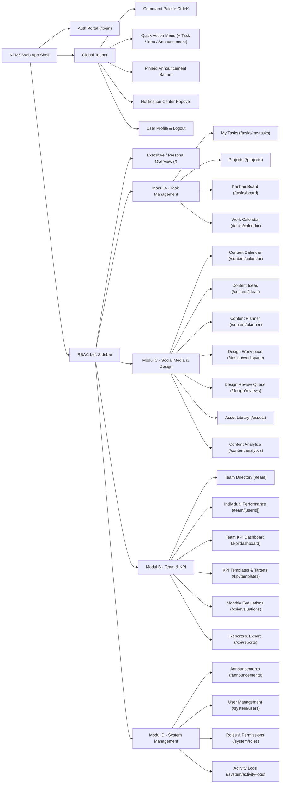

### 1.2 Matriks Visibilitas Menu Sidebar & Topbar Berdasarkan RBAC

Menu sidebar dirender secara dinamis dari *session permissions* di server (RSC) sehingga pengguna tidak pernah melihat menu yang tidak relevan dengan perannya, sekaligus tetap dilindungi oleh **Server-Side RBAC Guard** pada level Route dan Server Action.

| Grup Navigasi | Menu Item | Route App Router | `SUPER_ADMIN` | `PROJECT_MANAGER` | `STAFF_CREATOR` | `DESIGNER` | Catatan Scoping Data |
| :--- | :--- | :--- | :--- | :--- | :--- | :--- | :--- |
| **Utama** | Overview Dashboard | `/` | Full (Org-Wide) | Full (Managed Projects) | Personal Summary | Personal Summary | Widget menyesuaikan role secara adaptif |
| **Modul A: Tasks** | My Tasks | `/tasks/my-tasks` | Own + Filter All | Own + Delegated | Own Only | Own Only | Menampilkan task `GENERAL`, `CONTENT_PRODUCTION`, & `DESIGN_TASK` |
| **Modul A: Tasks** | Projects | `/projects` (+ `/projects/[projectId]`) | CRUD All | CRUD Assigned/Created | Read Assigned | Read Assigned | Project detail memuat tab Overview, Tasks, Members |
| **Modul A: Tasks** | Kanban Board | `/tasks/board` | All Projects | Managed Projects | Assigned Projects | Assigned Projects | Filter default: Active Project atau My Assigned |
| **Modul A: Tasks** | Work Calendar | `/tasks/calendar` | All Team Deadlines | Team Deadlines | Own + Project Deadlines | Own + Project Deadlines | Menampilkan deadline Task & jadwal `planned_publish_at` konten |
| **Modul C: Social & Design** | Content Calendar | `/content/calendar` | Full Access | Full Access | Create / Edit Plan | Read-Only (Brief Link) | Pengganti spreadsheet jadwal konten Krevia |
| **Modul C: Social & Design** | Content Ideas | `/content/ideas` | Full + Approve | Full + Approve | Create / Edit Own | Create / Comment | Disimpan di `content_ideas` (`IDEA` -> `APPROVED_IDEA` -> `CONVERTED`) |
| **Modul C: Social & Design** | Content Planner | `/content/planner` | Full Access | Full Access | Create / Edit | Read Brief Context | Form brief & tombol *Assign to Designer* |
| **Modul C: Social & Design** | Design Workspace | `/design/workspace` | Full View | Full View | Read / Comment | Submit / Upload Revision | Fokus antrian brief (`design_briefs`), versi desain, & revision loop |
| **Modul C: Social & Design** | Design Review Queue | `/design/reviews` | Full + Approve/Revise | Full + Approve/Revise | Read / Comment | Hidden (View in Workspace) | Antrian approval khusus PM & Super Admin (`design:submission:approve`) |
| **Modul C: Social & Design** | Asset Library | `/assets` | Full + Delete | Full + Manage Tags | View / Download | View / Download / Upload | Terisi otomatis saat desain berstatus `APPROVED` |
| **Modul C: Social & Design** | Content Analytics | `/content/analytics` | Full + Export | Full + Input | Input & View | View Only | Metrik performa konten (`engagement_rate`, `ctr`) pasca `PUBLISHED` |
| **Modul B: Team & KPI** | Team Directory | `/team` | Full View | Full View | View Active Team | View Active Team | Profil, role, departemen, dan beban kerja ringkas |
| **Modul B: Team & KPI** | Individual Performance | `/team/[userId]` | All Members | Team Members | Own Only (`/team/<self>`) | Own Only (`/team/<self>`) | `AUTO_TCR`, `AUTO_OTDR`, `AUTO_DQS`, `AUTO_CPVS` (drill-down) |
| **Modul B: Team & KPI** | Team KPI Dashboard | `/kpi/dashboard` | Full (Org-Wide) | Team Scope | Hidden | Hidden | Peringkat tren, bottleneck, & distribusi Grade A/B/C/D tim |
| **Modul B: Team & KPI** | KPI Templates & Targets | `/kpi/templates` | Full CRUD | Full CRUD (Team Scope) | Hidden | Hidden | `kpi:template:manage` & `kpi:assignment:manage` (total bobot 100%) |
| **Modul B: Team & KPI** | Monthly Evaluations | `/kpi/evaluations` (+ `/[evaluationId]`) | Review + Finalize | Create + Submit + Review | View Own (Self-Note V1.1) | View Own (Self-Note V1.1) | `FINALIZED` eksklusif `SUPER_ADMIN` & read-only bagi semua |
| **Modul B: Team & KPI** | Reports & Analytics | `/kpi/reports` | Full + Export CSV/PDF | Team + Export CSV/PDF | Hidden | Hidden | Laporan bulanan via `/api/kpi/reports/export` siap rapat Leadership |
| **Modul D: System** | Announcements | `/announcements` | CRUD + Pin/Broadcast | CRUD + Pin/Broadcast | Read & Mark Read | Read & Mark Read | Maks. 3 pengumuman pinned aktif tampil sebagai Top Banner |
| **Modul D: System** | User Management | `/system/users` | Full CRUD + Deactivate | Hidden | Hidden | Hidden | Pengelolaan akun internal, `token_version` revocation, & reset password |
| **Modul D: System** | Roles & Permissions | `/system/roles` | Full View + Matrix Edit | Hidden | Hidden | Hidden | Matriks 42 permission kanonik `module:resource:action` per role |
| **Modul D: System** | Activity Logs | `/system/activity-logs` | Full Org Audit Log | Scoped (Project/Social) | Hidden | Hidden | Append-only immutable trail, filterable + search |
| **Topbar Global** | Notification Center | Popover + `/notifications` | Own Notifications | Own Notifications | Own Notifications | Own Notifications | Badge angka unread polling 30s (`/api/notifications/unread`) + Mark All Read |
| **Topbar Global** | Quick Create (`+`) | Modal / Drawer | Task, Project, Idea, Ann. | Task, Project, Idea, Ann. | Task (Own), Idea, Plan | Idea, Design Upload | Aksi cepat kontekstual sesuai hak akses role |

### 1.3 Layout Wireframe Konseptual (Desktop-First Productivity Shell)

KTMS menggunakan tata letak **3-Zone Workspace** dengan **Right Slide-Over Drawer** agar anggota tim dapat meninjau detail task, memberikan catatan revisi desain, atau memeriksa histori aktivitas tanpa kehilangan konteks tampilan Kanban Board atau Content Calendar.

```text
+---------------------------------------------------------------------------------------------------+
| [Pinned Announcement Banner - Optional]  [!] Pengumuman: Evaluasi KPI Bulan Ini Ditutup Tgl 28  [x]|
+------------------+--------------------------------------------------------------------------------+
|  KREVIA KTMS     |  Breadcrumb: Social & Design / Design Workspace       [Ctrl+K Search...]  [+]  |
|  [Collapse <<]   |                                                         [Bell (3)]  [Avatar v] |
+------------------+--------------------------------------------------------------------------------+
|  MAIN            |  HEADER CANVAS                                                                 |
|  * Dashboard     |  Design Workspace & Review Queue                     [List] [Kanban] [Calendar]|
|                  |  Filter: [All Projects v] [Status v] [Assignee v] [Priority v]  [Reset Filter] |
|  TASK MGMT       +-------------------------------------------------+------------------------------+
|  * My Tasks  (5) |  PRIMARY WORKSPACE CANVAS                       |  SLIDE-OVER DETAIL DRAWER    |
|  * Projects      |  (Kanban Columns / Data Table / Calendar Grid)  |  (Width: 520px, Overlay/Push)|
|  * Kanban Board  |                                                 |                              |
|  * Work Calendar |  +---------------+  +---------------+           |  [DESIGN_TASK] #KTMS-142     |
|                  |  | IN_PROGRESS   |  | IN_REVIEW (2) |           |  IG Carousel: Promo Q4       |
|  SOCIAL & DESIGN |  +---------------+  +---------------+           |  Status: [DESIGN_REVIEW v]   |
|  * Content Cal.  |  | [URGENT]      |  | [HIGH]   <=== |===Active=>|  Version: [v2 - Latest v]    |
|  * Content Ideas |  | Reel Launch   |  | IG Carousel   |           |  --------------------------- |
|  * Planning      |  | Due: 22 Nov   |  | v2 Submitted  |           |  [Preview Image / Figma Link]|
|  > Design Wkspc  |  | @Nta-Design   |  | @Yoga-PM      |           |  Brief & Copywriting Summary |
|  * Asset Library |  +---------------+  +---------------+           |  Linked Task: #KTMS-142      |
|  * Analytics     |                                                 |  --------------------------- |
|                  |  +---------------+  +---------------+           |  [Approve & Save to Assets]  |
|  TEAM & KPI      |  | REVISION (1)  |  | DONE (8)      |           |  [Request Revision]          |
|  * Directory     |  +---------------+  +---------------+           |  --------------------------- |
|  * My Perf.      |  | [MEDIUM]      |  | [LOW]         |           |  Tab: [Comments] [History]   |
|  * KPI Dashboard |  | Banner Web    |  | LinkedIn Post |           |  - Yoga (PM): "Perbesar CTA" |
|  * Evaluations   |  | Rev #2 (!!)   |  | On-Time OK    |           |  - System: v2 uploaded 10:15 |
|                  |  +---------------+  +---------------+           |                              |
|  SYSTEM          |                                                 |                              |
|  * Announcements |                                                 |                              |
|  * Users & Roles |                                                 |                              |
|  * Activity Logs |                                                 |                              |
+------------------+-------------------------------------------------+------------------------------+
```

**Aturan Responsivitas (Desktop-First Guardrails):**
* **Desktop (`>= 1280px`):** Sidebar kiri `240px` (dapat diperkecil ke mode icon-only `64px`), Kanban menampilkan 4–5 kolom secara horizontal nyaman, Slide-Over Drawer `520px` terbuka di sisi kanan tanpa mereset posisi scroll canvas.
* **Laptop Compact (`1024px – 1279px`):** Sidebar otomatis *compact* (`64px`) saat Slide-Over Drawer terbuka agar area konten tetap leluasa.
* **Tablet & Mobile Browser (`< 1024px`):** Sidebar berubah menjadi *collapsible sheet*, Kanban Board menyediakan tombol toggle cepat ke **Grouped List View** agar pengguna tetap bisa memperbarui status tanpa kesulitan *horizontal drag* di layar sentuh.

### 1.4 Prinsip UX Utama & Standar Komponen Visual

1. **Zero-Context-Loss Productivity (Slide-Over Drawer):** Membuka detail Task, Content Plan, Design Review, atau User Profile selalu menggunakan **Slide-Over Drawer** (disinkronkan dengan URL query seperti `?drawer=task&id=<uuid>` sehingga tautan bisa dibagikan langsung lewat chat internal).
2. **URL-Driven Shareable Filters:** Filter pada Kanban, Work Calendar, Content Calendar, dan Activity Logs disimpan di URL `searchParams` (`?project=...&assignee=...&status=...`) sehingga saat PM membagikan link rapat, seluruh tim melihat *view* yang persis sama.
3. **Optimistic UI dengan Rollback Aman:** Aksi berfrekuensi tinggi (drag-and-drop kartu Kanban, centang sub-checklist, *mark notification as read*) langsung memperbarui UI secara instan; apabila server mengembalikan error (misal `403 Forbidden` atau `409 Version Conflict`), state otomatis dikembalikan (*rollback*) disertai toast notifikasi yang jelas.
4. **Keyboard & Quick-Action First:**
   * `Ctrl+K` / `Cmd+K`: Membuka Command Palette (cari Project, Task `#KTMS-xxx`, Content Item, anggota tim, atau lompat ke halaman).
   * `C`: Quick Create Task (saat fokus tidak berada di input teks).
   * `Esc`: Menutup Slide-Over Drawer atau Modal aktif.
5. **Standar Semantic Status Badges (Konsisten di Seluruh 4 Modul):**

| Entitas | Status Enum | Label UI | Warna Badge (Tailwind Token) | Ikon / Penanda Visual |
| :--- | :--- | :--- | :--- | :--- |
| **Task** | `BACKLOG` | Backlog | `slate` (`bg-slate-100 text-slate-700`) | Dot abu-abu |
| **Task** | `TODO` | To Do | `zinc` (`bg-zinc-100 text-zinc-800`) | Lingkaran kosong |
| **Task** | `IN_PROGRESS` | In Progress | `blue` (`bg-blue-100 text-blue-700`) | Lingkaran progres aktif |
| **Task** | `IN_REVIEW` | In Review | `amber` (`bg-amber-100 text-amber-800`) | Ikon mata / review |
| **Task** | `REVISION` | Needs Revision | `rose` (`bg-rose-100 text-rose-700`) | Panah putar balik |
| **Task** | `DONE` | Done | `emerald` (`bg-emerald-100 text-emerald-700`) | Centang hijau |
| **Task** | `CANCELLED` | Cancelled | `neutral` (`bg-neutral-200 text-neutral-500 line-through`) | Ikon silang |
| **Priority** | `URGENT` / `HIGH` / `MEDIUM` / `LOW` | Urgent / High / Medium / Low | `red` / `orange` / `sky` / `slate` | Flag / chevron prioritas |
| **Content** | `IDEA` -> `APPROVED_IDEA` | Idea / Approved | `violet` / `indigo` | Bohlam / centang |
| **Content** | `PLANNING` -> `IN_DESIGN` | Planning / In Design | `sky` / `blue` | Pensil / palet warna |
| **Content** | `DESIGN_REVIEW` / `DESIGN_REVISION` | Design Review / Revision | `amber` / `rose` | Preview / catatan revisi |
| **Content** | `READY_TO_PUBLISH` / `SCHEDULED` / `PUBLISHED` | Ready / Scheduled / Published | `teal` / `cyan` / `emerald` | Siap / jam / centang ganda |
| **Content** | `ARCHIVED` | Archived | `slate` (`bg-slate-100 text-slate-500`) | Kotak arsip |
| **Design** | `PENDING_BRIEF` / `IN_PROGRESS` / `SUBMITTED` | Pending / Working / Submitted | `slate` / `blue` / `amber` | Versi badge `v1`, `v2`, dst. |
| **Design** | `REVISION_REQUESTED` / `APPROVED` | Revision Req. / Approved | `rose` / `emerald` | Counter revisi `(Rev #n)` |
| **KPI Eval** | `DRAFT` / `SUBMITTED` / `REVIEWED` / `FINALIZED` | Draft / Submitted / Reviewed / Finalized | `slate` / `blue` / `amber` / `emerald` + Lock icon | Ikon gembok pada `FINALIZED` |

---

## 2. End-to-End User Flows (4 Skenario Operasional Harian Krevia)

Setiap skenario di bawah ini menyajikan: (1) **Flowchart Operasional** untuk keselarasan bisnis Leadership & tim, (2) **Sequence Diagram Teknis** untuk implementasi Server Actions, transaksi database, RBAC, dan sinkronisasi UI oleh Yoga & Nta, serta (3) **Aturan Kritis & Edge Cases**.

---

### 2.1 Skenario 1 — Siklus Hidup Project & Task Management (Kanban Board, Work Calendar, Deadline Alert & Reassignment)

**Ringkasan Bisnis:** Menjamin tidak ada lagi tugas operasional yang tercecer di grup chat. Setiap project dipecah menjadi task dengan PIC tunggal (`assignee_id`), prioritas, dan tenggat jelas yang langsung tersinkronisasi di **My Tasks**, **Kanban Board**, dan **Work Calendar**, lengkap dengan peringatan deadline otomatis serta prosedur *reassignment* yang transparan.

#### Diagram 1A — End-to-End Operational Flowchart (Project, Task Execution, Review & Escalation)

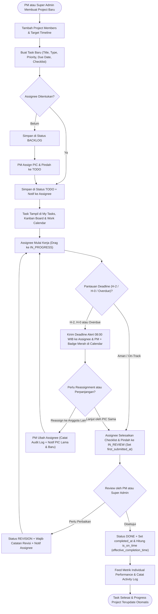

#### Diagram 1B — Technical Sequence Diagram (Kanban Drag-and-Drop, Concurrency Guard & Reassignment)

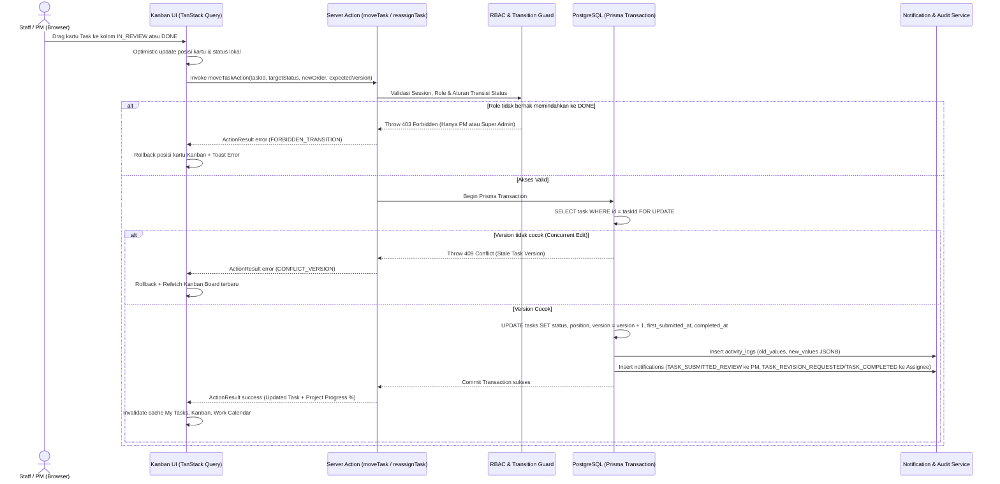

**Aturan Operasional & Edge Cases Kunci Skenario 1:**
* **Pemisahan Wewenang Penyelesaian (`DONE`):** Untuk menjaga kualitas kerja Krevia Digital, `STAFF_CREATOR` dan `DESIGNER` memindahkan task sampai `IN_REVIEW` (yang otomatis mencatat `first_submitted_at = COALESCE(first_submitted_at, NOW())`). Hanya `PROJECT_MANAGER` atau `SUPER_ADMIN` yang dapat mengesahkan ke `DONE` (`tasks:item:approve`) atau mengembalikan ke `REVISION` (kecuali untuk task personal non-project yang dibuat sendiri oleh user tanpa reviewer, sesuai flag `requires_review = false`).
* **Deteksi Deadline Tanpa Infrastruktur Berat:** Pengecekan deadline dijalankan melalui **Scheduled Cron Endpoint** (`/api/cron/deadline-alerts` dilindungi `CRON_SECRET`, setiap pagi pukul **08:00 WIB** dengan idempotency key harian agar tidak spam) dengan eskalasi bertingkat: **H-2 (`TASK_DEADLINE_SOON`)** ke Assignee, **H-0 (`TASK_DEADLINE_TODAY`)** ke Assignee, serta **H+1 & H+3 (`TASK_OVERDUE`)** ke Assignee & PM, dilengkapi indikator visual real-time (`due_date < NOW() AND status NOT IN ('DONE','CANCELLED')`) di UI Kanban & Work Calendar.
* **Reassignment yang Bersih:** Saat PM mengganti `assignee_id` di tengah pengerjaan, task otomatis hilang dari daftar aktif assignee lama, muncul di My Tasks assignee baru, memicu notifikasi `TASK_REASSIGNED` ke kedua belah pihak, dan mencatat `old_assignee_id -> new_assignee_id` di `activity_logs`.

---

### 2.2 Skenario 2 — Siklus Lengkap Konten Media Sosial & Design Workspace (Idea s/d Performance Analytics)

**Ringkasan Bisnis:** Menggantikan spreadsheet jadwal konten dan koordinasi file desain via chat. Skenario ini menghubungkan **Content Ideas**, **Content Calendar**, **Design Workspace**, **Asset Library**, serta **Task Management** dalam satu alur terintegrasi tanpa input ganda.

#### Diagram 2A — End-to-End Operational Flowchart (Social Media & Design Pipeline)

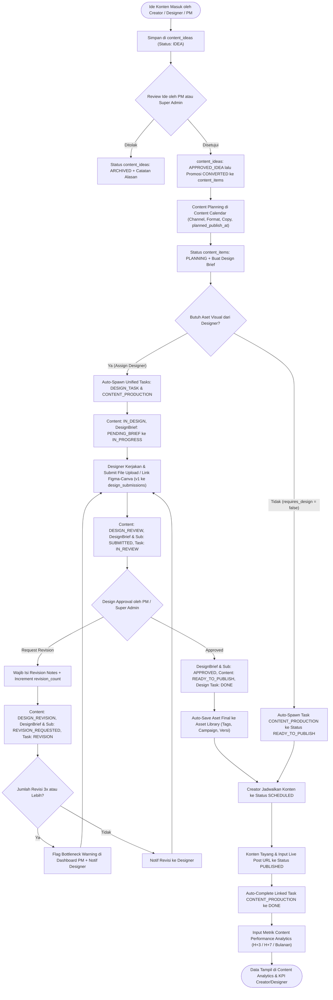

#### Diagram 2B — Technical Sequence Diagram (Auto-Spawn Task, Upload/Link Submission, Approval & Asset Library Auto-Save)

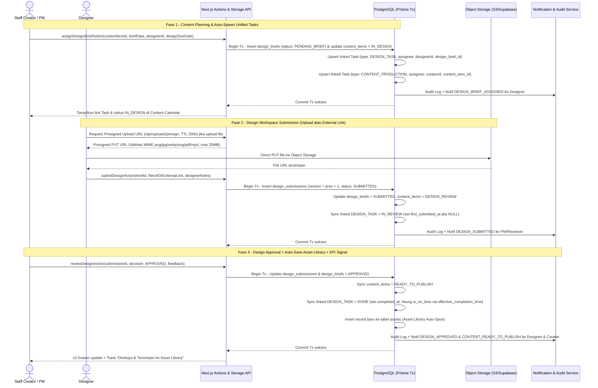

#### Diagram 2C — State Machine Sinkronisasi Content Item (`ContentStatus`)

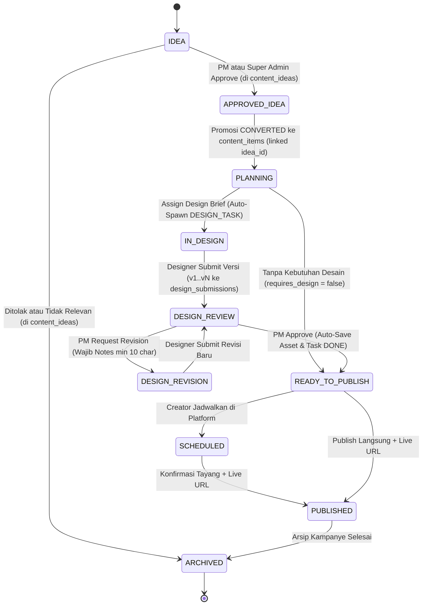

**Aturan Operasional & Edge Cases Kunci Skenario 2:**
* **Pemisahan Tabel `content_ideas` vs `content_items` & `design_briefs` vs `design_submissions`:** Ide awal disimpan pada `content_ideas` (`IDEA` -> `APPROVED_IDEA` / `ARCHIVED`); ketika dipromosikan ke kalender konten (`CONVERTED`), sistem membuat record baru di `content_items` (`PLANNING`, tertaut `idea_id`). Sementara itu, `design_briefs.status` melacak seluruh siklus `PENDING_BRIEF -> IN_PROGRESS -> SUBMITTED -> REVISION_REQUESTED / APPROVED`, sedangkan record pada `design_submissions` **hanya dibuat saat Designer menyerahkan file/link versi `v1..vN`** (`SUBMITTED`) sehingga tidak pernah ada record submission kosong (*placeholder*).
* **Hybrid Asset Storage:** Designer bebas memilih (a) unggah file langsung (`PNG`, `JPG`, `WEBP`, `SVG` dilayani sebagai *attachment*, `PDF`, `MP4` maks. `25 MB` via presigned PUT URL ber-TTL `300s / 5 menit` agar tidak membebani memori server Next.js; file `> 25 MB` wajib memakai tautan eksternal) atau (b) menempelkan tautan eksternal tervalidasi (`Figma`, `Canva`, `Google Drive`, `Frame.io`). Keduanya tetap tercatat berversi (`v1`, `v2`, `v3`) dan terpromosi otomatis ke **Asset Library** saat berstatus `APPROVED`.
* **Pencegahan Revisi Tanpa Arah:** Sistem menolak aksi *Request Revision* jika kolom `revision_notes` kosong (minimal 10 karakter) agar Designer mendapat arahan yang jelas dan terukur.
* **Integritas Anti-Duplikasi Task:** Jika brief desain diperbarui (misal perubahan deadline atau pergantian designer), sistem **memperbarui** record task `DESIGN_TASK` yang sudah tertaut (`design_brief_id`) alih-alih membuat task duplikat baru.

---

### 2.3 Skenario 3 — Penetapan KPI Bulanan, Agregasi Otomatis Individual Performance, Monthly Evaluation & Reporting

**Ringkasan Bisnis:** Menghilangkan bias subjektif dan proses hitung manual di spreadsheet setiap akhir bulan. Metrik objektif (ketepatan waktu task, rasio penyelesaian, kualitas revisi desain) dihitung otomatis dari aktivitas nyata harian di KTMS, lalu digabungkan dengan evaluasi kualitatif PM dan kalibrasi final oleh Leadership.

#### Diagram 3A — End-to-End Operational Flowchart (KPI Setup, Auto-Aggregation, Review & Finalize)

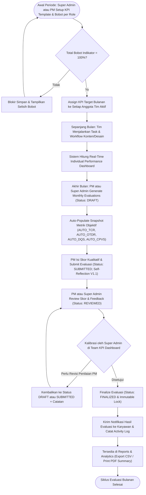

#### Diagram 3B — Technical Sequence Diagram (Auto-Aggregation Snapshot, Review & Finalization Lock)

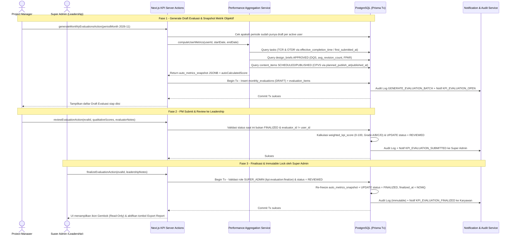

**Formula Transparan & Mekanisme Anti-Drift (Reproducible Metrics):**
* **Auto-Metrics Snapshot (`auto_metrics_snapshot`):** Saat evaluasi masuk `FINALIZED`, seluruh angka sumber (`AUTO_TCR`, `AUTO_OTDR` berbasis `effective_completion_time`, `AUTO_DQS = ROUND(AVG(GREATEST(40, 100 - 15 * revision_count)), 2)` + `avg_revision_count` & `FPAR`, `AUTO_CPVS = MIN(100.00, ROUND((C_delivered / C_target) * 100, 2))`, serta `MANUAL_SCORE` skala `0–100`) dan `weighted_kpi_score` (`0.00–100.00`, 4 Grade: **A** `90–100`, **B** `80–89.99`, **C** `70–79.99`, **D** `0–69.99`) dibekukan dalam kolom JSONB `auto_metrics_snapshot` pada tabel `monthly_evaluations`. Bila sebuah task dari bulan lalu dibuka kembali atau diarsipkan di bulan berikutnya, nilai historis rapor bulan yang sudah ditutup **tidak pernah berubah**.
* **Fallback `N/A` & Weight Re-Normalization:** Apabila denominator indikator otomatis bernilai nol (misal anggota baru belum memiliki task/brief/konten selesai pada bulan tersebut), sistem menyimpan nilai `NULL` (ditampilkan `N/A`, **bukan** `0.00`) agar tidak menghukum secara tidak adil, lalu secara otomatis menormalisasi bobot indikator aktif yang memiliki skor menggunakan rumus `ROUND(SUM(S_k * w_k) / SUM(w_k), 2)`.

---

### 2.4 Skenario 4 — Lintas Modul: Notification Center (In-App), Announcements Broadcast & Activity Logs (Audit Trail)

**Ringkasan Bisnis:** Memastikan koordinasi cepat tanpa *noise* berlebihan sekaligus menghadirkan akuntabilitas penuh (*governance*). Pengumuman penting Leadership tersemat di bagian atas layar dengan bukti keterbacaan, notifikasi kerja terpusat di lonceng aplikasi, dan setiap perubahan data tercatat permanen untuk audit.

#### Diagram 4A — Cross-Module Event Flow (Notification Center, Announcements & Audit Trail)

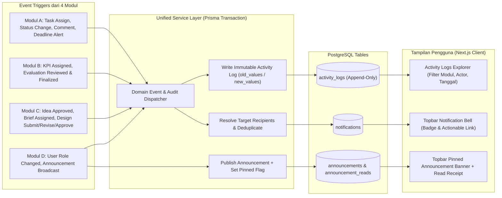

#### Diagram 4B — Technical Sequence Diagram (Transactional Audit Trail, Announcement Broadcast & Client Sync)

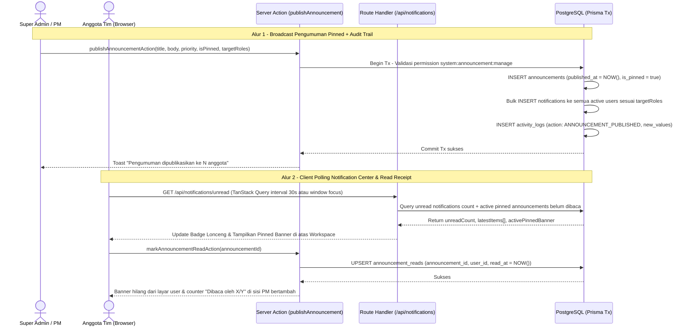

#### Diagram 4C — State Machine Ringkas Task (`TaskStatus`) untuk Referensi Notifikasi & KPI

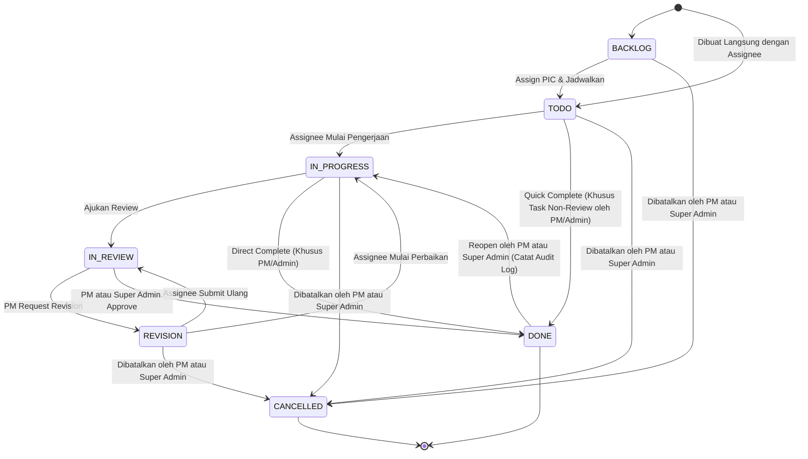

---

## 3. Use Case Specifications Lengkap (14 Use Case Utama — Modul A s/d D)

Seluruh Use Case di bawah ini dirancang langsung untuk menjadi acuan *acceptance testing* bagi Leadership dan *implementation spec* bagi Yoga & Nta.

---

### UC-01: Membuat Project Baru & Mengelola Anggota Project

* **Modul & Route:** Modul A — Task Management (`/projects`, `/projects/[projectId]`)
* **Aktor Utama:** `SUPER_ADMIN`, `PROJECT_MANAGER`
* **Aktor Pendukung:** `STAFF_CREATOR`, `DESIGNER` (sebagai anggota yang ditambahkan & penerima notifikasi)
* **Pre-conditions:**
  1. Aktor telah login dengan sesi aktif dan memiliki permission `tasks:project:create` / `tasks:project:update`.
  2. Minimal terdapat 1 user internal berstatus aktif untuk ditugaskan sebagai anggota project.
* **Post-conditions:**
  * **Success:** Record `projects` dan `project_members` tersimpan di database; anggota menerima in-app notification; `activity_logs` mencatat `PROJECT_CREATED`; project muncul di daftar filter Kanban Board dan Work Calendar.
  * **Failure:** Transaksi dibatalkan (*rollback*), tidak ada data parsial tersimpan, pesan validasi tampil pada form.
* **Main Success Flow:**
  1. Aktor membuka halaman `/projects` dan mengklik tombol **+ New Project** (atau via Topbar Quick Action `+`).
  2. Sistem membuka Slide-Over Drawer / Modal form Project (Nama Project, Kode Unik misal `KRV-Q4`, Deskripsi, Kategori, Start Date, Target End Date, Project Lead, dan Daftar Anggota).
  3. Aktor mengisi data wajib dan memilih anggota tim dari *multi-select* Team Directory.
  4. Aktor mengklik **Create Project**.
  5. Sistem memvalidasi payload menggunakan Zod, memastikan `end_date >= start_date`, menyimpan `projects` & `project_members` dalam satu Prisma transaction, menulis `activity_logs`, dan mengirim notifikasi ke seluruh anggota yang dipilih.
  6. Sistem menutup drawer, menampilkan toast sukses, dan mengarahkan aktor ke halaman detail project (`/projects/[projectId]`).
* **Alternative Flows:**
  * **AF-1 (Archive Project):** Saat project selesai atau dihentikan, PM/Super Admin mengubah status project menjadi `ARCHIVED`; project disembunyikan dari filter aktif Kanban namun tetap tersimpan untuk histori dan KPI.
  * **AF-2 (Tambah/Hapus Anggota di Tengah Project):** PM menambahkan anggota baru kapan saja melalui tab *Members*. Anggota baru langsung mendapat visibilitas terhadap seluruh task pada project tersebut.
* **Exception / Error Flows:**
  * **EF-1 (Unauthorized Role — `403`):** Jika `STAFF_CREATOR` atau `DESIGNER` mengakses endpoint pembuatan project secara langsung, RBAC guard menolak dengan `403 Forbidden`.
  * **EF-2 (Kode Project Duplikat — `409`):** Jika kode project sudah dipakai, form menampilkan inline error *"Kode project sudah digunakan, gunakan kode lain."*
  * **EF-3 (Rentang Tanggal Tidak Valid — `400`):** Jika `end_date < start_date`, form menolak submit sebelum menyentuh server dan memvalidasi ulang di server.
  * **EF-4 (Menghapus Anggota yang Masih Memiliki Task Aktif):** Sistem menampilkan konfirmasi peringatan yang mencantumkan jumlah task aktif milik anggota tersebut serta opsi memindahkan (*reassign*) atau tetap melepas keanggotaan.

---

### UC-02: Membuat, Mengassign & Memantau Task di My Tasks & Work Calendar

* **Modul & Route:** Modul A — Task Management (`/tasks/my-tasks`, `/tasks/calendar`, `/projects/[projectId]`)
* **Aktor Utama:** `PROJECT_MANAGER`, `SUPER_ADMIN` (create & assign ke siapa saja); `STAFF_CREATOR`, `DESIGNER` (memantau My Tasks & membuat sub-task/personal task jika diizinkan)
* **Aktor Pendukung:** Anggota tim yang ditugaskan (`assignee_id`)
* **Pre-conditions:**
  1. User terautentikasi dan memiliki akses ke project target.
  2. Project target berstatus aktif (bukan `ARCHIVED`).
* **Post-conditions:**
  * **Success:** Record `tasks` (`task_type = GENERAL`) tersimpan lengkap dengan `task_checklists` (jika ada), muncul secara real-time di **My Tasks** assignee, **Kanban Board** project, dan **Work Calendar** pada tanggal `due_date`; notifikasi `TASK_ASSIGNED` terkirim; `activity_logs` tercatat.
  * **Failure:** Task tidak dibuat; pesan error spesifik tampil tanpa menghilangkan input form yang sudah diketik user.
* **Main Success Flow:**
  1. Aktor mengklik **+ New Task** (atau menekan tombol keyboard `C`).
  2. Sistem menampilkan drawer form pembuatan task (Project, Judul Task, Deskripsi, `task_type`, Priority, Assignee, Start Date, Due Date, Checklist awal).
  3. Aktor mengisi rincian task dan memilih `assignee_id` serta `due_date`.
  4. Aktor menekan **Save Task**.
  5. Sistem memvalidasi input, menetapkan status awal `TODO` (jika assignee terisi) atau `BACKLOG` (jika assignee kosong), menyimpan record ke `tasks`, mengirim notifikasi ke assignee, dan mencatat `TASK_CREATED` di `activity_logs`.
  6. Assignee membuka `/tasks/my-tasks` (dikelompokkan berdasarkan *Overdue*, *Due Today*, *Upcoming*, *In Review*) atau `/tasks/calendar` (tampilan Mingguan/Bulanan) dan langsung melihat task baru tersebut.
* **Alternative Flows:**
  * **AF-1 (Quick Create dari Work Calendar):** Aktor mengklik sel tanggal tertentu di Work Calendar -> form task terbuka dengan `due_date` terisi otomatis sesuai tanggal yang diklik.
  * **AF-2 (Filter Multi-Dimensi):** User menyaring My Tasks atau Work Calendar berdasarkan `task_type` (`GENERAL` / `CONTENT_PRODUCTION` / `DESIGN_TASK`), prioritas, atau project; filter tersimpan di URL `searchParams`.
* **Exception / Error Flows:**
  * **EF-1 (Assign ke User Non-Anggota Project):** Dropdown assignee otomatis memfilter anggota project aktif; jika payload dimanipulasi ke user luar project atau user non-aktif (`is_active = false`), server mengembalikan `400 Bad Request`.
  * **EF-2 (Due Date di Masa Lalu):** Jika aktor memilih `due_date` sebelum hari ini, sistem menampilkan *soft warning* (kuning) *"Tenggat waktu berada di masa lalu. Lanjutkan?"* agar migrasi task lama tetap memungkinkan namun mencegah salah ketik.
  * **EF-3 (Staff Mencoba Assign ke Orang Lain):** `STAFF_CREATOR` / `DESIGNER` tanpa permission `tasks:item:assign` hanya dapat mengisi `assignee_id = diri sendiri`; upaya assign ke user lain ditolak `403 Forbidden`.

---

### UC-03: Mengelola Progres Task via Kanban Board Drag-and-Drop & Reassignment

* **Modul & Route:** Modul A — Task Management (`/tasks/board`)
* **Aktor Utama:** `SUPER_ADMIN`, `PROJECT_MANAGER`, `STAFF_CREATOR`, `DESIGNER`
* **Aktor Pendukung:** Reviewer (`PROJECT_MANAGER`), Assignee baru (pada kasus reassignment)
* **Pre-conditions:**
  1. User berada di halaman Kanban Board pada project yang dapat diakses.
  2. Terdapat minimal satu task pada kolom aktif (`BACKLOG`, `TODO`, `IN_PROGRESS`, `IN_REVIEW`, `REVISION`, `DONE`).
* **Post-conditions:**
  * **Success:** Status dan urutan posisi (`position`) kartu tersimpan di database dengan `version` terinkremen (dan `first_submitted_at` terisi saat pertama kali masuk `IN_REVIEW`); tampilan My Tasks & Work Calendar ikut terbarui; notifikasi & audit log tercatat.
  * **Failure:** Posisi kartu di Kanban dikembalikan (*optimistic rollback*) ke kolom asal disertai toast penjelasan.
* **Main Success Flow:**
  1. User menyaring Kanban Board (misal per project atau per assignee).
  2. User menarik (*drag*) kartu task dari kolom `TODO` dan melepaskannya (*drop*) ke kolom `IN_PROGRESS` (atau dari `IN_PROGRESS` ke `IN_REVIEW`).
  3. UI Kanban langsung memindahkan kartu secara optimistik.
  4. Client memanggil Server Action `moveTaskAction` membawa `taskId`, `targetStatus`, `newPosition`, dan `expectedVersion`.
  5. Server memverifikasi RBAC, aturan matriks transisi status, dan `expectedVersion` (optimistic locking).
  6. Server memperbarui `tasks` (termasuk `first_submitted_at = COALESCE(first_submitted_at, NOW())` saat masuk `IN_REVIEW`), menaikkan `version`, menulis `activity_logs` (`TASK_STATUS_CHANGED`), dan mengirim notifikasi `TASK_SUBMITTED_REVIEW` bila transisi memasuki `IN_REVIEW`.
  7. Server mengembalikan data terbaru dan client menyinkronkan cache TanStack Query.
* **Alternative Flows:**
  * **AF-1 (Akses Detail Tanpa Tinggalkan Kanban):** User mengklik badan kartu -> **Slide-Over Drawer** terbuka di sisi kanan untuk mencentang checklist, menulis komentar (`@mention`), melampirkan link, atau mengubah status via dropdown (penting untuk aksesibilitas keyboard & layar kecil).
  * **AF-2 (Reassignment Task oleh PM):** PM membuka Slide-Over Drawer pada task yang mengalami hambatan, mengganti `Assignee` ke anggota lain, lalu menyimpan -> sistem memicu notifikasi `TASK_REASSIGNED` ke PIC lama (*"Task dipindahkan ke..."*) dan PIC baru (*"Anda ditugaskan pada..."*) serta mencatat audit log.
  * **AF-3 (Task Terhubung Konten/Desain):** Jika user mencoba memindahkan `DESIGN_TASK` langsung ke `DONE` di Kanban tanpa melalui Design Approval di Modul C, sistem menampilkan petunjuk langsung (*deep link* ke `/design/reviews`) untuk menyelesaikannya melalui **Design Review Drawer** agar status `ContentItem` dan `AssetLibrary` tetap sinkron.
* **Exception / Error Flows:**
  * **EF-1 (Concurrent Kanban Drag-and-Drop Conflict — `409`):** Jika 2 pengguna menggeser kartu yang sama bersamaan, request kedua mendeteksi `version !== expectedVersion`. Server menolak dengan `409 Conflict`, UI melakukan *rollback* otomatis, merefresh board, dan menampilkan toast *"Task baru saja diperbarui oleh pengguna lain. Tampilan telah disegarkan."*
  * **EF-2 (Transisi Dilarang oleh Role — `403`):** Jika `STAFF_CREATOR` atau `DESIGNER` menarik kartu langsung ke kolom `DONE` pada task yang memerlukan review PM, server menolak dengan `403`, UI melakukan rollback dan menampilkan toast *"Pindahkan ke In Review agar disetujui oleh Project Manager."*
  * **EF-3 (Koneksi Terputus / Network Timeout):** Client membatalkan optimistic state setelah timeout dan menampilkan toast *"Gagal menyimpan perubahan. Periksa koneksi internet Anda."*

---

### UC-04: Review Hasil Task, Permintaan Revisi & Penanganan Deadline Alert

* **Modul & Route:** Modul A — Task Management (`/tasks/board`, `/tasks/calendar`, Notification Popover)
* **Aktor Utama:** `PROJECT_MANAGER`, `SUPER_ADMIN`
* **Aktor Pendukung:** Assignee (`STAFF_CREATOR`, `DESIGNER`), System Scheduler (Deadline Job)
* **Pre-conditions:**
  1. Task berada pada status `IN_REVIEW` (untuk proses review) atau mendekati/melewati `due_date` dengan status belum `DONE`/`CANCELLED` (untuk proses deadline alert).
* **Post-conditions:**
  * **Success (Approve):** Status task menjadi `DONE`, `completed_at` terisi timestamp server, flag `is_on_time` dihitung secara adil menggunakan `effective_completion_time` (`CASE WHEN revision_count = 0 THEN COALESCE(first_submitted_at, completed_at) ELSE completed_at END <= due_date`), progres project meningkat, dan data siap diagregasi ke Modul B KPI.
  * **Success (Revision):** Status task berubah ke `REVISION`, `revision_count` bertambah +1, catatan revisi tersimpan sebagai komentar berlabel `REVISION_NOTE`, dan assignee menerima notifikasi `TASK_REVISION_REQUESTED`.
  * **Failure:** Status task tetap pada kondisi sebelumnya; error ditampilkan di drawer.
* **Main Success Flow:**
  1. Reviewer menerima notifikasi `TASK_SUBMITTED_REVIEW` (*"Task #KTMS-xxx siap direview"*) dan mengkliknya -> sistem langsung membuka Slide-Over Drawer task terkait.
  2. Reviewer memeriksa daftar checklist, lampiran/tautan hasil kerja, serta komentar assignee.
  3. Reviewer memilih tombol **Approve & Mark Done**.
  4. Sistem menjalankan transaksi: mengubah status `IN_REVIEW -> DONE`, mengisi `completed_at = NOW()`, menghitung `is_on_time` berbasis `effective_completion_time`, mencatat `activity_logs`, dan mengirim notifikasi `TASK_COMPLETED` ke assignee.
* **Alternative Flows:**
  * **AF-1 (Request Revision):** Reviewer memilih **Request Revision**, mengisi alasan/poin perbaikan (wajib minimal 10 karakter), lalu menekan submit -> status berubah ke `REVISION`, `revision_count` bertambah +1, dan notifikasi `TASK_REVISION_REQUESTED` dikirim ke assignee.
  * **AF-2 (Otomasi Deadline Alert H-2, H-0 & Overdue):** Setiap hari pukul **08:00 WIB**, endpoint cron `/api/cron/deadline-alerts` memindai task aktif yang belum `DONE`/`CANCELLED` dengan eskalasi bertingkat: **H-2 (`TASK_DEADLINE_SOON`)** ke assignee, **H-0 (`TASK_DEADLINE_TODAY`)** ke assignee, serta **H+1 & H+3 (`TASK_OVERDUE`)** ke assignee + PM (dengan pencegahan duplikasi harian per task). Di Work Calendar dan My Tasks, kartu overdue otomatis menampilkan badge merah `Overdue X Hari`.
* **Exception / Error Flows:**
  * **EF-1 (Catatan Revisi Kosong — `400`):** Sistem menonaktifkan tombol submit revisi dan memvalidasi di server jika catatan kurang dari 10 karakter.
  * **EF-2 (Review Task yang Sudah Diubah/Dibatalkan — `409`):** Jika task sudah diubah menjadi `CANCELLED` atau `DONE` sebelum tombol diklik, server menolak dengan pesan status terkini.

---

### UC-05: Mengelola Team Directory & Memantau Individual Performance Dashboard

* **Modul & Route:** Modul B — Team Management & KPI (`/team`, `/team/[userId]`)
* **Aktor Utama:** `SUPER_ADMIN`, `PROJECT_MANAGER`, `STAFF_CREATOR`, `DESIGNER`
* **Aktor Pendukung:** Sistem Agregasi Performa (Service Layer)
* **Pre-conditions:**
  1. User sudah login.
  2. Data user aktif dan histori task operasional tersedia di PostgreSQL.
* **Post-conditions:**
  * **Success:** User melihat direktori tim sesuai hak akses dan metrik performa individu yang akurat berdasarkan periode bulan yang dipilih.
  * **Failure:** Menampilkan state error yang aman tanpa membocorkan data performa milik user lain yang tidak berhak dilihat.
* **Main Success Flow:**
  1. User membuka `/team` untuk melihat kartu/tabel anggota tim Krevia Digital (Nama, Foto/Inisial, Role, Departemen/Jabatan, Status Aktif, Jumlah Task Aktif saat ini).
  2. User membuka `/team/[userId]` (untuk dirinya sendiri via sidebar, atau PM/Super Admin mengklik nama anggota di Team Directory).
  3. User memilih filter periode bulan (default: bulan berjalan).
  4. Sistem mengagregasi secara real-time dari tabel `tasks`, `design_briefs`, dan `content_items`:
     * **Task Completion Rate (`AUTO_TCR`, %)**
     * **On-Time Delivery Rate (`AUTO_OTDR`, % berbasis `effective_completion_time`)**
     * **Total Tasks Completed vs Overdue**
     * **Design Quality Score (`AUTO_DQS`, `avg_revision_count`, & `FPAR`)** dari `design_briefs` `APPROVED` (khusus role `DESIGNER`)
     * **Content Production Volume Score (`AUTO_CPVS`)** dari `content_items` berstatus `SCHEDULED`/`PUBLISHED` (khusus role `STAFF_CREATOR`)
  5. Sistem menampilkan KPI Summary Cards, grafik tren 3–6 bulan terakhir, serta tabel rincian task yang menjadi dasar perhitungan (drill-down transparan).
* **Alternative Flows:**
  * **AF-1 (Self-View untuk Staff & Designer):** Saat `STAFF_CREATOR` atau `DESIGNER` membuka menu performa, sistem otomatis mengarahkan dan mengunci konteks ke `/team/[ownUserId]` sehingga mereka dapat memantau pencapaian pribadinya kapan saja tanpa bisa melihat skor rekan lain.
* **Exception / Error Flows:**
  * **EF-1 (Horizontal Privilege Escalation — `403`):** Jika `STAFF_CREATOR` atau `DESIGNER` mencoba mengakses URL `/team/[userId-orang-lain]` secara manual, Server Component / API memblokir dan merespons `403 Forbidden` (redirect ke performa diri sendiri dengan toast peringatan).
  * **EF-2 (Belum Ada Data Aktivitas di Bulan Terpilih):** Dashboard menampilkan *Empty State* informatif (*"Belum ada task selesai pada periode ini"*) dan metrik bernilai `NULL` (ditampilkan `N/A`, bukan `0.00%`) sehingga aman dari pembagian nol.

---

### UC-06: Mengonfigurasi Template KPI & Penetapan Bobot KPI Bulanan

* **Modul & Route:** Modul B — Team Management & KPI (`/kpi/templates`)
* **Aktor Utama:** `SUPER_ADMIN` (penuh seluruh organisasi), `PROJECT_MANAGER` (kelola template & assignment KPI tim sesuai scope)
* **Aktor Pendukung:** Seluruh anggota tim (penerima penetapan target bulanan)
* **Pre-conditions:**
  1. Aktor memiliki permission `kpi:template:manage` dan `kpi:assignment:manage` (`SUPER_ADMIN` & `PROJECT_MANAGER`).
  2. Periode bulan target belum ditutup/difinalisasi.
* **Post-conditions:**
  * **Success:** `kpi_templates` dan `kpi_assignments` tersimpan dengan total bobot tepat `100%`; perubahan tercatat di `activity_logs`; anggota tim menerima notifikasi penetapan target KPI bulan berjalan.
  * **Failure:** Perubahan bobot ditolak; konfigurasi lama tetap berlaku utuh.
* **Main Success Flow:**
  1. `SUPER_ADMIN` atau `PROJECT_MANAGER` membuka `/kpi/templates` dan memilih tab **KPI Templates by Role** (misal template khusus `DESIGNER`, `STAFF_CREATOR`, `PROJECT_MANAGER`).
  2. Aktor menambah/mengedit komponen indikator menggunakan sumber metrik kanonik (`AUTO_TCR`, `AUTO_OTDR`, `AUTO_DQS`, `AUTO_CPVS`, dan `MANUAL_SCORE` dengan unit `SCORE_100` skala `0–100`) — contoh default `DESIGNER`: `AUTO_TCR` 25%, `AUTO_OTDR` 25%, `AUTO_DQS` 30%, `MANUAL_SCORE` 20%.
  3. Sistem menampilkan indikator akumulasi bobot secara langsung (*real-time weight meter*).
  4. Setelah total bobot mencapai tepat `100%`, aktor menekan **Save & Apply to Active Period** (atau menggunakan fitur *Clone Previous Month* untuk mempercepat setup bulanan).
  5. Sistem memvalidasi di server bahwa `SUM(weight) === 100`, menyimpan `kpi_templates` & menghasilkan/memperbarui `kpi_assignments` untuk anggota aktif pada periode terkait, lalu mencatat `activity_logs`.
* **Alternative Flows:**
  * **AF-1 (Override Target Individu):** `SUPER_ADMIN` atau `PROJECT_MANAGER` dapat menyesuaikan target numerik spesifik (misal target volume konten `C_target` bulanan) untuk satu anggota tertentu (contoh: anak magang atau karyawan baru) tanpa mengubah template global role.
* **Exception / Error Flows:**
  * **EF-1 (Total Bobot Tidak Sama Dengan 100% — `400`):** Tombol simpan dinonaktifkan di UI dan ditolak di server dengan pesan *"Total bobot seluruh indikator harus tepat 100% (saat ini: X%)."*
  * **EF-2 (Edit Template pada Periode yang Sudah Finalized — `409`):** Perubahan template hanya berlaku untuk periode berjalan/mendatang dan tidak boleh mengubah struktur bobot pada evaluasi bulan lalu yang sudah berstatus `FINALIZED`.

---

### UC-07: Menjalankan Siklus Monthly KPI Evaluation (Auto-Aggregate, Review, Finalize) & Export Report

* **Modul & Route:** Modul B — Team Management & KPI (`/kpi/evaluations`, `/kpi/evaluations/[evaluationId]`, `/kpi/dashboard`, `/kpi/reports`)
* **Aktor Utama:** `SUPER_ADMIN` (kalibrasi & finalize), `PROJECT_MANAGER` (generate, isi penilaian, submit & review)
* **Aktor Pendukung:** `STAFF_CREATOR`, `DESIGNER` (penerima hasil evaluasi; self-reflection bersifat opsional / V1.1 `MOS-22`)
* **Pre-conditions:**
  1. Konfigurasi KPI periode bulan terkait sudah aktif (UC-06).
  2. Periode evaluasi telah dibuka oleh PM atau Super Admin.
* **Post-conditions:**
  * **Success:** `monthly_evaluations` berstatus `FINALIZED` dengan `auto_metrics_snapshot` dan `weighted_kpi_score` (`0.00–100.00`, Grade A/B/C/D) terkunci permanen; karyawan menerima notifikasi `KPI_EVALUATION_FINALIZED`; data teragregasi ke **Team KPI Dashboard** dan dapat diekspor ke CSV / Print-Friendly PDF via `/api/kpi/reports/export`.
  * **Failure:** Status evaluasi tidak berubah; peringatan ditampilkan.
* **Main Success Flow:**
  1. Di akhir bulan, PM atau Super Admin membuka `/kpi/evaluations`, memilih periode (misal `2026-11`), dan mengklik **Generate Monthly Evaluations** (`kpi:evaluation:create`).
  2. Sistem secara otomatis membuat record `DRAFT` untuk setiap anggota aktif, mengisi metrik objektif otomatis (`AUTO_TCR`, `AUTO_OTDR`, `AUTO_DQS`, `AUTO_CPVS`) ke `auto_metrics_snapshot`, dan mengirim notifikasi `KPI_EVALUATION_OPEN`.
  3. **Pengisian & Submit (`DRAFT -> SUBMITTED`):** Pada V1, PM membuka `/kpi/evaluations/[evaluationId]`, meninjau metrik otomatis beserta daftar task bukti, melengkapi skor indikator `MANUAL_SCORE` (`0–100`) dan `evaluator_notes`, lalu menekan **Submit Evaluation** (`DRAFT -> SUBMITTED`, notifikasi `KPI_EVALUATION_SUBMITTED`). *(Catatan: alur Employee Self-Reflection via `self_assessment_notes` bersifat opsional / diprioritaskan pada V1.1 `MOS-22`, sehingga pada V1 PM tidak terblokir menunggu input karyawan).*
  4. **Review & Kalibrasi (`SUBMITTED -> REVIEWED`):** `PROJECT_MANAGER` atau `SUPER_ADMIN` memverifikasi kelengkapan penilaian, sistem menghitung `weighted_kpi_score` (`0.00–100.00`, menerapkan *weight re-normalization* bila ada metrik `N/A`) beserta Grade (`A` `90–100`, `B` `80–89.99`, `C` `70–79.99`, `D` `0–69.99`), lalu menandai `REVIEWED`.
  5. **Finalisasi (`REVIEWED -> FINALIZED`):** `SUPER_ADMIN` (eksklusif, `kpi:evaluation:finalize`) meninjau perbandingan lintas tim di `/kpi/dashboard`, menambahkan catatan Leadership (opsional), lalu menekan **Finalize & Lock Evaluation**.
  6. Sistem membekukan `auto_metrics_snapshot`, mengunci record menjadi *read-only*, mencatat `KPI_EVALUATION_FINALIZED` di `activity_logs`, dan mengirim notifikasi `KPI_EVALUATION_FINALIZED` ke anggota tim.
  7. Leadership atau PM membuka `/kpi/reports` dan menekan **Export CSV** atau **Export PDF Summary** (`/api/kpi/reports/export`) untuk arsip rapat bulanan.
* **Alternative Flows:**
  * **AF-1 (Employee Self-Reflection Opsional / V1.1 `MOS-22`):** Apabila fitur self-reflection diaktifkan, anggota tim dapat menuliskan *Self-Reflection & Key Achievements* pada status `DRAFT` sebelum evaluasi dilanjutkan ke `SUBMITTED` dan `REVIEWED`.
  * **AF-2 (Kalibrasi Dikembalikan oleh Super Admin):** Jika `SUPER_ADMIN` menilai skor PM kurang sesuai bukti task, Super Admin mengklik **Return to PM** (`REVIEWED -> SUBMITTED`) disertai catatan kalibrasi.
* **Exception / Error Flows:**
  * **EF-1 (Upaya Mengedit Evaluasi yang Sudah `FINALIZED` — `423 Locked / 409`):** Seluruh input form menjadi *read-only* di UI; bila ada request mutasi ke server pada evaluasi berstatus `FINALIZED`, server menolaknya secara ketat.
  * **EF-2 (Skor Indikator Di Luar Rentang `0-100` atau Kosong — `400`):** Sistem menolak transisi ke `REVIEWED` bila masih ada indikator `MANUAL_SCORE` yang belum diberi nilai atau bernilai `< 0` / `> 100`.
  * **EF-3 (PM Mencoba Menilai Evaluasi Dirinya Sendiri — `403`):** Evaluasi milik seorang `PROJECT_MANAGER` hanya boleh direview dan difinalisasi oleh `SUPER_ADMIN` (pengecekan `evaluator_id !== user_id` / DB constraint `chk_monthly_eval_no_self`).

---

### UC-08: Mengajukan, Meninjau & Menyetujui Content Idea

* **Modul & Route:** Modul C — Social Media & Design Management (`/content/ideas`)
* **Aktor Utama:** `STAFF_CREATOR`, `DESIGNER` (pengaju ide); `PROJECT_MANAGER`, `SUPER_ADMIN` (reviewer/approver ide)
* **Aktor Pendukung:** Tim konten yang berdiskusi/upvote di daftar ide
* **Pre-conditions:**
  1. User terautentikasi dengan akses ke Modul C.
* **Post-conditions:**
  * **Success (Approve):** Status record di tabel `content_ideas` berubah `IDEA -> APPROVED_IDEA`; ide muncul di antrian **Ready to Plan** pada Content Planner (dan saat dipromosikan statusnya menjadi `CONVERTED` serta membuat record baru di `content_items` berstatus `PLANNING` dengan `idea_id` tertaut); pengaju ide menerima notifikasi `CONTENT_IDEA_REVIEWED`; `activity_logs` tercatat.
  * **Success (Reject/Archive):** Status `content_ideas` menjadi `ARCHIVED` beserta alasan penolakan.
  * **Failure:** Ide tidak tersimpan atau status tidak berubah.
* **Main Success Flow:**
  1. Aktor membuka `/content/ideas` dan mengklik **+ Submit Idea**.
  2. Aktor mengisi Judul Ide, Platform Target (`INSTAGRAM`, `TIKTOK`, `LINKEDIN`, `YOUTUBE`, `X_TWITTER`, `FACEBOOK`, `WEBSITE_BLOG`), Pillar/Kategori Konten, Deskripsi Hook/Konsep, dan Link Referensi (opsional).
  3. Aktor menekan **Submit Idea** -> sistem menyimpan record pada tabel `content_ideas` dengan status `IDEA` dan mengirim notifikasi ke PM.
  4. `PROJECT_MANAGER` atau `SUPER_ADMIN` membuka Slide-Over Drawer ide tersebut, membaca konsep & referensi, lalu menekan **Approve Idea**.
  5. Sistem mengubah status `content_ideas` ke `APPROVED_IDEA`, mencatat audit log, dan memberi notifikasi `CONTENT_IDEA_REVIEWED` (*"Ide Anda disetujui dan siap dipromosikan ke Content Planner"*) kepada pengaju.
* **Alternative Flows:**
  * **AF-1 (Directly Promote to Calendar / Planner):** Pada saat menekan Approve, PM dapat mencentang opsi *"Langsung promosikan ke Content Planner"* -> sistem otomatis mengubah `content_ideas.status = CONVERTED` dan membuat record `content_items` (`status = PLANNING`, `idea_id`) lalu membuka form Content Planner (UC-09).
  * **AF-2 (Tolak / Arsipkan Ide):** PM memilih **Archive Idea** dengan catatan alasan (misal *"Sudah pernah dibahas bulan lalu"*), status `content_ideas` berubah ke `ARCHIVED`.
* **Exception / Error Flows:**
  * **EF-1 (Staff/Designer Mencoba Approve Ide Sendiri — `403`):** Tombol Approve disembunyikan di UI dan ditolak oleh server guard `social:idea:approve`.
  * **EF-2 (URL Referensi Tidak Valid — `400`):** Validasi Zod memastikan format tautan menggunakan protokol aman `https://` atau `http://` (mencegah `javascript:` XSS payload).

---

### UC-09: Menyusun Content Plan di Content Calendar & Auto-Spawn Linked Tasks + Design Brief

* **Modul & Route:** Modul C — Social Media & Design Management (`/content/calendar`, `/content/planner`)
* **Aktor Utama:** `STAFF_CREATOR`, `PROJECT_MANAGER`, `SUPER_ADMIN`
* **Aktor Pendukung:** `DESIGNER` (penerima Design Brief & auto-spawned `DESIGN_TASK`)
* **Pre-conditions:**
  1. Ide sudah berstatus `APPROVED_IDEA` di `content_ideas` untuk dipromosikan (`CONVERTED`) ke `content_items` (atau PM/Creator membuat Content Plan baru langsung di `/content/calendar` sesuai permission `social:content:manage`).
  2. Minimal satu Project/Campaign aktif dan user ber-role `DESIGNER` tersedia (jika `requires_design = true`).
* **Post-conditions:**
  * **Success:** Record `content_items` berstatus `PLANNING` atau `IN_DESIGN`; record `design_briefs` (`status = PENDING_BRIEF`) tersimpan (tanpa membuat placeholder `design_submissions`); sistem secara atomik men-spawn linked task (`CONTENT_PRODUCTION` dan/atau `DESIGN_TASK`) pada tabel `tasks` yang otomatis muncul di **My Tasks**, **Kanban Board**, dan **Work Calendar**; notifikasi `DESIGN_BRIEF_ASSIGNED` & audit log tercatat.
  * **Failure:** Transaksi dibatalkan menyeluruh sehingga tidak pernah terjadi Content Plan tanpa Linked Task atau sebaliknya (*all-or-nothing transaction*).
* **Main Success Flow:**
  1. Aktor membuka `/content/calendar` atau `/content/planner` dan memilih item `APPROVED_IDEA` untuk dipromosikan (`CONVERTED` -> buat `content_items` dengan `idea_id`), atau mengklik tanggal di Content Calendar.
  2. Aktor melengkapi detail perencanaan: Project/Campaign, Platform (`social_platform_enum`), Format (`REELS`, `CAROUSEL`, `SINGLE_POST`, `STORY`, `SHORT_VIDEO`, `LONG_VIDEO`, `ARTICLE`, `INFOGRAPHIC`), `planned_publish_at`, Draft Caption/Copywriting, Hashtags, dan PIC Content (`creator_id`).
  3. Aktor mengaktifkan bagian **Design Brief** (`requires_design = true`), mengisi arahan visual, ukuran/rasio, teks di dalam desain, referensi, memilih `DESIGNER`, serta menetapkan `design_due_date`.
  4. Aktor mengklik **Save & Assign to Designer**.
  5. Sistem menjalankan Prisma `$transaction`:
     * Memperbarui `content_items` -> status `IN_DESIGN` (serta menandai `content_ideas.status = CONVERTED` jika berasal dari ide).
     * Menyimpan `design_briefs` dengan `status = PENDING_BRIEF` *(tidak membuat record placeholder pada `design_submissions`; submission baru dibuat ketika Designer mengunggah versi `v1..vN`)*.
     * Membuat/menyinkronkan task `DESIGN_TASK` untuk `DESIGNER` (`due_date = design_due_date`, `content_item_id`, `design_brief_id`).
     * Membuat/menyinkronkan task `CONTENT_PRODUCTION` untuk `STAFF_CREATOR` (`due_date = planned_publish_at`, `content_item_id`).
     * Menulis `activity_logs` dan mengirim notifikasi `DESIGN_BRIEF_ASSIGNED` ke `DESIGNER`.
  6. Content Calendar langsung menampilkan kartu konten pada tanggal tayang dengan badge status `IN_DESIGN` dan tautan langsung ke Linked Task.
* **Alternative Flows:**
  * **AF-1 (Simpan sebagai Draft `PLANNING` Tanpa Assign Designer Dulu):** Aktor menekan **Save Plan Only** -> status tetap `PLANNING`, task desain belum dibuat sampai brief siap ditugaskan.
  * **AF-2 (Konten Tanpa Desain Khusus):** Aktor mematikan toggle *"Membutuhkan Desain Visual"* (`requires_design = false`) -> status langsung berpindah ke `READY_TO_PUBLISH` dan hanya men-spawn task `CONTENT_PRODUCTION`.
  * **AF-3 (Reschedule Jadwal Publish pada Content Calendar):** Pada **V1**, PM/Creator membuka Slide-Over Drawer / Modal detail konten untuk mengubah tanggal `planned_publish_at` -> sistem menyinkronkan `due_date` pada linked `CONTENT_PRODUCTION` task secara otomatis. *(Catatan: drag-and-drop reschedule langsung di grid kalender diprioritaskan pada **V1.1 `MOS-20`**).*
* **Exception / Error Flows:**
  * **EF-1 (Deadline Desain Melewati Tanggal Publish — `400`):** Sistem menolak jika `design_due_date > planned_publish_at` dengan pesan *"Deadline desain harus sebelum atau sama dengan tanggal rencana publish (`planned_publish_at`)."*
  * **EF-2 (Brief Desain Tidak Lengkap saat Assign — `400`):** Jika tombol *Assign to Designer* diklik tanpa mengisi `designer_id`, `visual_direction`, atau `design_due_date`, form menyorot kolom wajib tersebut.
  * **EF-3 (Pencegahan Task Duplikat pada Edit Ulang Brief):** Jika brief yang sudah `IN_DESIGN` diedit dan disimpan ulang, sistem melakukan `UPDATE` pada linked task eksisting berdasarkan `design_brief_id` (dan partial unique index `uq_tasks_active_content_production`), bukan `INSERT` baru.

---

### UC-10: Mengunggah/Menautkan Hasil Desain di Design Workspace & Proses Design Approval / Revision Loop + Auto-Save Asset Library

* **Modul & Route:** Modul C — Social Media & Design Management (`/design/workspace`, `/design/reviews`)
* **Aktor Utama:** `DESIGNER` (eksekusi & submit desain di `/design/workspace`); `PROJECT_MANAGER`, `SUPER_ADMIN` (review, approve, request revision di `/design/reviews`)
* **Aktor Pendukung:** `STAFF_CREATOR` (penerima notifikasi saat aset siap tayang)
* **Pre-conditions:**
  1. Terdapat `design_briefs` aktif yang ditugaskan kepada `DESIGNER` (`design_briefs.status` = `PENDING_BRIEF`, `IN_PROGRESS`, atau `REVISION_REQUESTED`).
* **Post-conditions:**
  * **Success (Submit):** Record baru `design_submissions` tercipta (`version_number = vN`, `status = SUBMITTED`); `design_briefs.status = SUBMITTED`; `content_items = DESIGN_REVIEW`; linked `DESIGN_TASK = IN_REVIEW` (mencatat `first_submitted_at` jika masih NULL); PM menerima notifikasi `DESIGN_SUBMITTED`.
  * **Success (Approve):** `design_submissions = APPROVED` & `design_briefs = APPROVED`; `content_items = READY_TO_PUBLISH`; linked `DESIGN_TASK = DONE` (dengan `completed_at` & `is_on_time` berbasis `effective_completion_time` untuk KPI Designer); entri aset final otomatis tersimpan di tabel `assets` (Asset Library); notifikasi `DESIGN_APPROVED` & `CONTENT_READY_TO_PUBLISH` terkirim ke Designer & Creator.
  * **Success (Request Revision):** `design_submissions = REVISION_REQUESTED` & `design_briefs = REVISION_REQUESTED`; `revision_count` bertambah +1; `content_items = DESIGN_REVISION`; linked `DESIGN_TASK = REVISION`; notifikasi `DESIGN_REVISION_REQUESTED` terkirim ke Designer.
  * **Failure:** File gagal diunggah atau transaksi status dibatalkan tanpa merusak versi desain sebelumnya.
* **Main Success Flow:**
  1. `DESIGNER` membuka `/design/workspace` dan memilih brief dari antrian kerjanya, lalu menekan **Start Working** (`design_briefs.status`: `PENDING_BRIEF -> IN_PROGRESS`, linked `DESIGN_TASK -> IN_PROGRESS`).
  2. Setelah desain siap, `DESIGNER` memilih metode penyerahan:
     * **Upload File** (drag-and-drop ke dropzone -> client meminta presigned PUT URL ke `/api/uploads/presign` dengan TTL `300s / 5 menit` -> unggah langsung ke Supabase Storage/S3), ATAU
     * **External Link** (menempelkan tautan Figma/Canva/Google Drive; wajib untuk file `> 25 MB`).
  3. `DESIGNER` menambahkan catatan singkat lalu menekan **Submit for Review (v1)** (`design:submission:create`).
  4. Sistem menjalankan transaksi: membuat record `design_submissions` (`version_number = 1`, `status = SUBMITTED`), memperbarui `design_briefs.status = SUBMITTED`, menyinkronkan `content_items = DESIGN_REVIEW` dan linked `DESIGN_TASK = IN_REVIEW` (`first_submitted_at = COALESCE(first_submitted_at, NOW())`), serta mengirim notifikasi `DESIGN_SUBMITTED` ke PM.
  5. `PROJECT_MANAGER` atau `SUPER_ADMIN` membuka `/design/reviews` (atau **Design Review Drawer** yang menampilkan preview gambar/tautan di kiri, brief & histori versi di kanan).
  6. Reviewer mengklik **Approve Design** (`design:submission:approve`).
  7. Dalam satu Prisma transaction, sistem: (a) mengubah `design_submissions` & `design_briefs` ke `APPROVED`, (b) mengubah `content_items` ke `READY_TO_PUBLISH`, (c) menyelesaikan linked `DESIGN_TASK` ke `DONE` + hitung `is_on_time` berbasis `effective_completion_time`, (d) menyalin metadata & file/link final otomatis ke **Asset Library (`assets`)**, (e) menulis `activity_logs`, dan (f) mengirim notifikasi `DESIGN_APPROVED` & `CONTENT_READY_TO_PUBLISH` ke Designer & Content Creator.
* **Alternative Flows:**
  * **AF-1 (Revision Loop):** Pada langkah 6, Reviewer menekan **Request Revision**, mengisi `revision_notes` (wajib min. 10 karakter), dan mengirim -> `design_submissions` & `design_briefs` menjadi `REVISION_REQUESTED`, `revision_count += 1`, Content Item -> `DESIGN_REVISION`, Task -> `REVISION`. Designer memperbaiki lalu mengunggah `v2` (`version_number = 2`, kembali ke langkah 4). Seluruh riwayat versi `v1..vN` tetap tersimpan dan dapat dibandingkan di tab *Version History*.
  * **AF-2 (Peringatan Revisi Berulang `>= 3`):** Bila `revision_count >= 3` pada satu brief, sistem menampilkan badge peringatan kuning/merah *"High Revision Alert (3x)"* di `/design/workspace` & `/design/reviews` dan menyarankan sinkronisasi brief cepat antara PM dan Designer.
* **Exception / Error Flows:**
  * **EF-1 (File Terlalu Besar / MIME Tidak Didukung — `400` / `413`):** Client dan endpoint `/api/uploads/presign` menolak file melebihi batas (`25 MB`; file lebih besar diarahkan ke External Link) atau ekstensi di luar daftar aman (`PNG`, `JPG`, `WEBP`, `SVG` sebagai attachment, `PDF`, `MP4`) dengan pesan ukuran/format yang jelas.
  * **EF-2 (Designer atau Creator Mencoba Approve Desain — `403`):** Guard `design:submission:approve` hanya mengizinkan `PROJECT_MANAGER` dan `SUPER_ADMIN` (serta menolak keras `reviewer_id === designer_id`).
  * **EF-3 (Submit Versi Baru Saat Brief Sudah `APPROVED` — `409`):** Jika brief sudah final disetujui, submission terkunci kecuali PM/Super Admin melakukan *Reopen Brief* secara eksplisit (aset lama di Asset Library ditandai `is_superseded = true` saat versi pengganti disetujui).
  * **EF-4 (Upload ke Object Storage Gagal di Tengah Jalan):** Client menampilkan progress error + tombol *Retry Upload* dan tidak memanggil Server Action `submitDesignAction` agar tidak tercipta record dengan broken file URL.

---

### UC-11: Mengelola Asset Library & Menginput Content Performance Analytics

* **Modul & Route:** Modul C — Social Media & Design Management (`/assets`, `/content/analytics`, `/content/calendar`)
* **Aktor Utama:** `STAFF_CREATOR`, `PROJECT_MANAGER`, `SUPER_ADMIN`, `DESIGNER`
* **Aktor Pendukung:** —
* **Pre-conditions:**
  1. Untuk Asset Library: terdapat aset hasil auto-save dari Design Approval atau aset referensi yang diunggah manual.
  2. Untuk Content Analytics: Content Item sudah berstatus `PUBLISHED` (atau ditandai tayang terlebih dahulu).
* **Post-conditions:**
  * **Success:** Aset mudah ditemukan lewat pencarian/tag & dapat diunduh via `/api/uploads/download-url`; Content Item berpindah ke `SCHEDULED`/`PUBLISHED` (menyelesaikan task `CONTENT_PRODUCTION` dan berkontribusi ke metrik `AUTO_CPVS`); metrik `content_analytics` tersimpan dengan perhitungan otomatis `engagement_rate` & `ctr` dan tampil di grafik performa konten.
  * **Failure:** Input metrik tidak valid ditolak; tidak ada data korup pada grafik analytics.
* **Main Success Flow (Asset Library & Publishing -> Analytics):**
  1. Setelah desain disetujui (UC-10), `STAFF_CREATOR` mengakses aset final melalui tab Linked Assets atau halaman `/assets` (bisa difilter berdasarkan Project, Kategori `BRAND_KIT`/`SOCIAL_MEDIA`/`CAMPAIGN`/`TEMPLATE`/`PHOTO_VIDEO`/`DOCUMENT`/`OTHER`, Platform, Tags, dan kata kunci).
  2. `STAFF_CREATOR` menjadwalkan konten di platform media sosial, lalu memperbarui status di KTMS ke `SCHEDULED`.
  3. Ketika konten tayang, `STAFF_CREATOR` menekan **Mark as Published**, mengisi `published_url` dan `published_at` -> sistem mengubah status Content Item ke `PUBLISHED` dan secara otomatis menandai linked task `CONTENT_PRODUCTION` sebagai `DONE` (`is_on_time` dihitung terhadap `planned_publish_at`).
  4. Pada H+3 / H+7 atau akhir bulan, `STAFF_CREATOR` atau `PROJECT_MANAGER` membuka `/content/analytics` (atau tab *Analytics* di drawer konten) dan menginput metrik: `reach`, `impressions`, `likes`, `comments`, `shares`, `saves`, `clicks`, `video_views` (opsional), serta tanggal pencatatan (`recorded_date`).
  5. Sistem memvalidasi seluruh angka non-negatif, menghitung otomatis di database:
     * `engagement_rate` (`NUMERIC(6,2)`) = `0.00` jika `reach = 0`, selain itu `ROUND((likes + comments + shares + saves) / reach * 100, 2)`
     * `ctr` (`NUMERIC(6,2)`) = `0.00` jika `impressions = 0`, selain itu `ROUND(clicks / impressions * 100, 2)`
     lalu menyimpan record ke `content_analytics` (`social:analytics:manage`) dan memperbarui grafik performa per platform & top performing content.
* **Alternative Flows:**
  * **AF-1 (Upload Manual Aset Referensi/Brand Kit):** `DESIGNER`, `PROJECT_MANAGER`, atau `SUPER_ADMIN` (`assets:library:manage`) dapat mengunggah aset non-brief (seperti logo Krevia, template brand guideline, stok foto) secara manual ke `/assets` lengkap dengan kategori & tags.
  * **AF-2 (Update Snapshot Metrik Berkala):** Creator dapat mencatat beberapa `recorded_date` untuk satu konten (misal H+1, H+7, H+30) agar tren pertumbuhan konten terlihat pada grafik.
* **Exception / Error Flows:**
  * **EF-1 (Input Analytics pada Konten Belum `PUBLISHED` — `400`):** Tombol input analytics dinonaktifkan dan ditolak server jika status konten belum `PUBLISHED`.
  * **EF-2 (Angka Metrik Negatif atau Denominator Nol):** Server menolak angka negatif (`< 0`); jika `reach = 0` maka `engagement_rate = 0.00`, dan jika `impressions = 0` maka `ctr = 0.00` (aman dari pembagian nol).
  * **EF-3 (Hapus Aset yang Masih Tertaut ke Konten Aktif):** Penghapusan oleh `SUPER_ADMIN` menggunakan *soft delete* (`deleted_at`) dan menampilkan peringatan bila aset masih dipakai pada konten aktif.

---

### UC-12: Manajemen User, Aktivasi/Deaktivasi Akun & Konfigurasi Role/Permission RBAC

* **Modul & Route:** Modul D — System Management (`/system/users`, `/system/roles`)
* **Aktor Utama:** `SUPER_ADMIN`
* **Aktor Pendukung:** User internal yang dibuat/diubah akunnya
* **Pre-conditions:**
  1. Aktor login dengan role `SUPER_ADMIN` dan permission `system:user:manage` / `system:rbac:manage`.
* **Post-conditions:**
  * **Success:** Akun user dibuat/diperbarui/dinonaktifkan dengan password ter-hash (Argon2id/Bcrypt); sesi valid maks. 7 hari (*sliding*) dan perubahan role/deaktivasi langsung membatalkan sesi lama melalui inkremen `token_version`; perubahan tercatat ketat di `activity_logs`.
  * **Failure:** Tidak ada perubahan hak akses atau status akun; sistem terlindungi dari *self-lockout*.
* **Main Success Flow:**
  1. `SUPER_ADMIN` membuka `/system/users` dan mengklik **+ Add User**.
  2. Aktor mengisi Nama Lengkap, Email Krevia (`@krevia...`), Departemen/Jabatan, Role (`SUPER_ADMIN`, `PROJECT_MANAGER`, `STAFF_CREATOR`, `DESIGNER`), serta Password Awal sementara (flag `must_change_password = true`).
  3. Sistem memvalidasi keunikan email, melakukan hash password, menyimpan user, dan mencatat `USER_CREATED` di `activity_logs`.
  4. Untuk meninjau atau menyesuaikan hak akses, `SUPER_ADMIN` membuka `/system/roles` yang menampilkan **Matriks 42 Permission Kanonik** (`module:resource:action` vs 4 Roles) serta mengaktifkan/menonaktifkan toggle permission yang diperlukan.
  5. Sistem menyimpan perubahan ke tabel `role_permissions` dalam satu transaksi dan mencatat selisih `old_values` vs `new_values` di `activity_logs`.
* **Alternative Flows:**
  * **AF-1 (Deaktivasi User Resign / Cuti Panjang):** `SUPER_ADMIN` menekan **Deactivate User** (bukan hard-delete, agar seluruh histori task, KPI, dan audit log tetap utuh). Sistem menyetel `is_active = false` dan menaikkan `token_version` sehingga sesi login user langsung dicabut (*instant revocation*).
  * **AF-2 (Reset Password Internal):** `SUPER_ADMIN` dapat memicu reset password sementara bagi anggota tim yang lupa kata sandi, menyetel `must_change_password = true` dan menaikkan `token_version`.
* **Exception / Error Flows:**
  * **EF-1 (Anti Self-Lockout Super Admin — `400`):** Sistem melarang `SUPER_ADMIN` menonaktifkan akunnya sendiri, menurunkan role-nya sendiri jika ia adalah satu-satunya `SUPER_ADMIN` aktif, atau mencabut permission `system:rbac:manage` dari role `SUPER_ADMIN`.
  * **EF-2 (Deaktivasi User yang Masih Memegang Task Aktif):** Sistem menampilkan dialog daftar task aktif milik user tersebut dan menyarankan *bulk reassign* ke PM/anggota lain sebelum deaktivasi diselesaikan.
  * **EF-3 (Email Duplikat — `409`):** Sistem menolak pembuatan user dengan email yang sudah terdaftar (case-insensitive).

---

### UC-13: Memublikasikan Announcements (Pinned/Broadcast) & Memantau Read Receipts

* **Modul & Route:** Modul D — System Management (`/announcements` + Global Topbar Banner)
* **Aktor Utama:** `SUPER_ADMIN`, `PROJECT_MANAGER`
* **Aktor Pendukung:** Seluruh anggota tim aktif (penerima & pembaca pengumuman)
* **Pre-conditions:**
  1. Aktor memiliki permission `system:announcement:manage`.
* **Post-conditions:**
  * **Success:** Pengumuman tersimpan di tabel `announcements`; jika `is_pinned = true`, banner tampil di bagian atas aplikasi seluruh target user; in-app notification `ANNOUNCEMENT_PUBLISHED` terkirim; status keterbacaan tercatat di `announcement_reads`; audit log tercipta.
  * **Failure:** Pengumuman tidak terpublikasi dan tidak ada notifikasi broadcast terkirim.
* **Main Success Flow:**
  1. Aktor membuka `/announcements` (atau Quick Create `+` -> *New Announcement*).
  2. Aktor mengisi Judul, Isi Pengumuman (format teks/markdown sederhana), Tingkat Prioritas (`INFO`, `IMPORTANT`, `URGENT`), Target Audience (`ALL` atau filter per Role), Opsi **Pin to Top Banner**, dan Tanggal Kadaluarsa (`expires_at`, opsional).
  3. Aktor menekan **Publish Announcement**.
  4. Sistem menyimpan `announcements`, men-generate notifikasi broadcast `ANNOUNCEMENT_PUBLISHED` ke seluruh user aktif target, dan mencatat `ANNOUNCEMENT_PUBLISHED` di `activity_logs`.
  5. Seluruh target user melihat Pinned Banner di atas layar dan/atau notifikasi di lonceng. Saat user membuka detail pengumuman dan menekan **Acknowledge / Mark as Read**, sistem mencatat `announcement_reads` (`user_id`, `read_at`).
  6. Aktor pembuat dapat membuka drawer detail pengumuman untuk memantau daftar *"Dibaca oleh X dari Y anggota"* beserta siapa saja yang belum membaca.
* **Alternative Flows:**
  * **AF-1 (Unpin / Archive Pengumuman):** Jika pengumuman sudah tidak relevan, pembuat atau `SUPER_ADMIN` menekan **Unpin** atau **Archive** sehingga banner segera hilang dari seluruh layar tim.
* **Exception / Error Flows:**
  * **EF-1 (Batas Pinned Banner Aktif):** Untuk mencegah layar kerja penuh dengan banner, sistem membatasi maksimal **3 Pinned Announcements aktif** secara bersamaan (bila sudah 3, banner menampilkan switcher/counter atau meminta aktor meng-unpin pengumuman lama terlebih dahulu).
  * **EF-2 (Akses Pembuatan oleh Staff/Designer — `403`):** `STAFF_CREATOR` dan `DESIGNER` hanya dapat membaca dan menandai telah dibaca; aksi create/edit/delete ditolak server.

---

### UC-14: Membaca Notification Center (In-App) & Mengaudit Activity Logs Lintas Modul

* **Modul & Route:** Modul D — System Management (Topbar Notification Popover, `/notifications`, `/system/activity-logs`)
* **Aktor Utama:** Semua Role (Notification Center pribadi); `SUPER_ADMIN` & `PROJECT_MANAGER` scoped (Activity Logs)
* **Aktor Pendukung:** Sistem Event & Audit Logger
* **Pre-conditions:**
  1. User terautentikasi.
  2. Khusus Activity Logs: aktor memiliki permission `system:audit_log:read` (`SUPER_ADMIN` melihat semua modul; `PROJECT_MANAGER` melihat aktivitas project, task, dan social/design dalam lingkupnya).
* **Post-conditions:**
  * **Success:** Status `is_read` notifikasi diperbarui dan user diarahkan tepat ke entitas/drawer sumbernya (*deep linking*); audit trail dapat difilter, ditelusuri per diff JSON (`old_values` vs `new_values`), dan diekspor oleh `SUPER_ADMIN`.
  * **Failure:** Error muat data ditangani dengan retry state yang ramah tanpa mengganggu halaman utama.
* **Main Success Flow:**
  1. **Notification Center:** User melihat badge jumlah belum dibaca pada ikon Lonceng di Topbar (polling 30s ke `/api/notifications/unread`), mengkliknya untuk membuka popover daftar notifikasi terbaru (tab *All* dan *Unread*).
  2. User mengklik satu item notifikasi (misal *"PM meminta revisi desain v1 pada IG Carousel Q4"*).
  3. Sistem menandai notifikasi tersebut `is_read = true` (`read_at = NOW()`) secara optimistik dan menavigasi user langsung ke route + query drawer target (`/design/workspace?drawer=brief&id=<uuid>` atau `/design/reviews?drawer=brief&id=<uuid>` untuk reviewer).
  4. **Activity Logs:** `SUPER_ADMIN` membuka `/system/activity-logs`, menyaring log berdasarkan Rentang Tanggal, Modul (`TASKS`, `TEAM_KPI`, `SOCIAL_DESIGN`, `SYSTEM`), Aktor (`actor_id`), atau Jenis Aksi (`STATUS_CHANGE`, `APPROVE`, `FINALIZE`, `ROLE_CHANGE`).
  5. Aktor mengklik satu baris log untuk membuka Slide-Over Inspector yang menampilkan perbandingan rapi **Before (`old_values`) vs After (`new_values`)** beserta timestamp (`created_at`) dan metadata teknis.
* **Alternative Flows:**
  * **AF-1 (Mark All as Read):** User menekan tombol **Mark All Read** pada popover untuk mengosongkan seluruh badge unread sekaligus.
  * **AF-2 (Filter Log per Entitas dari Drawer):** Pada tab *History* di dalam Drawer Task atau Content Item, sistem memanggil subset `activity_logs` terfilter berdasarkan `entity_type` & `entity_id` sehingga histori lokal langsung terlihat di konteks kerja.
* **Exception / Error Flows:**
  * **EF-1 (Target Entitas Notifikasi Sudah Diarsipkan/Dihapus — `404`):** Jika user mengklik notifikasi lama yang entitasnya sudah di-soft-delete, sistem tetap menandai notifikasi sebagai terbaca dan menampilkan pesan ramah *"Item ini telah diarsipkan atau dihapus."*
  * **EF-2 (Immutability Enforcement — `405`):** Tabel `activity_logs` bersifat *append-only*. Tidak tersedia endpoint `PATCH/PUT/DELETE` bagi role mana pun (termasuk `SUPER_ADMIN`) untuk mengubah atau menghapus jejak audit.
  * **EF-3 (Akses Activity Logs Global oleh Non-Admin — `403`):** `STAFF_CREATOR` dan `DESIGNER` yang mencoba membuka `/system/activity-logs` akan ditolak oleh RBAC guard `system:audit_log:read`.

---

## 4. Matriks State Transition Lengkap (4 Entitas Inti & Cross-Module Sync)

Bagian ini menjadi kontrak deterministik bagi pengembangan backend (`Service Layer` & `Prisma Transaction`) agar setiap perubahan status selalu divalidasi secara ketat dan memicu side-effect lintas modul yang konsisten.

### 4.1 Matriks Transisi `TaskStatus` (Modul A — Unified Task Engine)

| Status Awal (`From`) | Status Tujuan (`To`) | Aktor Diizinkan (RBAC) | Trigger / Aksi UI & Guard Condition | Side-Effects Sistem (Sync, Notif, Audit, KPI) |
| :--- | :--- | :--- | :--- | :--- |
| *(New)* | `BACKLOG` | `SUPER_ADMIN`, `PROJECT_MANAGER` | Create Task tanpa `assignee_id` | Audit: `TASK_CREATED`. Tampil di kolom Backlog Kanban. |
| *(New)* | `TODO` | `SUPER_ADMIN`, `PROJECT_MANAGER`, `STAFF_CREATOR` (own), `DESIGNER` (own), atau *System Auto-Spawn* | Create Task dengan `assignee_id` terisi | Audit: `TASK_CREATED`. Notif `TASK_ASSIGNED` ke assignee. Muncul di My Tasks & Work Calendar. |
| `BACKLOG` | `TODO` | `SUPER_ADMIN`, `PROJECT_MANAGER` | Assign `assignee_id` / Drag ke `TODO` (Guard: `assignee_id IS NOT NULL`) | Audit: `TASK_STATUS_CHANGED`. Notif `TASK_ASSIGNED` ke assignee. |
| `TODO` | `IN_PROGRESS` | Assignee (`STAFF_CREATOR`, `DESIGNER`), `PROJECT_MANAGER`, `SUPER_ADMIN` | Drag ke `IN_PROGRESS` atau klik *Start Task* | Set `started_at = COALESCE(started_at, NOW())`. Jika linked `DESIGN_TASK`, sync `design_briefs.status` ke `IN_PROGRESS`. Audit log tercatat. |
| `IN_PROGRESS` | `IN_REVIEW` | Assignee, `PROJECT_MANAGER`, `SUPER_ADMIN` | Drag ke `IN_REVIEW` atau klik *Submit for Review* (untuk `DESIGN_TASK`, dipicu otomatis dari Design Submission) | Set `first_submitted_at = COALESCE(first_submitted_at, NOW())`. Audit: `TASK_SUBMITTED_REVIEW`. Notif `TASK_SUBMITTED_REVIEW` ke Project Manager / Reviewer. |
| `IN_REVIEW` | `REVISION` | `SUPER_ADMIN`, `PROJECT_MANAGER` | Klik *Request Revision* (`tasks:item:approve`, Guard: `revision_notes` wajib >= 10 karakter) | Increment `revision_count`. Audit: `TASK_REVISION_REQUESTED`. Notif `TASK_REVISION_REQUESTED` ke Assignee. |
| `REVISION` | `IN_PROGRESS` | Assignee, `PROJECT_MANAGER`, `SUPER_ADMIN` | Klik *Resume Work* atau Drag ke `IN_PROGRESS` | Audit: `TASK_STATUS_CHANGED`. |
| `REVISION` | `IN_REVIEW` | Assignee, `PROJECT_MANAGER`, `SUPER_ADMIN` | Submit ulang hasil perbaikan | Audit: `TASK_RESUBMITTED_REVIEW`. Notif `TASK_SUBMITTED_REVIEW` ke PM. |
| `IN_REVIEW` | `DONE` | `SUPER_ADMIN`, `PROJECT_MANAGER` (atau System saat Design Approved / Content Published) | Klik *Approve & Done* (`tasks:item:approve`, Guard: untuk `DESIGN_TASK` harus lewat Design Approval) | Set `completed_at = NOW()`, hitung `effective_completion_time = CASE WHEN revision_count = 0 THEN COALESCE(first_submitted_at, completed_at) ELSE completed_at END` & `is_on_time = (effective_completion_time <= due_date)`. Update Project Progress %. Feed KPI `AUTO_TCR`/`AUTO_OTDR`. Notif `TASK_COMPLETED` ke Assignee. Audit log. |
| `TODO` / `IN_PROGRESS` | `DONE` | `SUPER_ADMIN`, `PROJECT_MANAGER` | Quick Complete (hanya untuk task `GENERAL` dengan `requires_review = false` atau override PM/Admin) | Sama seperti transisi `IN_REVIEW -> DONE`. |
| `BACKLOG` / `TODO` / `IN_PROGRESS` / `REVISION` | `CANCELLED` | `SUPER_ADMIN`, `PROJECT_MANAGER` | Klik *Cancel Task* + alasan wajib | Task dikeluarkan dari denominator KPI `AUTO_TCR`. Notif `TASK_STATUS_CHANGED` ke Assignee. Audit log. |
| `DONE` | `IN_PROGRESS` | `SUPER_ADMIN`, `PROJECT_MANAGER` | Klik *Reopen Task* + alasan wajib | Reset `completed_at = NULL` (hanya memengaruhi KPI periode aktif yang belum `FINALIZED`). Notif `TASK_STATUS_CHANGED` ke Assignee. Audit log `TASK_REOPENED`. |

---

### 4.2 Matriks Transisi `ContentStatus` (Modul C — Social Media Pipeline)

| Status Awal (`From`) | Status Tujuan (`To`) | Aktor Diizinkan (RBAC) | Trigger / Aksi UI & Guard Condition | Side-Effects Sistem (Sync, Notif, Audit, KPI) |
| :--- | :--- | :--- | :--- | :--- |
| *(New di `content_ideas`)* | `IDEA` | Semua Role (`STAFF_CREATOR`, `DESIGNER`, `PROJECT_MANAGER`, `SUPER_ADMIN`) | Submit form *New Content Idea* | Simpan di `content_ideas` (`status = IDEA`). Audit: `CONTENT_IDEA_CREATED`. Notif ke PM untuk review ide. |
| `IDEA` *(di `content_ideas`)* | `APPROVED_IDEA` | `SUPER_ADMIN`, `PROJECT_MANAGER` | Klik *Approve Idea* (`social:idea:approve`) | Update `content_ideas.status = APPROVED_IDEA`. Audit: `CONTENT_IDEA_APPROVED`. Notif `CONTENT_IDEA_REVIEWED` ke pengaju ide. |
| `IDEA` *(di `content_ideas`)* | `ARCHIVED` | `SUPER_ADMIN`, `PROJECT_MANAGER` | Klik *Reject / Archive Idea* + alasan | Update `content_ideas.status = ARCHIVED`. Audit: `CONTENT_ARCHIVED`. Notif `CONTENT_IDEA_REVIEWED` ke pengaju ide. |
| `APPROVED_IDEA` *(Promosi `CONVERTED`)* | `PLANNING` *(di `content_items`)* | `STAFF_CREATOR`, `PROJECT_MANAGER`, `SUPER_ADMIN` | Promosi ide & simpan detail Content Plan (Platform, Format, `planned_publish_at`, Copy Draft) | Update `content_ideas.status = CONVERTED` + Insert `content_items` (`status = PLANNING`, linked `idea_id`). Audit: `CONTENT_PLANNED`. Muncul di `/content/calendar`. |
| `PLANNING` | `IN_DESIGN` | `STAFF_CREATOR`, `PROJECT_MANAGER`, `SUPER_ADMIN` | Klik *Assign Design Brief* (Guard: `designer_id`, `visual_direction`, `design_due_date <= planned_publish_at`) | **Cross-Module Sync:** Insert `design_briefs (status = PENDING_BRIEF)` *(tanpa placeholder `design_submissions`)* + Auto-Spawn linked tasks (`DESIGN_TASK` & `CONTENT_PRODUCTION`). Notif `DESIGN_BRIEF_ASSIGNED` ke Designer. Audit log. |
| `PLANNING` | `READY_TO_PUBLISH` | `STAFF_CREATOR`, `PROJECT_MANAGER`, `SUPER_ADMIN` | Toggle `requires_design = false` & Konfirmasi Siap Tayang | Auto-Spawn linked task `CONTENT_PRODUCTION`. Audit log. |
| `IN_DESIGN` | `DESIGN_REVIEW` | `DESIGNER` (via Design Submission) | Designer unggah file / tempel link desain `v1` | **Sync:** Insert `design_submissions (v1, SUBMITTED)` + Update `design_briefs = SUBMITTED` + linked `DESIGN_TASK = IN_REVIEW` (`first_submitted_at` set). Notif `DESIGN_SUBMITTED` ke PM/Reviewer. Audit log. |
| `DESIGN_REVIEW` | `DESIGN_REVISION` | `SUPER_ADMIN`, `PROJECT_MANAGER` | Klik *Request Revision* di Design Review Drawer (Guard: `revision_notes` wajib >= 10 char) | **Sync:** Update `design_submissions` & `design_briefs = REVISION_REQUESTED`, `revision_count += 1`, linked `DESIGN_TASK = REVISION`. Flag alert jika `>= 3`. Notif `DESIGN_REVISION_REQUESTED` ke Designer. Audit log. |
| `DESIGN_REVISION` | `DESIGN_REVIEW` | `DESIGNER` | Unggah/tautkan revisi versi baru (`vN`) | **Sync:** Insert `design_submissions (vN, SUBMITTED)` + Update `design_briefs = SUBMITTED`, linked `DESIGN_TASK = IN_REVIEW`. Notif `DESIGN_SUBMITTED` ke PM. Audit log. |
| `DESIGN_REVIEW` | `READY_TO_PUBLISH` | `SUPER_ADMIN`, `PROJECT_MANAGER` | Klik *Approve Design* (`design:submission:approve`) | **Sync:** Update `design_submissions` & `design_briefs = APPROVED`, linked `DESIGN_TASK = DONE` (feed KPI `AUTO_OTDR` & `AUTO_DQS` Designer), **Auto-Save Asset Library** (`assets`). Notif `DESIGN_APPROVED` & `CONTENT_READY_TO_PUBLISH` ke Designer & Creator. Audit log. |
| `READY_TO_PUBLISH` | `SCHEDULED` | `STAFF_CREATOR`, `PROJECT_MANAGER`, `SUPER_ADMIN` | Klik *Mark as Scheduled* + jadwal publish aktual | Audit: `CONTENT_SCHEDULED`. Berkontribusi pada hitungan `AUTO_CPVS` Creator bulan berjalan. Update badge di Content Calendar. |
| `SCHEDULED` / `READY_TO_PUBLISH` | `PUBLISHED` | `STAFF_CREATOR`, `PROJECT_MANAGER`, `SUPER_ADMIN` | Klik *Mark as Published* (Guard: input `published_url` valid & `published_at`) | **Sync:** Linked `CONTENT_PRODUCTION` task otomatis -> `DONE` (hitung `is_on_time` terhadap `planned_publish_at` & feed `AUTO_CPVS`). Membuka tab *Content Performance Analytics*. Audit log. |
| `PUBLISHED` / `PLANNING` | `ARCHIVED` | `SUPER_ADMIN`, `PROJECT_MANAGER` | Klik *Archive Content* | Memindahkan dari board aktif tanpa menghapus data analytics & asset library. Audit log. |

---

### 4.3 Matriks Transisi `DesignSubmissionStatus` (Modul C — `design_briefs.status` & `design_submissions.status`)

> **Catatan Kontrak DDL:** Status awal `PENDING_BRIEF` dan `IN_PROGRESS` disimpan pada **`design_briefs.status`**. Baris baru pada tabel **`design_submissions`** hanya dibuat (*INSERT*) saat Designer mengirimkan hasil desain versi `v1..vN` (`SUBMITTED`), kemudian status submission terbaru dan `design_briefs.status` diperbarui serempak ke `REVISION_REQUESTED` atau `APPROVED`.

| Status Awal (`From`) | Status Tujuan (`To`) | Aktor Diizinkan (RBAC) | Trigger / Aksi UI & Guard Condition | Side-Effects Sistem (Sync, Notif, Audit, KPI) |
| :--- | :--- | :--- | :--- | :--- |
| *(Auto-Created di `design_briefs`)* | `PENDING_BRIEF` | System (saat Brief di-assign oleh PM/Creator) | Trigger dari `PLANNING -> IN_DESIGN` | Insert `design_briefs (status = PENDING_BRIEF)` (tanpa record `design_submissions`). Brief masuk antrian *Pending* di `/design/workspace`. |
| `PENDING_BRIEF` *(di `design_briefs`)* | `IN_PROGRESS` *(di `design_briefs`)* | `DESIGNER` (assigned), `PROJECT_MANAGER`, `SUPER_ADMIN` | Klik *Start Designing* di `/design/workspace` | Update `design_briefs.status = IN_PROGRESS`. **Sync:** Linked `DESIGN_TASK` otomatis `TODO -> IN_PROGRESS` (`started_at` set). Audit log. |
| `PENDING_BRIEF` / `IN_PROGRESS` | `SUBMITTED` | `DESIGNER` (assigned) | Upload file (<= 25MB, valid MIME, presign TTL 300s) atau input External Link + klik *Submit Design* (`design:submission:create`) | **INSERT** record baru `design_submissions` (`version_number = 1`, `status = SUBMITTED`) + update `design_briefs.status = SUBMITTED`. **Sync:** `ContentStatus -> DESIGN_REVIEW`, linked `DESIGN_TASK -> IN_REVIEW` (`first_submitted_at` set). Notif `DESIGN_SUBMITTED` ke Reviewer. Audit log. |
| `SUBMITTED` | `REVISION_REQUESTED` | `SUPER_ADMIN`, `PROJECT_MANAGER` | Klik *Request Revision* (`design:submission:approve`, Guard: `revision_notes` wajib >= 10 karakter; `reviewer_id !== designer_id`) | Update `design_submissions` & `design_briefs = REVISION_REQUESTED`; increment `revision_count` pada `design_briefs` & linked task (memengaruhi metrik `AUTO_DQS` & `avg_revision_count` Designer di KPI). **Sync:** `ContentStatus -> DESIGN_REVISION`, linked `DESIGN_TASK -> REVISION`. Notif `DESIGN_REVISION_REQUESTED` ke Designer. Audit log. |
| `REVISION_REQUESTED` | `SUBMITTED` | `DESIGNER` (assigned) | Submit file/link revisi baru (`version_number = prev + 1`) | **INSERT** record baru `design_submissions (vN, SUBMITTED)` + update `design_briefs.status = SUBMITTED`. **Sync:** `ContentStatus -> DESIGN_REVIEW`, linked `DESIGN_TASK -> IN_REVIEW`. Notif `DESIGN_SUBMITTED` ke Reviewer. Audit log. |
| `SUBMITTED` | `APPROVED` | `SUPER_ADMIN`, `PROJECT_MANAGER` | Klik *Approve Design* (`design:submission:approve`, Guard: `reviewer_id !== designer_id`) | Update `design_submissions` & `design_briefs = APPROVED` (`approved_at = NOW()`). **Sync:** `ContentStatus -> READY_TO_PUBLISH`, linked `DESIGN_TASK -> DONE` (`completed_at`, `is_on_time` via `effective_completion_time`), **Auto-Insert ke `assets` (Asset Library)** (dan set `is_superseded = true` jika menggantikan aset sebelumnya). Notif `DESIGN_APPROVED` & `CONTENT_READY_TO_PUBLISH` ke Designer & Creator. Audit log. |

---

### 4.4 Matriks Transisi `EvaluationStatus` (Modul B — Monthly KPI Evaluation)

| Status Awal (`From`) | Status Tujuan (`To`) | Aktor Diizinkan (RBAC) | Trigger / Aksi UI & Guard Condition | Side-Effects Sistem (Sync, Notif, Audit, KPI) |
| :--- | :--- | :--- | :--- | :--- |
| *(Batch / Single)* | `DRAFT` | `SUPER_ADMIN`, `PROJECT_MANAGER` | Klik *Generate Monthly Evaluations* (`kpi:evaluation:create`, Guard: KPI assignments periode aktif valid total bobot 100%, belum ada evaluasi duplikat `UNIQUE(user_id, period_year, period_month)`) | Auto-populate metrik objektif (`AUTO_TCR`, `AUTO_OTDR`, `AUTO_DQS`, `AUTO_CPVS`) dari tabel `tasks`, `design_briefs`, & `content_items` ke `auto_metrics_snapshot`. Notif `KPI_EVALUATION_OPEN`. Audit log `KPI_DRAFT_GENERATED`. |
| `DRAFT` | `SUBMITTED` | `PROJECT_MANAGER`, `SUPER_ADMIN` *(serta Karyawan terkait pada V1.1 `MOS-22` opsional)* | Pada **V1**: PM melengkapi skor `MANUAL_SCORE` (`0–100`) & `evaluator_notes` lalu klik *Submit Evaluation*. *(Employee self-reflection `self_assessment_notes` bersifat opsional/V1.1 `MOS-22`)*. | Refresh auto-metrics terbaru sebelum submit. Notif `KPI_EVALUATION_SUBMITTED` ke Reviewer/Super Admin. Audit log. |
| `DRAFT` / `SUBMITTED` | `REVIEWED` | `PROJECT_MANAGER`, `SUPER_ADMIN` | Verifikasi seluruh skor indikator (`0–100`) & feedback + klik *Submit for Calibration* (Guard: `evaluator_id !== user_id`, semua item manual terisi) | Hitung `weighted_kpi_score` (`0.00–100.00`, terapkan *weight re-normalization* jika ada indikator `N/A`) dan 4 Grade (`A` `90–100`, `B` `80–89.99`, `C` `70–79.99`, `D` `0–69.99`). Notif ke `SUPER_ADMIN` untuk kalibrasi. Audit log. |
| `REVIEWED` | `SUBMITTED` | `SUPER_ADMIN` | Klik *Return for Adjustment* + catatan kalibrasi wajib | Membuka kembali form penilaian bagi PM untuk penyesuaian. Notif ke PM. Audit log. |
| `REVIEWED` | `FINALIZED` | `SUPER_ADMIN` (eksklusif, `kpi:evaluation:finalize`) | Klik *Finalize & Lock Evaluation* + konfirmasi modal | **Immutable Lock:** Membekukan `auto_metrics_snapshot` JSONB, mengisi `finalized_at` & `finalized_by`, mengunci seluruh endpoint edit untuk record ini. Memperbarui Team KPI Dashboard & membuka Export Report (`/api/kpi/reports/export`). Notif `KPI_EVALUATION_FINALIZED` ke Karyawan. Audit log `KPI_EVALUATION_FINALIZED`. |

---

### 4.5 Ringkasan Kontrak Sinkronisasi Atomik Lintas Modul (Developer Implementation Checklist)

Tabel berikut merangkum 6 titik integrasi kritikal yang **wajib dieksekusi di dalam `prisma.$transaction()`** oleh Mhd Yoga Andhika & Nta agar tidak pernah terjadi inkonsistensi antar modul:

| # | Trigger Event (Modul Asal) | Mutasi Sinkronisasi Atomik (Target Modul) | Side-Effects Wajib |
| :--- | :--- | :--- | :--- |
| **1** | **Assign Design Brief** (Modul C) | `content_items -> IN_DESIGN` + insert `design_briefs (status: PENDING_BRIEF)` *(tanpa insert placeholder `design_submissions`)* + upsert `tasks (DESIGN_TASK)` + upsert `tasks (CONTENT_PRODUCTION)` | `notifications` (`DESIGN_BRIEF_ASSIGNED` ke Designer) + `activity_logs` |
| **2** | **Submit Design vN** (Modul C) | insert `design_submissions (SUBMITTED, vN)` + update `design_briefs -> SUBMITTED` + update `content_items -> DESIGN_REVIEW` + update linked `tasks (DESIGN_TASK) -> IN_REVIEW` (`first_submitted_at = COALESCE(first_submitted_at, NOW())`) | `notifications` (`DESIGN_SUBMITTED` ke PM/Reviewer) + `activity_logs` |
| **3** | **Request Design Revision** (Modul C) | update `design_submissions & design_briefs -> REVISION_REQUESTED` + increment `revision_count` + update `content_items -> DESIGN_REVISION` + update linked `tasks (DESIGN_TASK) -> REVISION` | `notifications` (`DESIGN_REVISION_REQUESTED` ke Designer + Alert jika `rev >= 3`) + `activity_logs` |
| **4** | **Approve Design** (Modul C) | update `design_submissions & design_briefs -> APPROVED` (`approved_at`) + update `content_items -> READY_TO_PUBLISH` + update linked `tasks (DESIGN_TASK) -> DONE` (`completed_at`, `is_on_time` via `effective_completion_time`) + **insert `assets` (Asset Library)** | `notifications` (`DESIGN_APPROVED` & `CONTENT_READY_TO_PUBLISH`) + `activity_logs` + sinyal KPI `AUTO_OTDR` & `AUTO_DQS` Designer |
| **5** | **Mark Content Published** (Modul C) | update `content_items -> PUBLISHED` (`published_url`, `published_at`) + update linked `tasks (CONTENT_PRODUCTION) -> DONE` (`completed_at`, `is_on_time` terhadap `planned_publish_at`) | `notifications` (`TASK_COMPLETED` ke PM) + `activity_logs` + sinyal KPI `AUTO_CPVS` Creator |
| **6** | **Finalize Monthly KPI** (Modul B) | freeze `auto_metrics_snapshot` JSONB + hitung final `weighted_kpi_score` (`0–100`, Grade A/B/C/D) + update `monthly_evaluations -> FINALIZED` (`finalized_at`, `finalized_by`) | `notifications` (`KPI_EVALUATION_FINALIZED` ke Evaluatee) + `activity_logs` (immutable) |
