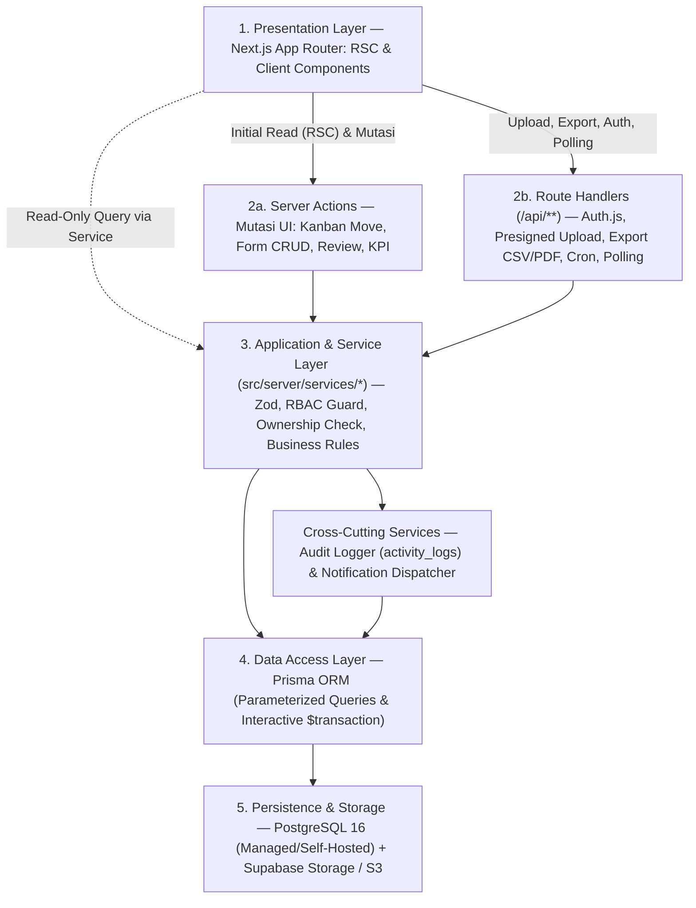
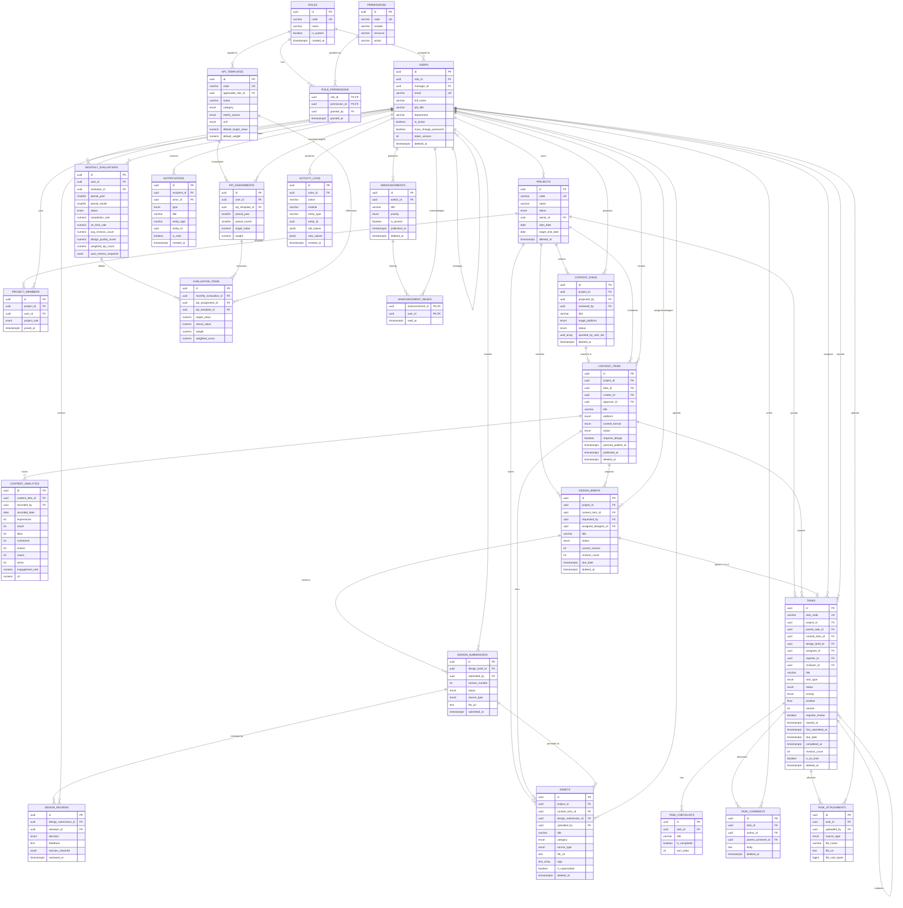
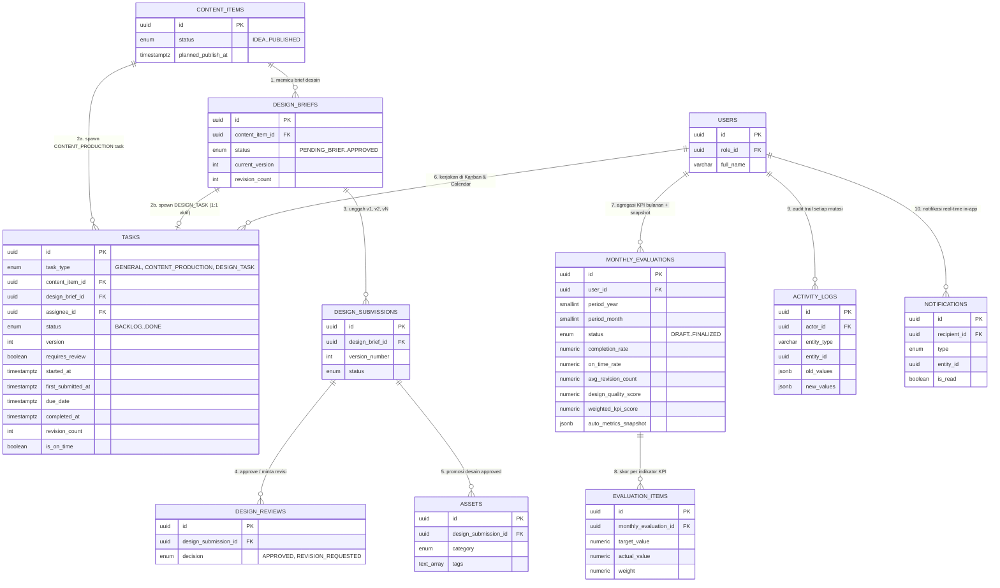

# 03 — Arsitektur Database, Skema PostgreSQL, Backend & Keamanan RBAC
## Krevia Team Management System (KTMS) — Blueprint Teknis V1

| Atribut Dokumen | Detail |
| :--- | :--- |
| **Proyek** | Krevia Team Management System (KTMS) — Internal Operations Platform |
| **Organisasi** | Krevia Digital (*"Build Smarter. Operate Better."*) |
| **Versi Dokumen** | v1.0 (Production Blueprint — Pre-Coding Phase) |
| **Target Audiens** | Leadership Krevia Digital (Executive Clarity) & Tim Developer (Mhd Yoga Andhika & Nta) |
| **Stack Database & Backend** | PostgreSQL 16 + Prisma ORM + Hybrid Next.js 15+ (Server Actions & Route Handlers) + Auth.js v5 + Supabase Storage / S3 |
| **Timeline Target V1** | 14 Hari (Minggu 1: Blueprint & Design, Minggu 2: Sprint Dev, Testing & Go-Live) |
| **Scope Guardrails V1** | Internal Web App (Desktop-First Responsive). **Out of Scope V1:** Native Mobile App, External Client Portal, Full HRIS (Payroll/Geofencing Attendance). |

---

## Ringkasan Arsitektur Data & Backend (Executive Summary)

Dokumen ini menetapkan fondasi **Single Source of Truth** untuk seluruh operasional internal Krevia Digital dalam satu skema relasional **PostgreSQL 16** yang terintegrasi lintas 4 modul (**Task Management**, **Team Management & KPI**, **Social Media & Design Management**, dan **System Management**).

Keputusan arsitektur inti yang dirancang khusus agar **2 developer (Yoga & Nta)** dapat mengeksekusi V1 secara aman dan tuntas dalam **2 minggu** tanpa mengorbankan skalabilitas jangka panjang:

1. **Unified Task Core (Zero Data Duplication):** Task yang lahir dari *Content Planning* maupun *Design Brief* disimpan langsung di tabel `tasks` terpadu (melalui `task_type`, `content_item_id`, dan `design_brief_id`). Hasilnya: satu tugas otomatis tampil di **My Tasks**, **Kanban Board**, **Work Calendar**, sekaligus langsung menjadi bahan hitung objektif di **KPI & Individual Performance**.
2. **Hybrid Next.js Backend (Single Codebase, Zero API Glue Overhead):** Menggunakan **Next.js Server Actions** untuk mutasi internal berkecepatan tinggi dan **Route Handlers (`/api/**`)** untuk kebutuhan HTTP khusus (Auth.js, Presigned Upload, Export Laporan, Cron Alert).
3. **Immutable KPI Snapshot & Audit Trail:** Evaluasi KPI bulanan menyimpan *frozen snapshot* metrik di `monthly_evaluations` saat berstatus `FINALIZED` sehingga laporan historis tidak pernah bergeser meski task diedit bulan berikutnya. Seluruh aksi mutasi tercatat permanen di `activity_logs` (*append-only* dengan `old_values` & `new_values` bertipe `JSONB`).
4. **Database-Backed RBAC (`module:resource:action`):** 4 peran kanonik (`SUPER_ADMIN`, `PROJECT_MANAGER`, `STAFF_CREATOR`, `DESIGNER`) dikontrol dari tabel `roles`, `permissions`, dan `role_permissions` serta dijaga secara berlapis di server-side Service Layer.

---

## 1. Rekomendasi Arsitektur Backend & Justifikasi Teknis

### 1.1 Perbandingan Objektif Opsi Arsitektur Backend

Dalam tahap inisiasi proyek, muncul beberapa pertimbangan teknologi backend—termasuk opsi **Hybrid Next.js Full-Stack + PostgreSQL**, **Separate Node.js/NestJS API**, serta **Laravel API / Laravel + React Inertia + MySQL**. Berikut evaluasi objektif berbasis konteks nyata Krevia Digital (**2 developer, target V1 14 hari, kebutuhan analitik KPI & audit log**):

| Kriteria Evaluasi | Opsi A: Hybrid Next.js Server Actions + Route Handlers + PostgreSQL 16 (**DIREKOMENDASIKAN**) | Opsi B: Separate Node.js / NestJS REST API + Next.js Frontend | Opsi C: Laravel (+ React/Inertia atau API) + MySQL |
| :--- | :--- | :--- | :--- |
| **Kecepatan Delivery V1 (Tim 2 Dev / 14 Hari)** | **Sangat Tinggi.** Satu repositori, satu bahasa (TypeScript end-to-end), kontrak tipe data langsung dibagi antara Prisma, Service Layer, dan UI tanpa *boilerplate* DTO ganda. | **Sedang–Lambat.** Harus mengelola 2 service, 2 deployment pipeline, CORS, OpenAPI/Swagger sync, serta duplikasi validasi request/response. | **Sedang.** Laravel sangat produktif untuk CRUD konvensional, tetapi kombinasi PHP + TypeScript (React) membagi konteks kognitif 2 developer & menghilangkan *shared type safety* langsung antara DB dan UI. |
| **Kemampuan Analitik KPI & Audit Log (PostgreSQL vs MySQL)** | **Unggul.** PostgreSQL 16 memiliki dukungan superior untuk CTE kompleks (`WITH`), `FILTER (WHERE ...)`, *Partial Indexes* (`WHERE deleted_at IS NULL`), array native (`TEXT[]`), dan **`JSONB` + GIN Index** untuk `activity_logs` & KPI snapshot. | **Unggul** (jika tetap pakai PostgreSQL), namun beban orkestrasi *microservice-style* tidak sebanding untuk tim 2 orang di V1. | **Cukup, namun terbatas di analitik JSON/Partial Index.** MySQL tidak mendukung *partial index* native dan dukungan array/JSON indexing kurang fleksibel dibanding `JSONB` PostgreSQL. |
| **Interaktivitas UI Modern (Kanban Drag-and-Drop, Calendar, Live Filter)** | **Sangat Baik.** RSC untuk initial load super cepat + Server Actions/TanStack Query untuk *optimistic update* Kanban dan filter Calendar mulus. | **Sangat Baik**, tetapi menambah network hop ekstra (`Browser -> Next.js -> NestJS -> DB`) kecuali client memanggil NestJS langsung. | **Baik** (via Inertia), tetapi untuk pola *optimistic update* Kanban kompleks & *concurrent client state* tetap membutuhkan API JSON terpisah di luar siklus Inertia. |
| **Biaya Infrastruktur & Operasional V1** | **Paling Hemat.** 1 aplikasi Next.js (Vercel/VPS Docker) + 1 Managed PostgreSQL (Supabase/Neon) atau self-hosted PostgreSQL. | **Lebih Tinggi.** Minimal 2 runtime container/hosting + manajemen networking & observability terpisah. | **Hemat** (1 server VPS/Forge), tetapi butuh manajemen stack PHP-FPM + Nginx + Queue Worker + Node build. |
| **Jalur Migrasi / Skalabilitas Masa Depan (V2+)** | **Aman & Terstruktur.** Karena seluruh *business logic* dipisahkan rapi ke `Service Layer`, mengekstrak endpoint ke API terpisah atau mobile app di V2 cukup membungkus Service Layer yang sama di `/api/v1/**`. | **Sangat Baik** untuk skala tim >10 developer dengan banyak client (Web + iOS + Android). | **Baik** untuk tim PHP dedicated, kurang optimal jika roadmap Krevia memusatkan kompetensi tim di ekosistem TypeScript/React. |

> **Catatan Objektif untuk Leadership terkait Pertimbangan Laravel + MySQL:**
> Stack **Laravel + React/Inertia + MySQL** adalah stack yang matang dan sangat baik jika tim inti didominasi engineer PHP. Namun untuk **KTMS V1 dengan 2 developer dalam 14 hari**, **Next.js 15+ (App Router) + Prisma + PostgreSQL 16** memberikan keunggulan terukur: (1) **Single Language (100% TypeScript)** dari skema database sampai tombol UI sehingga risiko bug integrasi turun drastis, (2) **PostgreSQL 16** jauh lebih kuat untuk agregasi KPI bulanan, *soft-delete partial indexing*, serta pencarian *Asset Library* & *Audit Trail* berbasis `JSONB`, dan (3) **Zero Deployment Overhead** sehingga waktu 14 hari fokus ke fitur bisnis, bukan konfigurasi infrastruktur ganda.

---

### 1.2 Strategi Lapisan Arsitektur Backend (Layered Architecture)

Agar kode tetap bersih, mudah diuji, dan tidak mencampur *business logic* ke dalam komponen UI, seluruh akses data wajib mengikuti **5 Lapisan Arsitektur Ketat** berikut:



#### Pembagian Tanggung Jawab Tiap Lapisan
1. **UI / RSC Layer (`src/app/**`, `src/features/*/components/**`):**
   - **Larangan Keras:** Komponen React (RSC maupun Client) **dilarang** memanggil `prisma.*` secara langsung. Semua pembacaan data melewati *Query Service* yang sudah memuat filter `deleted_at IS NULL` dan pemeriksaan RBAC/scope.
2. **Entry Point Layer (Server Actions vs Route Handlers):**
   - **Gunakan Server Actions (`src/features/*/actions/*.ts`) untuk:**
     - Create/Update/Delete Project, Task, Checklist, Comment.
     - Drag-and-drop Kanban status & urutan posisi (`moveTaskAction`).
     - Konversi Content Idea -> Content Plan -> Auto-spawn Design Brief & Task.
     - Submit Design, Approve/Request Revision, Promote ke Asset Library.
     - Simpan skor KPI bulanan & Finalisasi Evaluasi.
     - Publikasi Announcement & mark-as-read.
   - **Gunakan Route Handlers (`src/app/api/**/route.ts`) untuk:**
     - `/api/auth/[...nextauth]` — Handler autentikasi Auth.js v5.
     - `/api/uploads/presign` — Generate Presigned PUT URL & validasi MIME/ukuran.
     - `/api/uploads/download-url` — Generate Signed GET URL sementara (TTL 15 menit) setelah cek izin RBAC.
     - `/api/notifications/unread`, `/api/tasks/calendar`, & `/api/content/calendar` — Endpoint JSON ringan untuk polling (30 detik) dan filtering TanStack Query.
     - `/api/kpi/reports/export` — Streaming export CSV/XLSX/PDF laporan KPI bulanan.
     - `/api/cron/deadline-alerts` — Trigger terjadwal harian pukul **08:00 WIB** (dilindungi `CRON_SECRET`) untuk notifikasi deadline H-2 (`TASK_DEADLINE_SOON`), H-0 (`TASK_DEADLINE_TODAY`), dan overdue H+1 & H+3 (`TASK_OVERDUE`).
     - `/api/health` — Health check aplikasi & konektivitas PostgreSQL.
3. **Service Layer (`src/server/services/**`):**
   - Titik tunggal penegakan **Zod Validation**, **RBAC Permission Guard (`requirePermission`)**, **Scope/Ownership Check**, aturan bisnis lintas modul, dan transaksi atomik `prisma.$transaction()`.
   - Setiap mutasi data wajib memanggil `recordActivityLog()` di dalam transaksi yang sama dan memicu `dispatchNotifications()` setelah transaksi sukses (atau di dalam transaksi agar konsisten).
4. **Prisma ORM Layer (`src/server/db/prisma.ts`, `prisma/schema.prisma`):**
   - Mengelola *connection pooling* (PgBouncer / Supabase Transaction Pooler pada port `6543` untuk runtime serverless + Direct Connection `5432` untuk Prisma Migrate).
   - Semua query otomatis parameterized (anti SQL Injection).
5. **PostgreSQL 16 + Object Storage:**
   - Menegakkan integritas data tahap akhir melalui `FOREIGN KEY`, `UNIQUE`, `CHECK`, `ENUM`, dan *Partial Index*.

---

### 1.3 Strategi Penyimpanan File & Aset Desain (Hybrid Storage Architecture)

Tim kreatif dan desain bekerja dengan file berukuran besar (Figma, Canva, video mentah Reels, Adobe Illustrator) sekaligus membutuhkan pratinjau cepat dan aset final terpusat. KTMS menerapkan strategi **Hybrid Storage**:

1. **Mode 1 — External Cloud Links (Zero Storage Cost untuk Source Files):**
   - Mendukung tautan langsung ke **Figma**, **Canva**, **Google Drive**, atau URL referensi tervalidasi (`source_type IN ('FIGMA', 'CANVA', 'GOOGLE_DRIVE', 'OTHER_LINK')`).
   - Wajib melalui validasi skema URL (`https://` only, menolak `javascript:`, `data:`, atau IP internal/SSRF) sebelum disimpan ke PostgreSQL.
2. **Mode 2 — Direct File Upload via Presigned URL (Supabase Storage / S3-Compatible):**
   - File **tidak pernah** dikirim lewat body Server Action atau Next.js API (menghindari batas payload 4,5 MB di platform serverless dan mencegah memori server membengkak).
   - Alur upload aman 3 langkah:
     1. Client meminta `POST /api/uploads/presign` dengan `{ module, entityId, fileName, mimeType, fileSizeBytes }`.
     2. Server memeriksa sesi + RBAC permission, memvalidasi **MIME Allowlist** & **Max Size Cap**, lalu mengembalikan `presignedPutUrl` (berlaku 5 menit) dan `storageKey` terstandarisasi: `ktms/{env}/{module}/{entityId}/{uuid}.{ext}`.
     3. Client melakukan HTTP `PUT` langsung ke Object Storage, lalu memanggil Server Action untuk mencatat metadata file ke PostgreSQL (`task_attachments`, `design_submissions`, atau `assets`) setelah server memverifikasi keberadaan objek (`HEAD Object`).

#### Kebijakan Validasi File & Batas Ukuran (Storage Guardrails)

| Kategori Upload | MIME Type yang Diizinkan | Batas Ukuran Maksimal (V1) | Bucket Policy & Akses |
| :--- | :--- | :--- | :--- |
| **User Avatar** | `image/jpeg`, `image/png`, `image/webp` | **2 MB** | Public CDN / Signed URL panjang |
| **Task Attachment** | `image/jpeg`, `image/png`, `image/webp`, `application/pdf`, `application/vnd.openxmlformats-officedocument.*`, `text/csv`, `application/zip` | **25 MB** *(>25 MB gunakan External Cloud Link)* | **Private Bucket** (Signed GET URL TTL 15 menit via cek RBAC) |
| **Design Submission Preview & Asset Library** | `image/jpeg`, `image/png`, `image/webp`, `image/svg+xml` (disanitasi/unduh attachment), `application/pdf`, `video/mp4` | **25 MB** *(file mentah/video >25 MB wajib pakai External Cloud Link: Figma/Canva/GDrive)* | **Private Bucket** (Signed GET URL + thumbnail teroptimasi) |

> **Keamanan Upload:** File `image/svg+xml` wajib disajikan dengan header `Content-Disposition: attachment` atau dikonversi ke WebP/PNG saat pratinjau untuk mencegah Stored XSS. Nama file asli selalu disanitasi (`slugify`) dan `storage_key` memakai UUID acak agar tidak dapat ditebak (*path traversal safe*).

---

## 2. Entity Relationship Diagram (ERD) Lengkap

Skema database KTMS terdiri dari **25 tabel inti** yang terhubung secara relasional penuh. Untuk keterbacaan maksimal bagi Leadership maupun developer, ERD disajikan dalam 2 diagram:
1. **Master ERD Overview** (seluruh 25 entitas beserta atribut kunci dan kardinalitasnya).
2. **Sub-ERD Fokus Relasi Lintas Modul** (memperjelas alur data dari Social Media & Design ke Unified Tasks hingga Evaluasi KPI Bulanan & Audit Trail).

### 2.1 Master ERD Overview (25 Entitas — 4 Modul Terintegrasi)



### 2.2 Sub-ERD Fokus Relasi Lintas Modul (Operational & KPI Backbone)

Diagram berikut memperlihatkan bagaimana **4 modul KTMS bekerja sebagai satu sistem terpadu** tanpa tabel task terpisah:



---

## 3. Skema Tabel PostgreSQL Detail (Data Dictionary, ENUM, DDL & Indexing)

### 3.1 PostgreSQL Extensions & Definisi ENUM Eksplisit

Seluruh status kanonik didefinisikan sebagai PostgreSQL `ENUM` agar integritas nilai dijaga di level database sekaligus otomatis ter-generate menjadi TypeScript enum oleh Prisma ORM.

```sql
-- Extensions wajib pada PostgreSQL 16
CREATE EXTENSION IF NOT EXISTS "pgcrypto"; -- gen_random_uuid()
CREATE EXTENSION IF NOT EXISTS "pg_trgm";  -- Trigram search untuk pencarian cepat Asset & Task

-- ============================================================================
-- 1. CANONICAL ENUMS (Shared Architectural Contract)
-- ============================================================================

CREATE TYPE task_status_enum AS ENUM (
  'BACKLOG',
  'TODO',
  'IN_PROGRESS',
  'IN_REVIEW',
  'REVISION',
  'DONE',
  'CANCELLED'
);

CREATE TYPE task_type_enum AS ENUM (
  'GENERAL',
  'CONTENT_PRODUCTION',
  'DESIGN_TASK'
);

CREATE TYPE task_priority_enum AS ENUM (
  'LOW',
  'MEDIUM',
  'HIGH',
  'URGENT'
);

CREATE TYPE content_status_enum AS ENUM (
  'IDEA',
  'APPROVED_IDEA',
  'PLANNING',
  'IN_DESIGN',
  'DESIGN_REVIEW',
  'DESIGN_REVISION',
  'READY_TO_PUBLISH',
  'SCHEDULED',
  'PUBLISHED',
  'ARCHIVED'
);

CREATE TYPE design_submission_status_enum AS ENUM (
  'PENDING_BRIEF',
  'IN_PROGRESS',
  'SUBMITTED',
  'REVISION_REQUESTED',
  'APPROVED'
);

CREATE TYPE kpi_evaluation_status_enum AS ENUM (
  'DRAFT',
  'SUBMITTED',
  'REVIEWED',
  'FINALIZED'
);

-- ============================================================================
-- 2. SUPPORTING DOMAIN ENUMS
-- ============================================================================

CREATE TYPE employment_status_enum AS ENUM (
  'FULL_TIME',
  'PART_TIME',
  'CONTRACT',
  'INTERN',
  'INACTIVE'
);

CREATE TYPE project_status_enum AS ENUM (
  'PLANNING',
  'ACTIVE',
  'ON_HOLD',
  'COMPLETED',
  'ARCHIVED'
);

CREATE TYPE project_member_role_enum AS ENUM (
  'OWNER',
  'LEAD',
  'MEMBER',
  'VIEWER'
);

CREATE TYPE content_idea_status_enum AS ENUM (
  'IDEA',
  'APPROVED_IDEA',
  'CONVERTED',
  'ARCHIVED'
);

CREATE TYPE social_platform_enum AS ENUM (
  'INSTAGRAM',
  'TIKTOK',
  'LINKEDIN',
  'YOUTUBE',
  'X_TWITTER',
  'FACEBOOK',
  'WEBSITE_BLOG'
);

CREATE TYPE content_format_enum AS ENUM (
  'REELS',
  'CAROUSEL',
  'SINGLE_POST',
  'STORY',
  'SHORT_VIDEO',
  'LONG_VIDEO',
  'ARTICLE',
  'INFOGRAPHIC'
);

CREATE TYPE design_review_decision_enum AS ENUM (
  'APPROVED',
  'REVISION_REQUESTED'
);

CREATE TYPE asset_source_type_enum AS ENUM (
  'UPLOAD',
  'FIGMA',
  'CANVA',
  'GOOGLE_DRIVE',
  'OTHER_LINK'
);

CREATE TYPE asset_category_enum AS ENUM (
  'BRAND_KIT',
  'SOCIAL_MEDIA',
  'CAMPAIGN',
  'TEMPLATE',
  'PHOTO_VIDEO',
  'DOCUMENT',
  'OTHER'
);

CREATE TYPE kpi_category_enum AS ENUM (
  'DELIVERY',
  'QUALITY',
  'PRODUCTIVITY',
  'CREATIVE',
  'COLLABORATION'
);

CREATE TYPE kpi_metric_source_enum AS ENUM (
  'AUTO_TCR',
  'AUTO_OTDR',
  'AUTO_DQS',
  'AUTO_CPVS',
  'MANUAL_SCORE'
);

CREATE TYPE kpi_unit_enum AS ENUM (
  'PERCENTAGE',
  'COUNT',
  'SCORE_100',
  'RATIO'
);

CREATE TYPE kpi_grade_enum AS ENUM (
  'A',
  'B',
  'C',
  'D'
);

CREATE TYPE notification_type_enum AS ENUM (
  'TASK_ASSIGNED',
  'TASK_REASSIGNED',
  'TASK_STATUS_CHANGED',
  'TASK_SUBMITTED_REVIEW',
  'TASK_REVISION_REQUESTED',
  'TASK_COMPLETED',
  'TASK_COMMENT_MENTION',
  'TASK_DEADLINE_SOON',
  'TASK_DEADLINE_TODAY',
  'TASK_OVERDUE',
  'CONTENT_IDEA_REVIEWED',
  'CONTENT_READY_TO_PUBLISH',
  'DESIGN_BRIEF_ASSIGNED',
  'DESIGN_SUBMITTED',
  'DESIGN_REVISION_REQUESTED',
  'DESIGN_APPROVED',
  'KPI_EVALUATION_OPEN',
  'KPI_EVALUATION_SUBMITTED',
  'KPI_EVALUATION_FINALIZED',
  'ANNOUNCEMENT_PUBLISHED',
  'SYSTEM_ALERT'
);

CREATE TYPE announcement_priority_enum AS ENUM (
  'INFO',
  'IMPORTANT',
  'URGENT'
);
```

---

### 3.2 Data Dictionary Lengkap (Seluruh 25 Tabel)

> **Konvensi Global Skema KTMS:**
> - **Primary Key:** `UUID` dengan default `gen_random_uuid()` (aman dari enumerasi ID di URL).
> - **Timestamp:** Seluruh kolom waktu memakai `TIMESTAMPTZ` (UTC di storage, diformat ke `Asia/Jakarta` WIB di UI).
> - **Soft Delete (`deleted_at`):** Diterapkan pada entitas operasional bernilai historis (`users`, `projects`, `tasks`, `task_comments`, `task_attachments`, `content_ideas`, `content_items`, `design_briefs`, `assets`, `kpi_templates`, `announcements`). Tabel audit (`activity_logs`) bersifat **immutable (append-only)** tanpa `updated_at` maupun `deleted_at`.

#### Kelompok 1 — Identity, Team Directory & RBAC (Modul D & Modul B)

##### 1. `roles`
- **Tujuan:** Menyimpan daftar peran sistem (4 peran kanonik: `SUPER_ADMIN`, `PROJECT_MANAGER`, `STAFF_CREATOR`, `DESIGNER`) dan siap mendukung peran kustom di masa depan.
- **Kebijakan Delete:** `is_system = TRUE` dilindungi dari penghapusan.

| Kolom | Tipe PostgreSQL | Null | Default | Constraint / Keterangan |
| :--- | :--- | :---: | :--- | :--- |
| `id` | `UUID` | NO | `gen_random_uuid()` | `PRIMARY KEY` |
| `code` | `VARCHAR(50)` | NO | — | `UNIQUE`, format uppercase snake_case (`SUPER_ADMIN`, dll.) |
| `name` | `VARCHAR(100)` | NO | — | Nama tampilan role (mis. `Super Admin / Leadership`) |
| `description` | `TEXT` | YES | `NULL` | Deskripsi tanggung jawab role |
| `is_system` | `BOOLEAN` | NO | `FALSE` | `TRUE` untuk 4 canonical roles agar tidak terhapus |
| `created_at` | `TIMESTAMPTZ` | NO | `NOW()` | Waktu pembuatan |
| `updated_at` | `TIMESTAMPTZ` | NO | `NOW()` | Auto-update via trigger |

##### 2. `permissions`
- **Tujuan:** Katalog izin granular berbasis pola `module:resource:action` (contoh: `tasks:item:assign`, `design:submission:approve`).
- **Kebijakan Delete:** Managed via seed/migration.

| Kolom | Tipe PostgreSQL | Null | Default | Constraint / Keterangan |
| :--- | :--- | :---: | :--- | :--- |
| `id` | `UUID` | NO | `gen_random_uuid()` | `PRIMARY KEY` |
| `code` | `VARCHAR(100)` | NO | — | `UNIQUE`, `CHECK (code ~ '^[a-z_]+:[a-z_]+:[a-z_]+$')` |
| `module` | `VARCHAR(50)` | NO | — | Nama modul (`tasks`, `kpi`, `social`, `design`, `assets`, `system`) |
| `resource` | `VARCHAR(50)` | NO | — | Nama entitas/fitur (`project`, `item`, `submission`, `evaluation`, dll.) |
| `action` | `VARCHAR(50)` | NO | — | Aksi (`read`, `create`, `update`, `delete`, `assign`, `approve`, `finalize`, dll.) |
| `description` | `TEXT` | YES | `NULL` | Penjelasan hak akses untuk UI manajemen RBAC |
| `created_at` | `TIMESTAMPTZ` | NO | `NOW()` | Waktu pembuatan |

##### 3. `role_permissions`
- **Tujuan:** Tabel penghubung *many-to-many* antara `roles` dan `permissions`.
- **Kebijakan Delete:** Hard delete saat hak akses dicabut (perubahan dicatat di `activity_logs`).

| Kolom | Tipe PostgreSQL | Null | Default | Constraint / Keterangan |
| :--- | :--- | :---: | :--- | :--- |
| `role_id` | `UUID` | NO | — | `PK`, `FK -> roles(id) ON DELETE CASCADE` |
| `permission_id` | `UUID` | NO | — | `PK`, `FK -> permissions(id) ON DELETE CASCADE` |
| `granted_by` | `UUID` | YES | `NULL` | `FK -> users(id) ON DELETE SET NULL` |
| `granted_at` | `TIMESTAMPTZ` | NO | `NOW()` | Waktu pemberian izin |

##### 4. `users`
- **Tujuan:** Identitas autentikasi (Auth.js v5 Credentials), otorisasi role, sekaligus profil inti **Team Directory** (Modul B) agar tidak memecah data user secara berlebihan di V1.
- **Kebijakan Delete:** Soft delete (`deleted_at`) + `is_active = FALSE` agar riwayat task, review, dan KPI user yang sudah keluar tetap utuh.

| Kolom | Tipe PostgreSQL | Null | Default | Constraint / Keterangan |
| :--- | :--- | :---: | :--- | :--- |
| `id` | `UUID` | NO | `gen_random_uuid()` | `PRIMARY KEY` |
| `role_id` | `UUID` | NO | — | `FK -> roles(id) ON DELETE RESTRICT` |
| `manager_id` | `UUID` | YES | `NULL` | `FK -> users(id) ON DELETE SET NULL` (atasan langsung / evaluator) |
| `email` | `VARCHAR(255)` | NO | — | `UNIQUE` (disimpan lowercase, `CHECK (email = LOWER(email))`) |
| `password_hash` | `TEXT` | NO | — | Hash Argon2id (atau bcrypt cost 12); tidak pernah dikembalikan ke client |
| `full_name` | `VARCHAR(150)` | NO | — | Nama lengkap anggota tim |
| `display_name` | `VARCHAR(80)` | YES | `NULL` | Nama panggilan di Kanban/Comment |
| `avatar_url` | `TEXT` | YES | `NULL` | URL foto profil |
| `job_title` | `VARCHAR(100)` | NO | — | Jabatan di Team Directory (mis. `Social Media Specialist`) |
| `department` | `VARCHAR(100)` | NO | `'Operations'` | Divisi (`Creative`, `Design`, `Tech`, `Operations`, `Leadership`) |
| `phone` | `VARCHAR(30)` | YES | `NULL` | Nomor kontak internal |
| `bio` | `TEXT` | YES | `NULL` | Ringkasan keahlian/peran di Team Directory |
| `skills` | `TEXT[]` | NO | `'{}'` | Daftar skill untuk filter Team Directory & pembagian task |
| `employment_status` | `employment_status_enum` | NO | `'FULL_TIME'` | Status kepegawaian (bukan payroll/HRIS) |
| `joined_at` | `DATE` | YES | `NULL` | Tanggal bergabung di Krevia Digital |
| `is_active` | `BOOLEAN` | NO | `TRUE` | `FALSE` langsung memblokir login & sesi aktif |
| `must_change_password` | `BOOLEAN` | NO | `FALSE` | `TRUE` untuk akun baru/hasil reset agar wajib ganti password saat login pertama |
| `token_version` | `INTEGER` | NO | `1` | Di-increment saat ganti password, ubah role, atau suspend untuk revoke JWT instan |
| `last_login_at` | `TIMESTAMPTZ` | YES | `NULL` | Timestamp login terakhir |
| `created_at` | `TIMESTAMPTZ` | NO | `NOW()` | Waktu pembuatan akun |
| `updated_at` | `TIMESTAMPTZ` | NO | `NOW()` | Auto-update via trigger |
| `deleted_at` | `TIMESTAMPTZ` | YES | `NULL` | Soft delete timestamp |

---

#### Kelompok 2 — Task Management (Modul A)

##### 5. `projects`
- **Tujuan:** Wadah pengelompokan pekerjaan (proyek klien internal, kampanye bulanan, operasional tim) yang menaungi task, konten, dan aset.
- **Kebijakan Delete:** Soft delete (`deleted_at`).

| Kolom | Tipe PostgreSQL | Null | Default | Constraint / Keterangan |
| :--- | :--- | :---: | :--- | :--- |
| `id` | `UUID` | NO | `gen_random_uuid()` | `PRIMARY KEY` |
| `code` | `VARCHAR(20)` | NO | — | `UNIQUE`, prefix kode task (mis. `KRV`, `SOC`, `WEB`) |
| `name` | `VARCHAR(150)` | NO | — | Nama proyek |
| `description` | `TEXT` | YES | `NULL` | Deskripsi ruang lingkup & target proyek |
| `status` | `project_status_enum` | NO | `'ACTIVE'` | Status siklus hidup proyek |
| `color_hex` | `VARCHAR(7)` | NO | `'#2563EB'` | Warna badge/kalender (`CHECK (color_hex ~ '^#[0-9A-Fa-f]{6}$')`) |
| `owner_id` | `UUID` | NO | — | `FK -> users(id) ON DELETE RESTRICT` (PM / penanggung jawab) |
| `start_date` | `DATE` | YES | `NULL` | Tanggal mulai proyek |
| `target_end_date` | `DATE` | YES | `NULL` | Target selesai (`CHECK (target_end_date IS NULL OR start_date IS NULL OR target_end_date >= start_date)`) |
| `archived_at` | `TIMESTAMPTZ` | YES | `NULL` | Timestamp arsip proyek |
| `created_at` | `TIMESTAMPTZ` | NO | `NOW()` | Waktu dibuat |
| `updated_at` | `TIMESTAMPTZ` | NO | `NOW()` | Auto-update via trigger |
| `deleted_at` | `TIMESTAMPTZ` | YES | `NULL` | Soft delete |

##### 6. `project_members`
- **Tujuan:** Menentukan keanggotaan tim dalam sebuah proyek untuk kontrol visibilitas & penugasan task.
- **Kebijakan Delete:** Hard delete saat anggota dikeluarkan dari proyek.

| Kolom | Tipe PostgreSQL | Null | Default | Constraint / Keterangan |
| :--- | :--- | :---: | :--- | :--- |
| `id` | `UUID` | NO | `gen_random_uuid()` | `PRIMARY KEY` |
| `project_id` | `UUID` | NO | — | `FK -> projects(id) ON DELETE CASCADE` |
| `user_id` | `UUID` | NO | — | `FK -> users(id) ON DELETE CASCADE` |
| `project_role` | `project_member_role_enum` | NO | `'MEMBER'` | Peran lokal di dalam proyek (`OWNER`, `LEAD`, `MEMBER`, `VIEWER`) |
| `added_by` | `UUID` | YES | `NULL` | `FK -> users(id) ON DELETE SET NULL` |
| `joined_at` | `TIMESTAMPTZ` | NO | `NOW()` | `UNIQUE (project_id, user_id)` |

##### 7. `tasks` (**Unified Task Core — Jantung Integrasi Lintas Modul**)
- **Tujuan:** Tabel tugas tunggal untuk seluruh task umum (`GENERAL`), produksi konten (`CONTENT_PRODUCTION`), dan eksekusi desain (`DESIGN_TASK`). Memberi makan **My Tasks**, **Kanban Board**, **Work Calendar**, dan **KPI / Individual Performance**.
- **Kebijakan Delete:** Soft delete (`deleted_at`).

| Kolom | Tipe PostgreSQL | Null | Default | Constraint / Keterangan |
| :--- | :--- | :---: | :--- | :--- |
| `id` | `UUID` | NO | `gen_random_uuid()` | `PRIMARY KEY` |
| `task_code` | `VARCHAR(30)` | NO | — | `UNIQUE`, contoh `KRV-104` (di-generate otomatis) |
| `project_id` | `UUID` | NO | — | `FK -> projects(id) ON DELETE RESTRICT` |
| `parent_task_id` | `UUID` | YES | `NULL` | `FK -> tasks(id) ON DELETE SET NULL` (dukungan subtask) |
| `content_item_id` | `UUID` | YES | `NULL` | `FK -> content_items(id) ON DELETE SET NULL` (**Cross-Module Link**) |
| `design_brief_id` | `UUID` | YES | `NULL` | `FK -> design_briefs(id) ON DELETE SET NULL` (**Cross-Module Link**, partial unique 1:1 aktif) |
| `title` | `VARCHAR(200)` | NO | — | Judul task |
| `description` | `TEXT` | YES | `NULL` | Deskripsi detail / acceptance criteria (Markdown) |
| `task_type` | `task_type_enum` | NO | `'GENERAL'` | `GENERAL`, `CONTENT_PRODUCTION`, atau `DESIGN_TASK` |
| `status` | `task_status_enum` | NO | `'TODO'` | 7 status kanonik Kanban (`BACKLOG` .. `CANCELLED`) |
| `priority` | `task_priority_enum` | NO | `'MEDIUM'` | `LOW`, `MEDIUM`, `HIGH`, `URGENT` |
| `position` | `DOUBLE PRECISION` | NO | `65536` | *Fractional indexing* untuk reorder Kanban O(1) tanpa update seluruh kolom |
| `version` | `INTEGER` | NO | `1` | `CHECK (version >= 1)` — *optimistic concurrency lock* untuk Kanban drag-and-drop |
| `requires_review` | `BOOLEAN` | NO | `TRUE` | Menentukan apakah task wajib melewati status `IN_REVIEW` sebelum `DONE` |
| `assignee_id` | `UUID` | YES | `NULL` | `FK -> users(id) ON DELETE SET NULL` (pelaksana utama) |
| `reporter_id` | `UUID` | NO | — | `FK -> users(id) ON DELETE RESTRICT` (pembuat task) |
| `reviewer_id` | `UUID` | YES | `NULL` | `FK -> users(id) ON DELETE SET NULL` (approver saat status `IN_REVIEW`) |
| `start_date` | `DATE` | YES | `NULL` | Tanggal mulai untuk visualisasi Work Calendar |
| `started_at` | `TIMESTAMPTZ` | YES | `NULL` | Diisi otomatis saat pertama masuk `IN_PROGRESS` (untuk cycle time analytics) |
| `first_submitted_at` | `TIMESTAMPTZ` | YES | `NULL` | Diisi sekali (`COALESCE(first_submitted_at, NOW())`) saat pertama masuk `IN_REVIEW` (acuan adil `OTDR` jika lolos tanpa revisi) |
| `due_date` | `TIMESTAMPTZ` | YES | `NULL` | Batas waktu (acuan perhitungan `is_on_time` dan deadline alert) |
| `completed_at` | `TIMESTAMPTZ` | YES | `NULL` | Diisi otomatis saat transisi ke `DONE` (di-null-kan jika reopen) |
| `is_on_time` | `BOOLEAN` | YES | `NULL` | Diisi saat `DONE`: `effective_completion_time <= due_date`, di mana `effective_completion_time = COALESCE(first_submitted_at, completed_at)` jika `revision_count = 0`, selain itu `completed_at` (`NULL` jika tanpa `due_date`) |
| `estimated_hours` | `NUMERIC(5,2)` | YES | `NULL` | `CHECK (estimated_hours >= 0)` |
| `actual_hours` | `NUMERIC(5,2)` | YES | `NULL` | `CHECK (actual_hours >= 0)` |
| `revision_count` | `INTEGER` | NO | `0` | `CHECK (revision_count >= 0)`; otomatis bertambah saat status masuk `REVISION` atau design ditolak |
| `tags` | `TEXT[]` | NO | `'{}'` | Tag bebas untuk filter cepat |
| `created_at` | `TIMESTAMPTZ` | NO | `NOW()` | Waktu pembuatan |
| `updated_at` | `TIMESTAMPTZ` | NO | `NOW()` | Auto-update via trigger |
| `deleted_at` | `TIMESTAMPTZ` | YES | `NULL` | Soft delete |

##### 8. `task_checklists`
- **Tujuan:** Daftar sub-langkah kerja (*checklist item*) di dalam sebuah task untuk pelacakan progres detail.
- **Kebijakan Delete:** Hard delete (cascade saat task benar-benar di-purge).

| Kolom | Tipe PostgreSQL | Null | Default | Constraint / Keterangan |
| :--- | :--- | :---: | :--- | :--- |
| `id` | `UUID` | NO | `gen_random_uuid()` | `PRIMARY KEY` |
| `task_id` | `UUID` | NO | — | `FK -> tasks(id) ON DELETE CASCADE` |
| `title` | `VARCHAR(255)` | NO | — | Deskripsi item checklist |
| `is_completed` | `BOOLEAN` | NO | `FALSE` | Status centang |
| `completed_by` | `UUID` | YES | `NULL` | `FK -> users(id) ON DELETE SET NULL` |
| `completed_at` | `TIMESTAMPTZ` | YES | `NULL` | Waktu penyelesaian item |
| `sort_order` | `INTEGER` | NO | `0` | Urutan tampilan checklist |
| `created_at` | `TIMESTAMPTZ` | NO | `NOW()` | Waktu dibuat |
| `updated_at` | `TIMESTAMPTZ` | NO | `NOW()` | Auto-update via trigger |

##### 9. `task_comments`
- **Tujuan:** Diskusi terstruktur per task dengan dukungan *reply thread* dan `@mention` yang memicu notifikasi.
- **Kebijakan Delete:** Soft delete (`deleted_at`).

| Kolom | Tipe PostgreSQL | Null | Default | Constraint / Keterangan |
| :--- | :--- | :---: | :--- | :--- |
| `id` | `UUID` | NO | `gen_random_uuid()` | `PRIMARY KEY` |
| `task_id` | `UUID` | NO | — | `FK -> tasks(id) ON DELETE CASCADE` |
| `author_id` | `UUID` | NO | — | `FK -> users(id) ON DELETE RESTRICT` |
| `parent_comment_id` | `UUID` | YES | `NULL` | `FK -> task_comments(id) ON DELETE SET NULL` |
| `body` | `TEXT` | NO | — | Isi komentar (Markdown disanitasi) |
| `mentioned_user_ids` | `UUID[]` | NO | `'{}'` | Daftar ID user yang di-mention untuk trigger notifikasi |
| `created_at` | `TIMESTAMPTZ` | NO | `NOW()` | Waktu komentar |
| `updated_at` | `TIMESTAMPTZ` | NO | `NOW()` | Auto-update via trigger |
| `deleted_at` | `TIMESTAMPTZ` | YES | `NULL` | Soft delete |

##### 10. `task_attachments`
- **Tujuan:** Menyimpan lampiran hybrid (file upload via Presigned URL maupun external cloud link) pada task.
- **Kebijakan Delete:** Soft delete (`deleted_at`); file fisik di Object Storage dibersihkan oleh retention job.

| Kolom | Tipe PostgreSQL | Null | Default | Constraint / Keterangan |
| :--- | :--- | :---: | :--- | :--- |
| `id` | `UUID` | NO | `gen_random_uuid()` | `PRIMARY KEY` |
| `task_id` | `UUID` | NO | — | `FK -> tasks(id) ON DELETE CASCADE` |
| `uploaded_by` | `UUID` | NO | — | `FK -> users(id) ON DELETE RESTRICT` |
| `source_type` | `asset_source_type_enum` | NO | `'UPLOAD'` | `UPLOAD`, `FIGMA`, `CANVA`, `GOOGLE_DRIVE`, `OTHER_LINK` |
| `file_name` | `VARCHAR(255)` | NO | — | Nama tampilan file/link |
| `file_url` | `TEXT` | NO | — | URL eksternal atau URL internal/key reference |
| `storage_key` | `TEXT` | YES | `NULL` | Key di Supabase Storage / S3 (wajib terisi jika `source_type = 'UPLOAD'`) |
| `mime_type` | `VARCHAR(120)` | YES | `NULL` | MIME type tervalidasi |
| `file_size_bytes` | `BIGINT` | YES | `NULL` | `CHECK (file_size_bytes IS NULL OR file_size_bytes >= 0)` |
| `created_at` | `TIMESTAMPTZ` | NO | `NOW()` | Waktu unggah |
| `deleted_at` | `TIMESTAMPTZ` | YES | `NULL` | Soft delete |

---

#### Kelompok 3 — Social Media & Design Management (Modul C)

##### 11. `content_ideas`
- **Tujuan:** Bank ide konten (*Content Ideas Management*) sebelum diseleksi dan dipromosikan menjadi jadwal resmi di *Content Calendar*.
- **Kebijakan Delete:** Soft delete (`deleted_at`).

| Kolom | Tipe PostgreSQL | Null | Default | Constraint / Keterangan |
| :--- | :--- | :---: | :--- | :--- |
| `id` | `UUID` | NO | `gen_random_uuid()` | `PRIMARY KEY` |
| `project_id` | `UUID` | NO | — | `FK -> projects(id) ON DELETE RESTRICT` |
| `title` | `VARCHAR(200)` | NO | — | Judul/hook ide konten |
| `description` | `TEXT` | YES | `NULL` | Konsep, sudut pandang, dan objektif konten |
| `target_platform` | `social_platform_enum` | NO | `'INSTAGRAM'` | Platform target utama |
| `content_pillar` | `VARCHAR(100)` | YES | `NULL` | Pilar konten (mis. `Education`, `Case Study`, `Behind The Scene`) |
| `reference_urls` | `JSONB` | NO | `'[]'::jsonb` | Array objek `{ "label": "...", "url": "..." }` |
| `status` | `content_idea_status_enum` | NO | `'IDEA'` | `IDEA`, `APPROVED_IDEA`, `CONVERTED`, `ARCHIVED` |
| `upvoted_by_user_ids` | `UUID[]` | NO | `'{}'` | Daftar ID anggota tim yang memberi upvote pada ide konten |
| `proposed_by` | `UUID` | NO | — | `FK -> users(id) ON DELETE RESTRICT` |
| `reviewed_by` | `UUID` | YES | `NULL` | `FK -> users(id) ON DELETE SET NULL` |
| `review_notes` | `TEXT` | YES | `NULL` | Catatan kurasi dari PM / Leadership |
| `reviewed_at` | `TIMESTAMPTZ` | YES | `NULL` | Waktu review ide |
| `created_at` | `TIMESTAMPTZ` | NO | `NOW()` | Waktu dibuat |
| `updated_at` | `TIMESTAMPTZ` | NO | `NOW()` | Auto-update via trigger |
| `deleted_at` | `TIMESTAMPTZ` | YES | `NULL` | Soft delete |

##### 12. `content_items`
- **Tujuan:** Entitas inti **Content Calendar** & **Content Planning** (pengganti spreadsheet konten). Mengelola lifecycle konten dari `IDEA` hingga `PUBLISHED`/`ARCHIVED`.
- **Kebijakan Delete:** Soft delete (`deleted_at`).

| Kolom | Tipe PostgreSQL | Null | Default | Constraint / Keterangan |
| :--- | :--- | :---: | :--- | :--- |
| `id` | `UUID` | NO | `gen_random_uuid()` | `PRIMARY KEY` |
| `project_id` | `UUID` | NO | — | `FK -> projects(id) ON DELETE RESTRICT` |
| `idea_id` | `UUID` | YES | `NULL` | `FK -> content_ideas(id) ON DELETE SET NULL` (jejak asal ide) |
| `title` | `VARCHAR(200)` | NO | — | Judul konten pada kalender |
| `platform` | `social_platform_enum` | NO | — | Platform publikasi |
| `content_format` | `content_format_enum` | NO | — | Format (`REELS`, `CAROUSEL`, `SINGLE_POST`, dll.) |
| `content_pillar` | `VARCHAR(100)` | YES | `NULL` | Pilar konten untuk analitik proporsi konten |
| `campaign_name` | `VARCHAR(150)` | YES | `NULL` | Nama kampanye (opsional) |
| `status` | `content_status_enum` | NO | `'PLANNING'` | 10 status kanonik (`IDEA` .. `ARCHIVED`) |
| `requires_design` | `BOOLEAN` | NO | `TRUE` | `TRUE` jika konten membutuhkan eksekusi visual (memicu pembuatan `design_briefs` & `DESIGN_TASK`) |
| `caption` | `TEXT` | YES | `NULL` | Draft/final caption media sosial |
| `hashtags` | `TEXT[]` | NO | `'{}'` | Daftar hashtag terstruktur |
| `cta_text` | `VARCHAR(255)` | YES | `NULL` | Call-to-action konten |
| `creator_id` | `UUID` | NO | — | `FK -> users(id) ON DELETE RESTRICT` (Content Creator PIC) |
| `approver_id` | `UUID` | YES | `NULL` | `FK -> users(id) ON DELETE SET NULL` (PM / Reviewer) |
| `planned_publish_at` | `TIMESTAMPTZ` | YES | `NULL` | Jadwal tayang di Content Calendar |
| `published_at` | `TIMESTAMPTZ` | YES | `NULL` | Waktu tayang aktual (wajib terisi saat status `PUBLISHED`) |
| `published_url` | `TEXT` | YES | `NULL` | Tautan postingan live |
| `created_at` | `TIMESTAMPTZ` | NO | `NOW()` | Waktu dibuat |
| `updated_at` | `TIMESTAMPTZ` | NO | `NOW()` | Auto-update via trigger |
| `deleted_at` | `TIMESTAMPTZ` | YES | `NULL` | Soft delete |

##### 13. `design_briefs`
- **Tujuan:** Dokumen brief kreatif terstruktur di **Design Workspace**. Dapat terhubung ke `content_items` maupun berdiri sendiri untuk kebutuhan desain non-sosmed (mis. deck presentasi/banner internal). Otomatis men-spawn 1 `tasks` bertipe `DESIGN_TASK`.
- **Kebijakan Delete:** Soft delete (`deleted_at`).

| Kolom | Tipe PostgreSQL | Null | Default | Constraint / Keterangan |
| :--- | :--- | :---: | :--- | :--- |
| `id` | `UUID` | NO | `gen_random_uuid()` | `PRIMARY KEY` |
| `project_id` | `UUID` | NO | — | `FK -> projects(id) ON DELETE RESTRICT` |
| `content_item_id` | `UUID` | YES | `NULL` | `FK -> content_items(id) ON DELETE SET NULL` |
| `title` | `VARCHAR(200)` | NO | — | Judul brief desain |
| `objective` | `TEXT` | NO | — | Tujuan visual & pesan utama |
| `dimensions_spec` | `VARCHAR(150)` | YES | `NULL` | Spesifikasi dimensi (mis. `1080x1350px 4:5, 5 slides`) |
| `copy_text` | `TEXT` | YES | `NULL` | Teks wajib yang tampil di dalam visual |
| `brand_guidelines_notes` | `TEXT` | YES | `NULL` | Instruksi warna, font, dan gaya visual |
| `reference_links` | `JSONB` | NO | `'[]'::jsonb` | Array moodboard/referensi `[{ "label": "...", "url": "..." }]` |
| `status` | `design_submission_status_enum` | NO | `'PENDING_BRIEF'` | 5 status kanonik (`PENDING_BRIEF` .. `APPROVED`) |
| `requested_by` | `UUID` | NO | — | `FK -> users(id) ON DELETE RESTRICT` |
| `assigned_designer_id` | `UUID` | YES | `NULL` | `FK -> users(id) ON DELETE SET NULL` |
| `due_date` | `TIMESTAMPTZ` | YES | `NULL` | Deadline desain (tersinkron dengan `tasks.due_date`) |
| `current_version` | `INTEGER` | NO | `0` | Versi submission terakhir (`0` = belum submit) |
| `revision_count` | `INTEGER` | NO | `0` | Total siklus revisi (masukan metrik KPI kualitas Designer) |
| `approved_at` | `TIMESTAMPTZ` | YES | `NULL` | Waktu desain disetujui final |
| `approved_by` | `UUID` | YES | `NULL` | `FK -> users(id) ON DELETE SET NULL` |
| `created_at` | `TIMESTAMPTZ` | NO | `NOW()` | Waktu dibuat |
| `updated_at` | `TIMESTAMPTZ` | NO | `NOW()` | Auto-update via trigger |
| `deleted_at` | `TIMESTAMPTZ` | YES | `NULL` | Soft delete |

##### 14. `design_submissions`
- **Tujuan:** Menyimpan setiap versi unggahan hasil desain (`v1`, `v2`, `v3`...) secara kronologis untuk histori revisi dan perbandingan versi di **Design Workspace**.
- **Kebijakan Delete:** Immutable history (tidak di-delete agar jejak revisi KPI tidak bisa dimanipulasi).

| Kolom | Tipe PostgreSQL | Null | Default | Constraint / Keterangan |
| :--- | :--- | :---: | :--- | :--- |
| `id` | `UUID` | NO | `gen_random_uuid()` | `PRIMARY KEY` |
| `design_brief_id` | `UUID` | NO | — | `FK -> design_briefs(id) ON DELETE CASCADE` |
| `version_number` | `INTEGER` | NO | — | `CHECK (version_number >= 1)`, `UNIQUE (design_brief_id, version_number)` |
| `submitted_by` | `UUID` | NO | — | `FK -> users(id) ON DELETE RESTRICT` |
| `status` | `design_submission_status_enum` | NO | `'SUBMITTED'` | `CHECK (status IN ('SUBMITTED', 'REVISION_REQUESTED', 'APPROVED'))` |
| `source_type` | `asset_source_type_enum` | NO | `'UPLOAD'` | Hybrid: file upload atau link Figma/Canva/GDrive |
| `file_url` | `TEXT` | NO | — | URL pratinjau/link desain |
| `storage_key` | `TEXT` | YES | `NULL` | Key Object Storage jika `source_type = 'UPLOAD'` |
| `thumbnail_url` | `TEXT` | YES | `NULL` | URL thumbnail ringan untuk grid Design Workspace |
| `mime_type` | `VARCHAR(120)` | YES | `NULL` | MIME type file |
| `file_size_bytes` | `BIGINT` | YES | `NULL` | Ukuran file (bytes) |
| `designer_notes` | `TEXT` | YES | `NULL` | Catatan perubahan dari Designer pada versi ini |
| `submitted_at` | `TIMESTAMPTZ` | NO | `NOW()` | Waktu pengumpulan versi |
| `created_at` | `TIMESTAMPTZ` | NO | `NOW()` | Waktu pencatatan |

##### 15. `design_reviews`
- **Tujuan:** Mencatat keputusan **Approval & Revision Loop** secara eksplisit per versi submission beserta daftar poin revisi terstruktur.
- **Kebijakan Delete:** Immutable review log.

| Kolom | Tipe PostgreSQL | Null | Default | Constraint / Keterangan |
| :--- | :--- | :---: | :--- | :--- |
| `id` | `UUID` | NO | `gen_random_uuid()` | `PRIMARY KEY` |
| `design_submission_id` | `UUID` | NO | — | `FK -> design_submissions(id) ON DELETE CASCADE` |
| `reviewer_id` | `UUID` | NO | — | `FK -> users(id) ON DELETE RESTRICT` |
| `decision` | `design_review_decision_enum` | NO | — | `APPROVED` atau `REVISION_REQUESTED` |
| `feedback` | `TEXT` | NO | — | Catatan evaluasi / alasan revisi |
| `revision_checklist` | `JSONB` | NO | `'[]'::jsonb` | Daftar poin revisi `[{ "item": "Perbesar CTA slide 3", "resolved": false }]` |
| `reviewed_at` | `TIMESTAMPTZ` | NO | `NOW()` | Waktu keputusan review |

##### 16. `assets`
- **Tujuan:** **Asset Library** terpusat untuk menyimpan brand kit, template, dan hasil desain yang dipromosikan otomatis/manual setelah disetujui (`APPROVED`).
- **Kebijakan Delete:** Soft delete (`deleted_at`).

| Kolom | Tipe PostgreSQL | Null | Default | Constraint / Keterangan |
| :--- | :--- | :---: | :--- | :--- |
| `id` | `UUID` | NO | `gen_random_uuid()` | `PRIMARY KEY` |
| `project_id` | `UUID` | YES | `NULL` | `FK -> projects(id) ON DELETE SET NULL` |
| `content_item_id` | `UUID` | YES | `NULL` | `FK -> content_items(id) ON DELETE SET NULL` |
| `design_submission_id` | `UUID` | YES | `NULL` | `FK -> design_submissions(id) ON DELETE SET NULL` (sumber promosi desain) |
| `title` | `VARCHAR(200)` | NO | — | Judul aset |
| `description` | `TEXT` | YES | `NULL` | Keterangan penggunaan aset |
| `category` | `asset_category_enum` | NO | `'OTHER'` | Kategori aset (`BRAND_KIT`, `SOCIAL_MEDIA`, `CAMPAIGN`, dll.) |
| `source_type` | `asset_source_type_enum` | NO | `'UPLOAD'` | Hybrid upload atau external link |
| `file_url` | `TEXT` | NO | — | URL aset |
| `storage_key` | `TEXT` | YES | `NULL` | Key Object Storage bila di-upload |
| `thumbnail_url` | `TEXT` | YES | `NULL` | URL thumbnail |
| `mime_type` | `VARCHAR(120)` | YES | `NULL` | MIME type |
| `file_size_bytes` | `BIGINT` | YES | `NULL` | Ukuran file |
| `tags` | `TEXT[]` | NO | `'{}'` | Tag pencarian cepat (diindeks dengan GIN) |
| `metadata` | `JSONB` | NO | `'{}'::jsonb` | Dimensi, durasi video, rasio aspek, dsb. |
| `uploaded_by` | `UUID` | NO | — | `FK -> users(id) ON DELETE RESTRICT` |
| `is_approved_brand_asset` | `BOOLEAN` | NO | `FALSE` | Penanda aset resmi terverifikasi brand |
| `is_superseded` | `BOOLEAN` | NO | `FALSE` | `TRUE` bila versi aset lebih baru telah diunggah/dipromosikan menggantikan aset lama |
| `created_at` | `TIMESTAMPTZ` | NO | `NOW()` | Waktu dibuat |
| `updated_at` | `TIMESTAMPTZ` | NO | `NOW()` | Auto-update via trigger |
| `deleted_at` | `TIMESTAMPTZ` | YES | `NULL` | Soft delete |

##### 17. `content_analytics`
- **Tujuan:** **Content Performance Analytics** — menyimpan catatan performa berkala (mis. H+1, H+7, H+30) untuk konten yang berstatus `PUBLISHED`.
- **Kebijakan Delete:** Hard delete oleh admin/PM jika salah input.

| Kolom | Tipe PostgreSQL | Null | Default | Constraint / Keterangan |
| :--- | :--- | :---: | :--- | :--- |
| `id` | `UUID` | NO | `gen_random_uuid()` | `PRIMARY KEY` |
| `content_item_id` | `UUID` | NO | — | `FK -> content_items(id) ON DELETE CASCADE` |
| `recorded_date` | `DATE` | NO | — | Tanggal pencatatan snapshot metrik; `UNIQUE (content_item_id, recorded_date)` |
| `impressions` | `INTEGER` | NO | `0` | `CHECK (impressions >= 0)` |
| `reach` | `INTEGER` | NO | `0` | `CHECK (reach >= 0)` |
| `likes` | `INTEGER` | NO | `0` | `CHECK (likes >= 0)` |
| `comments` | `INTEGER` | NO | `0` | `CHECK (comments >= 0)` |
| `shares` | `INTEGER` | NO | `0` | `CHECK (shares >= 0)` |
| `saves` | `INTEGER` | NO | `0` | `CHECK (saves >= 0)` |
| `clicks` | `INTEGER` | NO | `0` | `CHECK (clicks >= 0)` |
| `video_views` | `INTEGER` | NO | `0` | `CHECK (video_views >= 0)` |
| `engagement_rate` | `NUMERIC(6,2)` | NO | `GENERATED` | *Stored Generated Column*: `CASE WHEN reach = 0 THEN 0.00 ELSE LEAST(999.99, ROUND(((likes + comments + shares + saves)::NUMERIC / reach) * 100, 2)) END` (tanpa fallback ke `impressions`) |
| `ctr` | `NUMERIC(6,2)` | NO | `GENERATED` | *Stored Generated Column*: `CASE WHEN impressions = 0 THEN 0.00 ELSE LEAST(999.99, ROUND((clicks::NUMERIC / impressions) * 100, 2)) END` |
| `notes` | `TEXT` | YES | `NULL` | Catatan insight performa |
| `recorded_by` | `UUID` | NO | — | `FK -> users(id) ON DELETE RESTRICT` |
| `created_at` | `TIMESTAMPTZ` | NO | `NOW()` | Waktu input |
| `updated_at` | `TIMESTAMPTZ` | NO | `NOW()` | Auto-update via trigger |

---

#### Kelompok 4 — Team Management & KPI (Modul B)

##### 18. `kpi_templates`
- **Tujuan:** Master definisi indikator KPI (baik metrik otomatis dari sistem seperti *On-Time Delivery Rate* & *Avg Design Revision* maupun indikator kualitatif manual seperti *Inisiatif & Kolaborasi*).
- **Kebijakan Delete:** Soft delete (`deleted_at`) agar evaluasi historis tetap punya referensi indikator.

| Kolom | Tipe PostgreSQL | Null | Default | Constraint / Keterangan |
| :--- | :--- | :---: | :--- | :--- |
| `id` | `UUID` | NO | `gen_random_uuid()` | `PRIMARY KEY` |
| `code` | `VARCHAR(50)` | NO | — | `UNIQUE`, contoh `KPI_TCR`, `KPI_OTDR`, `KPI_DQS`, `KPI_CPVS`, `KPI_COLLAB` |
| `name` | `VARCHAR(150)` | NO | — | Nama indikator KPI |
| `description` | `TEXT` | YES | `NULL` | Formula & panduan penilaian |
| `category` | `kpi_category_enum` | NO | — | `DELIVERY`, `QUALITY`, `PRODUCTIVITY`, `CREATIVE`, `COLLABORATION` |
| `applicable_role_id` | `UUID` | YES | `NULL` | `FK -> roles(id) ON DELETE SET NULL` (`NULL` = berlaku untuk semua role) |
| `metric_source` | `kpi_metric_source_enum` | NO | — | `AUTO_TCR`, `AUTO_OTDR`, `AUTO_DQS`, `AUTO_CPVS`, atau `MANUAL_SCORE` (unit manual: `SCORE_100` skala 0–100) |
| `unit` | `kpi_unit_enum` | NO | `'PERCENTAGE'` | Satuan metrik (`PERCENTAGE`, `COUNT`, `SCORE_100`, `RATIO`) |
| `default_target_value` | `NUMERIC(10,2)` | NO | — | Target standar (mis. `90.00` untuk 90% TCR/OTDR, `85.00` untuk DQS, `12.00` konten/bulan untuk CPVS) |
| `default_weight` | `NUMERIC(5,2)` | NO | — | Bobot default 0–100 (`CHECK (default_weight > 0 AND default_weight <= 100)`) |
| `is_higher_better` | `BOOLEAN` | NO | `TRUE` | `TRUE` untuk seluruh skor kanonik termasuk `AUTO_DQS` (skor kualitas desain 40–100; makin tinggi makin baik) |
| `is_active` | `BOOLEAN` | NO | `TRUE` | Status aktif untuk periode baru |
| `created_by` | `UUID` | NO | — | `FK -> users(id) ON DELETE RESTRICT` |
| `created_at` | `TIMESTAMPTZ` | NO | `NOW()` | Waktu dibuat |
| `updated_at` | `TIMESTAMPTZ` | NO | `NOW()` | Auto-update via trigger |
| `deleted_at` | `TIMESTAMPTZ` | YES | `NULL` | Soft delete |

##### 19. `kpi_assignments`
- **Tujuan:** Menetapkan target & bobot KPI spesifik per individu pada bulan & tahun tertentu (total bobot per user per periode divalidasi = `100.00` di Service Layer sebelum evaluasi di-submit).
- **Kebijakan Delete:** Hard delete hanya jika `monthly_evaluations` periode terkait belum berstatus `FINALIZED`.

| Kolom | Tipe PostgreSQL | Null | Default | Constraint / Keterangan |
| :--- | :--- | :---: | :--- | :--- |
| `id` | `UUID` | NO | `gen_random_uuid()` | `PRIMARY KEY` |
| `user_id` | `UUID` | NO | — | `FK -> users(id) ON DELETE RESTRICT` |
| `kpi_template_id` | `UUID` | NO | — | `FK -> kpi_templates(id) ON DELETE RESTRICT` |
| `period_year` | `SMALLINT` | NO | — | `CHECK (period_year BETWEEN 2024 AND 2100)` |
| `period_month` | `SMALLINT` | NO | — | `CHECK (period_month BETWEEN 1 AND 12)` |
| `target_value` | `NUMERIC(10,2)` | NO | — | Target yang disesuaikan untuk user pada bulan tersebut |
| `weight` | `NUMERIC(5,2)` | NO | — | `CHECK (weight > 0 AND weight <= 100)` |
| `assigned_by` | `UUID` | NO | — | `FK -> users(id) ON DELETE RESTRICT` |
| `created_at` | `TIMESTAMPTZ` | NO | `NOW()` | `UNIQUE (user_id, kpi_template_id, period_year, period_month)` |
| `updated_at` | `TIMESTAMPTZ` | NO | `NOW()` | Auto-update via trigger |

##### 20. `monthly_evaluations`
- **Tujuan:** Header **Monthly Evaluation** & penyimpanan **Computed Immutable KPI Snapshot** per anggota tim per bulan. Saat berstatus `FINALIZED`, baris ini dikunci (*read-only*) sebagai arsip resmi laporan manajemen.
- **Kebijakan Delete:** Tidak dihapus (rekam kinerja permanen).

| Kolom | Tipe PostgreSQL | Null | Default | Constraint / Keterangan |
| :--- | :--- | :---: | :--- | :--- |
| `id` | `UUID` | NO | `gen_random_uuid()` | `PRIMARY KEY` |
| `user_id` | `UUID` | NO | — | `FK -> users(id) ON DELETE RESTRICT` |
| `evaluator_id` | `UUID` | NO | — | `FK -> users(id) ON DELETE RESTRICT`, `CHECK (evaluator_id <> user_id)` (PM / Leadership penilai; tidak boleh menilai diri sendiri) |
| `period_year` | `SMALLINT` | NO | — | `CHECK (period_year BETWEEN 2024 AND 2100)` |
| `period_month` | `SMALLINT` | NO | — | `CHECK (period_month BETWEEN 1 AND 12)`, `UNIQUE (user_id, period_year, period_month)` |
| `status` | `kpi_evaluation_status_enum` | NO | `'DRAFT'` | `DRAFT`, `SUBMITTED`, `REVIEWED`, `FINALIZED` |
| `total_tasks_assigned` | `INTEGER` | NO | `0` | Jumlah task periode tersebut (snapshot) |
| `total_tasks_completed` | `INTEGER` | NO | `0` | Jumlah task berstatus `DONE` pada periode tersebut |
| `tasks_completed_on_time` | `INTEGER` | NO | `0` | Jumlah task `DONE` dengan `is_on_time = TRUE` |
| `completion_rate` | `NUMERIC(5,2)` | YES | `NULL` | Persentase `(completed / assigned) * 100`; **`NULL` (`N/A`)** jika denominator = 0 |
| `on_time_rate` | `NUMERIC(5,2)` | YES | `NULL` | Persentase `(on_time / completed_with_due) * 100`; **`NULL` (`N/A`)** jika denominator = 0 |
| `avg_revision_count` | `NUMERIC(5,2)` | YES | `NULL` | Rata-rata revisi per task/design selesai; **`NULL` (`N/A`)** jika belum ada data |
| `design_quality_score` | `NUMERIC(5,2)` | YES | `NULL` | Skor DQS Designer (`ROUND(AVG(GREATEST(40, 100 - 15 * revision_count)), 2)`); **`NULL` (`N/A`)** jika 0 design brief approved |
| `weighted_kpi_score` | `NUMERIC(5,2)` | NO | `0.00` | Skor akhir berbobot hasil *weight re-normalization* (`CHECK (weighted_kpi_score BETWEEN 0 AND 100)`) |
| `performance_grade` | `kpi_grade_enum` | YES | `NULL` | 4 Grade kanonik: `A` (`90–100`), `B` (`80–89.99`), `C` (`70–79.99`), `D` (`0–69.99`) |
| `auto_metrics_snapshot` | `JSONB` | NO | `'{}'::jsonb` | **Frozen Audit Payload:** menyimpan `task_ids`, breakdown `task_type`, `design_brief_ids`, dan `calculated_at` |
| `self_assessment_notes` | `TEXT` | YES | `NULL` | Refleksi/catatan anggota tim saat submit |
| `evaluator_notes` | `TEXT` | YES | `NULL` | Feedback resmi & rencana pengembangan dari evaluator |
| `submitted_at` | `TIMESTAMPTZ` | YES | `NULL` | Waktu submit |
| `reviewed_at` | `TIMESTAMPTZ` | YES | `NULL` | Waktu review |
| `finalized_at` | `TIMESTAMPTZ` | YES | `NULL` | Waktu dikunci permanen |
| `finalized_by` | `UUID` | YES | `NULL` | `FK -> users(id) ON DELETE SET NULL` |
| `created_at` | `TIMESTAMPTZ` | NO | `NOW()` | Waktu dibuat |
| `updated_at` | `TIMESTAMPTZ` | NO | `NOW()` | Auto-update via trigger |

##### 21. `evaluation_items`
- **Tujuan:** Rincian skor per indikator KPI di dalam `monthly_evaluations` lengkap dengan snapshot nama indikator & bobot agar tetap akurat meskipun template berubah di bulan berikutnya.
- **Kebijakan Delete:** Cascade bersama `monthly_evaluations` (diblokir di Service Layer saat status `FINALIZED`).

| Kolom | Tipe PostgreSQL | Null | Default | Constraint / Keterangan |
| :--- | :--- | :---: | :--- | :--- |
| `id` | `UUID` | NO | `gen_random_uuid()` | `PRIMARY KEY` |
| `monthly_evaluation_id` | `UUID` | NO | — | `FK -> monthly_evaluations(id) ON DELETE CASCADE` |
| `kpi_assignment_id` | `UUID` | YES | `NULL` | `FK -> kpi_assignments(id) ON DELETE SET NULL` |
| `kpi_template_id` | `UUID` | NO | — | `FK -> kpi_templates(id) ON DELETE RESTRICT` |
| `indicator_name_snapshot` | `VARCHAR(150)` | NO | — | Nama indikator dibekukan saat evaluasi dibuat |
| `metric_source` | `kpi_metric_source_enum` | NO | — | Sumber perhitungan indikator |
| `target_value` | `NUMERIC(10,2)` | NO | — | Nilai target pada periode tersebut |
| `actual_value` | `NUMERIC(10,2)` | YES | `NULL` | Capaian aktual (otomatis atau input evaluator); `NULL` jika indikator berstatus `N/A` (denominator = 0) |
| `weight` | `NUMERIC(5,2)` | NO | — | Bobot persentase (`CHECK (weight > 0 AND weight <= 100)`) |
| `achievement_pct` | `NUMERIC(6,2)` | YES | `NULL` | Skor/persentase pencapaian (`CHECK (achievement_pct IS NULL OR achievement_pct BETWEEN 0 AND 100)`, maks. `100.00`; `NULL` bila `N/A`) |
| `weighted_score` | `NUMERIC(6,2)` | YES | `NULL` | Kontribusi skor ter-normalisasi terhadap bobot aktif (`NULL` bila indikator `N/A`) |
| `evidence_notes` | `TEXT` | YES | `NULL` | Catatan bukti pendukung penilaian |
| `created_at` | `TIMESTAMPTZ` | NO | `NOW()` | `UNIQUE (monthly_evaluation_id, kpi_template_id)` |
| `updated_at` | `TIMESTAMPTZ` | NO | `NOW()` | Auto-update via trigger |

---

#### Kelompok 5 — System Management: Notifications, Announcements & Audit Trail (Modul D)

##### 22. `notifications`
- **Tujuan:** **Notification Center (In-App)** yang mencatat pemberitahuan terpersonalisasi beserta deep link ke entitas terkait.
- **Kebijakan Delete:** Retensi otomatis (mis. arsip/purge notifikasi terbaca >90 hari via cron).

| Kolom | Tipe PostgreSQL | Null | Default | Constraint / Keterangan |
| :--- | :--- | :---: | :--- | :--- |
| `id` | `UUID` | NO | `gen_random_uuid()` | `PRIMARY KEY` |
| `recipient_id` | `UUID` | NO | — | `FK -> users(id) ON DELETE CASCADE` |
| `actor_id` | `UUID` | YES | `NULL` | `FK -> users(id) ON DELETE SET NULL` (`NULL` = sistem/cron) |
| `type` | `notification_type_enum` | NO | — | Jenis event notifikasi |
| `title` | `VARCHAR(180)` | NO | — | Judul ringkas notifikasi |
| `message` | `TEXT` | NO | — | Pesan lengkap notifikasi |
| `entity_type` | `VARCHAR(50)` | YES | `NULL` | Mis. `TASK`, `DESIGN_BRIEF`, `CONTENT_ITEM`, `MONTHLY_EVALUATION`, `ANNOUNCEMENT` |
| `entity_id` | `UUID` | YES | `NULL` | ID entitas terkait |
| `action_url` | `VARCHAR(255)` | YES | `NULL` | Deep-link internal Next.js (mis. `/tasks/uuid`) |
| `is_read` | `BOOLEAN` | NO | `FALSE` | Status baca |
| `read_at` | `TIMESTAMPTZ` | YES | `NULL` | Waktu dibaca |
| `metadata` | `JSONB` | NO | `'{}'::jsonb` | Data tambahan ringan (`taskCode`, `versionNumber`, dll.) |
| `created_at` | `TIMESTAMPTZ` | NO | `NOW()` | Waktu notifikasi dikirim |

##### 23. `announcements`
- **Tujuan:** **Announcements** internal dari Leadership / PM dengan opsi pinning, prioritas, masa berlaku, dan penargetan peran.
- **Kebijakan Delete:** Soft delete (`deleted_at`).

| Kolom | Tipe PostgreSQL | Null | Default | Constraint / Keterangan |
| :--- | :--- | :---: | :--- | :--- |
| `id` | `UUID` | NO | `gen_random_uuid()` | `PRIMARY KEY` |
| `author_id` | `UUID` | NO | — | `FK -> users(id) ON DELETE RESTRICT` |
| `title` | `VARCHAR(200)` | NO | — | Judul pengumuman |
| `content` | `TEXT` | NO | — | Isi pengumuman (Markdown) |
| `priority` | `announcement_priority_enum` | NO | `'INFO'` | `INFO`, `IMPORTANT`, `URGENT` |
| `target_role_ids` | `UUID[]` | NO | `'{}'` | Kosong (`'{}'`) = broadcast ke semua role; terisi = hanya role tertentu |
| `is_pinned` | `BOOLEAN` | NO | `FALSE` | Disematkan di bagian atas Dashboard & halaman Announcements |
| `published_at` | `TIMESTAMPTZ` | NO | `NOW()` | Waktu tayang pengumuman |
| `expires_at` | `TIMESTAMPTZ` | YES | `NULL` | Batas akhir tayang di banner aktif (opsional) |
| `created_at` | `TIMESTAMPTZ` | NO | `NOW()` | Waktu dibuat |
| `updated_at` | `TIMESTAMPTZ` | NO | `NOW()` | Auto-update via trigger |
| `deleted_at` | `TIMESTAMPTZ` | YES | `NULL` | Soft delete |

##### 24. `announcement_reads`
- **Tujuan:** Melacak siapa saja yang sudah membaca pengumuman penting (*read receipt*) untuk memastikan komunikasi Leadership tersampaikan.
- **Kebijakan Delete:** Cascade saat pengumuman dihapus fisik.

| Kolom | Tipe PostgreSQL | Null | Default | Constraint / Keterangan |
| :--- | :--- | :---: | :--- | :--- |
| `announcement_id` | `UUID` | NO | — | `PK`, `FK -> announcements(id) ON DELETE CASCADE` |
| `user_id` | `UUID` | NO | — | `PK`, `FK -> users(id) ON DELETE CASCADE` |
| `read_at` | `TIMESTAMPTZ` | NO | `NOW()` | Waktu user membaca/mengonfirmasi pengumuman |

##### 25. `activity_logs` (**Immutable Audit Trail**)
- **Tujuan:** Rekaman audit permanen untuk setiap aksi mutasi (`CREATE`, `UPDATE`, `DELETE`, `STATUS_CHANGE`, `APPROVE`, `REVISION`, `ROLE_CHANGE`, `LOGIN`, `FINALIZE_KPI`) dengan perbandingan sebelum-sesudah dalam `JSONB`.
- **Kebijakan Delete:** **APPEND-ONLY (Immutable).** Dilindungi oleh database trigger yang menolak `UPDATE` dan `DELETE`.

| Kolom | Tipe PostgreSQL | Null | Default | Constraint / Keterangan |
| :--- | :--- | :---: | :--- | :--- |
| `id` | `UUID` | NO | `gen_random_uuid()` | `PRIMARY KEY` |
| `actor_id` | `UUID` | YES | `NULL` | `FK -> users(id) ON DELETE SET NULL` (`NULL` = sistem/cron) |
| `action` | `VARCHAR(80)` | NO | — | Contoh: `tasks:item:status_changed`, `design:submission:approved` |
| `module` | `VARCHAR(50)` | NO | — | 4 modul kanonik: `'TASKS'`, `'TEAM_KPI'`, `'SOCIAL_DESIGN'`, `'SYSTEM'` |
| `entity_type` | `VARCHAR(60)` | NO | — | Nama entitas (`TASK`, `USER`, `DESIGN_BRIEF`, `MONTHLY_EVALUATION`, dll.) |
| `entity_id` | `UUID` | YES | `NULL` | ID entitas yang terdampak |
| `summary` | `VARCHAR(255)` | NO | — | Ringkasan terbaca manusia (mis. `"Mhd Yoga memindahkan KRV-104 ke IN_REVIEW"`) |
| `old_values` | `JSONB` | YES | `NULL` | State sebelum mutasi (field sensitif seperti `password_hash` wajib di-redact) |
| `new_values` | `JSONB` | YES | `NULL` | State sesudah mutasi |
| `ip_address` | `INET` | YES | `NULL` | Alamat IP asal request |
| `user_agent` | `TEXT` | YES | `NULL` | Browser/client user-agent |
| `created_at` | `TIMESTAMPTZ` | NO | `NOW()` | Timestamp aksi (tidak memiliki `updated_at`/`deleted_at`) |

---

### 3.3 Production SQL DDL Lengkap (PostgreSQL 16 — Copy-Paste Ready)

Urutan `CREATE TABLE` di bawah disusun secara topologis (*zero circular FK deadlock*) sehingga dapat dijalankan langsung pada PostgreSQL 16 setelah blok ENUM pada Bagian 3.1.

```sql
-- ============================================================================
-- HELPER TRIGGER FUNCTIONS
-- ============================================================================

CREATE OR REPLACE FUNCTION fn_set_updated_at()
RETURNS TRIGGER AS $$
BEGIN
  NEW.updated_at = NOW();
  RETURN NEW;
END;
$$ LANGUAGE plpgsql;

CREATE OR REPLACE FUNCTION fn_prevent_audit_log_mutation()
RETURNS TRIGGER AS $$
BEGIN
  RAISE EXCEPTION 'activity_logs bersifat immutable (append-only): operasi % ditolak.', TG_OP;
END;
$$ LANGUAGE plpgsql;

-- ============================================================================
-- 1. IDENTITY, TEAM DIRECTORY & RBAC
-- ============================================================================

CREATE TABLE roles (
  id          UUID PRIMARY KEY DEFAULT gen_random_uuid(),
  code        VARCHAR(50) NOT NULL UNIQUE,
  name        VARCHAR(100) NOT NULL,
  description TEXT,
  is_system   BOOLEAN NOT NULL DEFAULT FALSE,
  created_at  TIMESTAMPTZ NOT NULL DEFAULT NOW(),
  updated_at  TIMESTAMPTZ NOT NULL DEFAULT NOW(),
  CONSTRAINT chk_roles_code_format CHECK (code ~ '^[A-Z][A-Z0-9_]*$')
);

CREATE TABLE users (
  id                UUID PRIMARY KEY DEFAULT gen_random_uuid(),
  role_id           UUID NOT NULL REFERENCES roles(id) ON DELETE RESTRICT,
  manager_id        UUID REFERENCES users(id) ON DELETE SET NULL,
  email             VARCHAR(255) NOT NULL UNIQUE,
  password_hash     TEXT NOT NULL,
  full_name         VARCHAR(150) NOT NULL,
  display_name      VARCHAR(80),
  avatar_url        TEXT,
  job_title         VARCHAR(100) NOT NULL,
  department        VARCHAR(100) NOT NULL DEFAULT 'Operations',
  phone             VARCHAR(30),
  bio               TEXT,
  skills            TEXT[] NOT NULL DEFAULT '{}',
  employment_status employment_status_enum NOT NULL DEFAULT 'FULL_TIME',
  joined_at         DATE,
  is_active            BOOLEAN NOT NULL DEFAULT TRUE,
  must_change_password BOOLEAN NOT NULL DEFAULT FALSE,
  token_version        INTEGER NOT NULL DEFAULT 1,
  last_login_at     TIMESTAMPTZ,
  created_at        TIMESTAMPTZ NOT NULL DEFAULT NOW(),
  updated_at        TIMESTAMPTZ NOT NULL DEFAULT NOW(),
  deleted_at        TIMESTAMPTZ,
  CONSTRAINT chk_users_email_lower CHECK (email = LOWER(email)),
  CONSTRAINT chk_users_no_self_manager CHECK (manager_id IS NULL OR manager_id <> id),
  CONSTRAINT chk_users_token_version CHECK (token_version >= 1)
);

CREATE TABLE permissions (
  id          UUID PRIMARY KEY DEFAULT gen_random_uuid(),
  code        VARCHAR(100) NOT NULL UNIQUE,
  module      VARCHAR(50) NOT NULL,
  resource    VARCHAR(50) NOT NULL,
  action      VARCHAR(50) NOT NULL,
  description TEXT,
  created_at  TIMESTAMPTZ NOT NULL DEFAULT NOW(),
  CONSTRAINT chk_permissions_code_format CHECK (code ~ '^[a-z_]+:[a-z_]+:[a-z_]+$')
);

CREATE TABLE role_permissions (
  role_id       UUID NOT NULL REFERENCES roles(id) ON DELETE CASCADE,
  permission_id UUID NOT NULL REFERENCES permissions(id) ON DELETE CASCADE,
  granted_by    UUID REFERENCES users(id) ON DELETE SET NULL,
  granted_at    TIMESTAMPTZ NOT NULL DEFAULT NOW(),
  PRIMARY KEY (role_id, permission_id)
);

-- ============================================================================
-- 2. PROJECTS & MEMBERSHIP (MODUL A)
-- ============================================================================

CREATE TABLE projects (
  id              UUID PRIMARY KEY DEFAULT gen_random_uuid(),
  code            VARCHAR(20) NOT NULL UNIQUE,
  name            VARCHAR(150) NOT NULL,
  description     TEXT,
  status          project_status_enum NOT NULL DEFAULT 'ACTIVE',
  color_hex       VARCHAR(7) NOT NULL DEFAULT '#2563EB',
  owner_id        UUID NOT NULL REFERENCES users(id) ON DELETE RESTRICT,
  start_date      DATE,
  target_end_date DATE,
  archived_at     TIMESTAMPTZ,
  created_at      TIMESTAMPTZ NOT NULL DEFAULT NOW(),
  updated_at      TIMESTAMPTZ NOT NULL DEFAULT NOW(),
  deleted_at      TIMESTAMPTZ,
  CONSTRAINT chk_projects_code_upper CHECK (code ~ '^[A-Z0-9_-]{2,20}$'),
  CONSTRAINT chk_projects_color_hex CHECK (color_hex ~ '^#[0-9A-Fa-f]{6}$'),
  CONSTRAINT chk_projects_dates CHECK (
    target_end_date IS NULL OR start_date IS NULL OR target_end_date >= start_date
  )
);

CREATE TABLE project_members (
  id           UUID PRIMARY KEY DEFAULT gen_random_uuid(),
  project_id   UUID NOT NULL REFERENCES projects(id) ON DELETE CASCADE,
  user_id      UUID NOT NULL REFERENCES users(id) ON DELETE CASCADE,
  project_role project_member_role_enum NOT NULL DEFAULT 'MEMBER',
  added_by     UUID REFERENCES users(id) ON DELETE SET NULL,
  joined_at    TIMESTAMPTZ NOT NULL DEFAULT NOW(),
  CONSTRAINT uq_project_members_pair UNIQUE (project_id, user_id)
);

-- ============================================================================
-- 3. SOCIAL MEDIA & DESIGN MANAGEMENT (MODUL C)
-- ============================================================================

CREATE TABLE content_ideas (
  id              UUID PRIMARY KEY DEFAULT gen_random_uuid(),
  project_id      UUID NOT NULL REFERENCES projects(id) ON DELETE RESTRICT,
  title           VARCHAR(200) NOT NULL,
  description     TEXT,
  target_platform social_platform_enum NOT NULL DEFAULT 'INSTAGRAM',
  content_pillar  VARCHAR(100),
  reference_urls      JSONB NOT NULL DEFAULT '[]'::jsonb,
  status              content_idea_status_enum NOT NULL DEFAULT 'IDEA',
  upvoted_by_user_ids UUID[] NOT NULL DEFAULT '{}',
  proposed_by         UUID NOT NULL REFERENCES users(id) ON DELETE RESTRICT,
  reviewed_by     UUID REFERENCES users(id) ON DELETE SET NULL,
  review_notes    TEXT,
  reviewed_at     TIMESTAMPTZ,
  created_at      TIMESTAMPTZ NOT NULL DEFAULT NOW(),
  updated_at      TIMESTAMPTZ NOT NULL DEFAULT NOW(),
  deleted_at      TIMESTAMPTZ
);

CREATE TABLE content_items (
  id                 UUID PRIMARY KEY DEFAULT gen_random_uuid(),
  project_id         UUID NOT NULL REFERENCES projects(id) ON DELETE RESTRICT,
  idea_id            UUID REFERENCES content_ideas(id) ON DELETE SET NULL,
  title              VARCHAR(200) NOT NULL,
  platform           social_platform_enum NOT NULL,
  content_format     content_format_enum NOT NULL,
  content_pillar     VARCHAR(100),
  campaign_name      VARCHAR(150),
  status             content_status_enum NOT NULL DEFAULT 'PLANNING',
  requires_design    BOOLEAN NOT NULL DEFAULT TRUE,
  caption            TEXT,
  hashtags           TEXT[] NOT NULL DEFAULT '{}',
  cta_text           VARCHAR(255),
  creator_id         UUID NOT NULL REFERENCES users(id) ON DELETE RESTRICT,
  approver_id        UUID REFERENCES users(id) ON DELETE SET NULL,
  planned_publish_at TIMESTAMPTZ,
  published_at       TIMESTAMPTZ,
  published_url      TEXT,
  created_at         TIMESTAMPTZ NOT NULL DEFAULT NOW(),
  updated_at         TIMESTAMPTZ NOT NULL DEFAULT NOW(),
  deleted_at         TIMESTAMPTZ
);

CREATE TABLE design_briefs (
  id                     UUID PRIMARY KEY DEFAULT gen_random_uuid(),
  project_id             UUID NOT NULL REFERENCES projects(id) ON DELETE RESTRICT,
  content_item_id        UUID REFERENCES content_items(id) ON DELETE SET NULL,
  title                  VARCHAR(200) NOT NULL,
  objective              TEXT NOT NULL,
  dimensions_spec        VARCHAR(150),
  copy_text              TEXT,
  brand_guidelines_notes TEXT,
  reference_links        JSONB NOT NULL DEFAULT '[]'::jsonb,
  status                 design_submission_status_enum NOT NULL DEFAULT 'PENDING_BRIEF',
  requested_by           UUID NOT NULL REFERENCES users(id) ON DELETE RESTRICT,
  assigned_designer_id   UUID REFERENCES users(id) ON DELETE SET NULL,
  due_date               TIMESTAMPTZ,
  current_version        INTEGER NOT NULL DEFAULT 0,
  revision_count         INTEGER NOT NULL DEFAULT 0,
  approved_at            TIMESTAMPTZ,
  approved_by            UUID REFERENCES users(id) ON DELETE SET NULL,
  created_at             TIMESTAMPTZ NOT NULL DEFAULT NOW(),
  updated_at             TIMESTAMPTZ NOT NULL DEFAULT NOW(),
  deleted_at             TIMESTAMPTZ,
  CONSTRAINT chk_design_briefs_counters CHECK (current_version >= 0 AND revision_count >= 0)
);

CREATE TABLE design_submissions (
  id              UUID PRIMARY KEY DEFAULT gen_random_uuid(),
  design_brief_id UUID NOT NULL REFERENCES design_briefs(id) ON DELETE CASCADE,
  version_number  INTEGER NOT NULL,
  submitted_by    UUID NOT NULL REFERENCES users(id) ON DELETE RESTRICT,
  status          design_submission_status_enum NOT NULL DEFAULT 'SUBMITTED',
  source_type     asset_source_type_enum NOT NULL DEFAULT 'UPLOAD',
  file_url        TEXT NOT NULL,
  storage_key     TEXT,
  thumbnail_url   TEXT,
  mime_type       VARCHAR(120),
  file_size_bytes BIGINT,
  designer_notes  TEXT,
  submitted_at    TIMESTAMPTZ NOT NULL DEFAULT NOW(),
  created_at      TIMESTAMPTZ NOT NULL DEFAULT NOW(),
  CONSTRAINT uq_design_submissions_ver UNIQUE (design_brief_id, version_number),
  CONSTRAINT chk_design_submissions_ver CHECK (version_number >= 1),
  CONSTRAINT chk_design_submissions_status CHECK (
    status IN ('SUBMITTED', 'REVISION_REQUESTED', 'APPROVED')
  ),
  CONSTRAINT chk_design_submissions_upload_key CHECK (
    source_type <> 'UPLOAD' OR storage_key IS NOT NULL
  ),
  CONSTRAINT chk_design_submissions_size CHECK (file_size_bytes IS NULL OR file_size_bytes >= 0)
);

CREATE TABLE design_reviews (
  id                   UUID PRIMARY KEY DEFAULT gen_random_uuid(),
  design_submission_id UUID NOT NULL REFERENCES design_submissions(id) ON DELETE CASCADE,
  reviewer_id          UUID NOT NULL REFERENCES users(id) ON DELETE RESTRICT,
  decision             design_review_decision_enum NOT NULL,
  feedback             TEXT NOT NULL,
  revision_checklist   JSONB NOT NULL DEFAULT '[]'::jsonb,
  reviewed_at          TIMESTAMPTZ NOT NULL DEFAULT NOW()
);

CREATE TABLE assets (
  id                      UUID PRIMARY KEY DEFAULT gen_random_uuid(),
  project_id              UUID REFERENCES projects(id) ON DELETE SET NULL,
  content_item_id         UUID REFERENCES content_items(id) ON DELETE SET NULL,
  design_submission_id    UUID REFERENCES design_submissions(id) ON DELETE SET NULL,
  title                   VARCHAR(200) NOT NULL,
  description             TEXT,
  category                asset_category_enum NOT NULL DEFAULT 'OTHER',
  source_type             asset_source_type_enum NOT NULL DEFAULT 'UPLOAD',
  file_url                TEXT NOT NULL,
  storage_key             TEXT,
  thumbnail_url           TEXT,
  mime_type               VARCHAR(120),
  file_size_bytes         BIGINT,
  tags                    TEXT[] NOT NULL DEFAULT '{}',
  metadata                JSONB NOT NULL DEFAULT '{}'::jsonb,
  uploaded_by             UUID NOT NULL REFERENCES users(id) ON DELETE RESTRICT,
  is_approved_brand_asset BOOLEAN NOT NULL DEFAULT FALSE,
  is_superseded           BOOLEAN NOT NULL DEFAULT FALSE,
  created_at              TIMESTAMPTZ NOT NULL DEFAULT NOW(),
  updated_at              TIMESTAMPTZ NOT NULL DEFAULT NOW(),
  deleted_at              TIMESTAMPTZ,
  CONSTRAINT chk_assets_upload_key CHECK (source_type <> 'UPLOAD' OR storage_key IS NOT NULL),
  CONSTRAINT chk_assets_size CHECK (file_size_bytes IS NULL OR file_size_bytes >= 0)
);

CREATE TABLE content_analytics (
  id              UUID PRIMARY KEY DEFAULT gen_random_uuid(),
  content_item_id UUID NOT NULL REFERENCES content_items(id) ON DELETE CASCADE,
  recorded_date   DATE NOT NULL,
  impressions     INTEGER NOT NULL DEFAULT 0,
  reach           INTEGER NOT NULL DEFAULT 0,
  likes           INTEGER NOT NULL DEFAULT 0,
  comments        INTEGER NOT NULL DEFAULT 0,
  shares          INTEGER NOT NULL DEFAULT 0,
  saves           INTEGER NOT NULL DEFAULT 0,
  clicks          INTEGER NOT NULL DEFAULT 0,
  video_views     INTEGER NOT NULL DEFAULT 0,
  engagement_rate NUMERIC(6,2) GENERATED ALWAYS AS (
    CASE
      WHEN reach = 0 THEN 0.00
      ELSE LEAST(
        999.99,
        ROUND(((likes + comments + shares + saves)::NUMERIC / reach) * 100, 2)
      )
    END
  ) STORED,
  ctr             NUMERIC(6,2) GENERATED ALWAYS AS (
    CASE
      WHEN impressions = 0 THEN 0.00
      ELSE LEAST(
        999.99,
        ROUND((clicks::NUMERIC / impressions) * 100, 2)
      )
    END
  ) STORED,
  notes           TEXT,
  recorded_by     UUID NOT NULL REFERENCES users(id) ON DELETE RESTRICT,
  created_at      TIMESTAMPTZ NOT NULL DEFAULT NOW(),
  updated_at      TIMESTAMPTZ NOT NULL DEFAULT NOW(),
  CONSTRAINT uq_content_analytics_day UNIQUE (content_item_id, recorded_date),
  CONSTRAINT chk_content_analytics_nonneg CHECK (
    impressions >= 0 AND reach >= 0 AND likes >= 0 AND comments >= 0
    AND shares >= 0 AND saves >= 0 AND clicks >= 0 AND video_views >= 0
  )
);

-- ============================================================================
-- 4. UNIFIED TASKS & COLLABORATION (MODUL A + CROSS-MODULE HUB)
-- ============================================================================

CREATE SEQUENCE IF NOT EXISTS seq_task_code_num START 1001;

CREATE TABLE tasks (
  id              UUID PRIMARY KEY DEFAULT gen_random_uuid(),
  task_code       VARCHAR(30) NOT NULL UNIQUE,
  project_id      UUID NOT NULL REFERENCES projects(id) ON DELETE RESTRICT,
  parent_task_id  UUID REFERENCES tasks(id) ON DELETE SET NULL,
  content_item_id UUID REFERENCES content_items(id) ON DELETE SET NULL,
  design_brief_id UUID REFERENCES design_briefs(id) ON DELETE SET NULL,
  title           VARCHAR(200) NOT NULL,
  description     TEXT,
  task_type       task_type_enum NOT NULL DEFAULT 'GENERAL',
  status          task_status_enum NOT NULL DEFAULT 'TODO',
  priority        task_priority_enum NOT NULL DEFAULT 'MEDIUM',
  position           DOUBLE PRECISION NOT NULL DEFAULT 65536,
  version            INTEGER NOT NULL DEFAULT 1,
  requires_review    BOOLEAN NOT NULL DEFAULT TRUE,
  assignee_id        UUID REFERENCES users(id) ON DELETE SET NULL,
  reporter_id        UUID NOT NULL REFERENCES users(id) ON DELETE RESTRICT,
  reviewer_id        UUID REFERENCES users(id) ON DELETE SET NULL,
  start_date         DATE,
  started_at         TIMESTAMPTZ,
  first_submitted_at TIMESTAMPTZ,
  due_date           TIMESTAMPTZ,
  completed_at       TIMESTAMPTZ,
  is_on_time         BOOLEAN,
  estimated_hours    NUMERIC(5,2),
  actual_hours       NUMERIC(5,2),
  revision_count     INTEGER NOT NULL DEFAULT 0,
  tags               TEXT[] NOT NULL DEFAULT '{}',
  created_at         TIMESTAMPTZ NOT NULL DEFAULT NOW(),
  updated_at         TIMESTAMPTZ NOT NULL DEFAULT NOW(),
  deleted_at         TIMESTAMPTZ,
  CONSTRAINT chk_tasks_no_self_parent CHECK (parent_task_id IS NULL OR parent_task_id <> id),
  CONSTRAINT chk_tasks_version_pos CHECK (version >= 1),
  CONSTRAINT chk_tasks_hours CHECK (
    (estimated_hours IS NULL OR estimated_hours >= 0) AND
    (actual_hours IS NULL OR actual_hours >= 0)
  ),
  CONSTRAINT chk_tasks_revision_nonneg CHECK (revision_count >= 0),
  CONSTRAINT chk_tasks_done_timestamp CHECK (
    (status = 'DONE' AND completed_at IS NOT NULL) OR
    (status <> 'DONE')
  ),
  CONSTRAINT chk_tasks_type_fk_alignment CHECK (
    (task_type <> 'DESIGN_TASK' OR design_brief_id IS NOT NULL)
  )
);

CREATE TABLE task_checklists (
  id           UUID PRIMARY KEY DEFAULT gen_random_uuid(),
  task_id      UUID NOT NULL REFERENCES tasks(id) ON DELETE CASCADE,
  title        VARCHAR(255) NOT NULL,
  is_completed BOOLEAN NOT NULL DEFAULT FALSE,
  completed_by UUID REFERENCES users(id) ON DELETE SET NULL,
  completed_at TIMESTAMPTZ,
  sort_order   INTEGER NOT NULL DEFAULT 0,
  created_at   TIMESTAMPTZ NOT NULL DEFAULT NOW(),
  updated_at   TIMESTAMPTZ NOT NULL DEFAULT NOW()
);

CREATE TABLE task_comments (
  id                 UUID PRIMARY KEY DEFAULT gen_random_uuid(),
  task_id            UUID NOT NULL REFERENCES tasks(id) ON DELETE CASCADE,
  author_id          UUID NOT NULL REFERENCES users(id) ON DELETE RESTRICT,
  parent_comment_id  UUID REFERENCES task_comments(id) ON DELETE SET NULL,
  body               TEXT NOT NULL,
  mentioned_user_ids UUID[] NOT NULL DEFAULT '{}',
  created_at         TIMESTAMPTZ NOT NULL DEFAULT NOW(),
  updated_at         TIMESTAMPTZ NOT NULL DEFAULT NOW(),
  deleted_at         TIMESTAMPTZ
);

CREATE TABLE task_attachments (
  id              UUID PRIMARY KEY DEFAULT gen_random_uuid(),
  task_id         UUID NOT NULL REFERENCES tasks(id) ON DELETE CASCADE,
  uploaded_by     UUID NOT NULL REFERENCES users(id) ON DELETE RESTRICT,
  source_type     asset_source_type_enum NOT NULL DEFAULT 'UPLOAD',
  file_name       VARCHAR(255) NOT NULL,
  file_url        TEXT NOT NULL,
  storage_key     TEXT,
  mime_type       VARCHAR(120),
  file_size_bytes BIGINT,
  created_at      TIMESTAMPTZ NOT NULL DEFAULT NOW(),
  deleted_at      TIMESTAMPTZ,
  CONSTRAINT chk_task_attachments_upload_key CHECK (
    source_type <> 'UPLOAD' OR storage_key IS NOT NULL
  ),
  CONSTRAINT chk_task_attachments_size CHECK (file_size_bytes IS NULL OR file_size_bytes >= 0)
);

-- ============================================================================
-- 5. TEAM MANAGEMENT & KPI EVALUATION (MODUL B)
-- ============================================================================

CREATE TABLE kpi_templates (
  id                   UUID PRIMARY KEY DEFAULT gen_random_uuid(),
  code                 VARCHAR(50) NOT NULL UNIQUE,
  name                 VARCHAR(150) NOT NULL,
  description          TEXT,
  category             kpi_category_enum NOT NULL,
  applicable_role_id   UUID REFERENCES roles(id) ON DELETE SET NULL,
  metric_source        kpi_metric_source_enum NOT NULL,
  unit                 kpi_unit_enum NOT NULL DEFAULT 'PERCENTAGE',
  default_target_value NUMERIC(10,2) NOT NULL,
  default_weight       NUMERIC(5,2) NOT NULL,
  is_higher_better     BOOLEAN NOT NULL DEFAULT TRUE,
  is_active            BOOLEAN NOT NULL DEFAULT TRUE,
  created_by           UUID NOT NULL REFERENCES users(id) ON DELETE RESTRICT,
  created_at           TIMESTAMPTZ NOT NULL DEFAULT NOW(),
  updated_at           TIMESTAMPTZ NOT NULL DEFAULT NOW(),
  deleted_at           TIMESTAMPTZ,
  CONSTRAINT chk_kpi_templates_weight CHECK (default_weight > 0 AND default_weight <= 100)
);

CREATE TABLE kpi_assignments (
  id              UUID PRIMARY KEY DEFAULT gen_random_uuid(),
  user_id         UUID NOT NULL REFERENCES users(id) ON DELETE RESTRICT,
  kpi_template_id UUID NOT NULL REFERENCES kpi_templates(id) ON DELETE RESTRICT,
  period_year     SMALLINT NOT NULL,
  period_month    SMALLINT NOT NULL,
  target_value    NUMERIC(10,2) NOT NULL,
  weight          NUMERIC(5,2) NOT NULL,
  assigned_by     UUID NOT NULL REFERENCES users(id) ON DELETE RESTRICT,
  created_at      TIMESTAMPTZ NOT NULL DEFAULT NOW(),
  updated_at      TIMESTAMPTZ NOT NULL DEFAULT NOW(),
  CONSTRAINT uq_kpi_assignments_period UNIQUE (user_id, kpi_template_id, period_year, period_month),
  CONSTRAINT chk_kpi_assignments_year CHECK (period_year BETWEEN 2024 AND 2100),
  CONSTRAINT chk_kpi_assignments_month CHECK (period_month BETWEEN 1 AND 12),
  CONSTRAINT chk_kpi_assignments_weight CHECK (weight > 0 AND weight <= 100)
);

CREATE TABLE monthly_evaluations (
  id                      UUID PRIMARY KEY DEFAULT gen_random_uuid(),
  user_id                 UUID NOT NULL REFERENCES users(id) ON DELETE RESTRICT,
  evaluator_id            UUID NOT NULL REFERENCES users(id) ON DELETE RESTRICT,
  period_year             SMALLINT NOT NULL,
  period_month            SMALLINT NOT NULL,
  status                  kpi_evaluation_status_enum NOT NULL DEFAULT 'DRAFT',
  total_tasks_assigned    INTEGER NOT NULL DEFAULT 0,
  total_tasks_completed   INTEGER NOT NULL DEFAULT 0,
  tasks_completed_on_time INTEGER NOT NULL DEFAULT 0,
  completion_rate         NUMERIC(5,2),
  on_time_rate            NUMERIC(5,2),
  avg_revision_count      NUMERIC(5,2),
  design_quality_score    NUMERIC(5,2),
  weighted_kpi_score      NUMERIC(5,2) NOT NULL DEFAULT 0.00,
  performance_grade       kpi_grade_enum,
  auto_metrics_snapshot   JSONB NOT NULL DEFAULT '{}'::jsonb,
  self_assessment_notes   TEXT,
  evaluator_notes         TEXT,
  submitted_at            TIMESTAMPTZ,
  reviewed_at             TIMESTAMPTZ,
  finalized_at            TIMESTAMPTZ,
  finalized_by            UUID REFERENCES users(id) ON DELETE SET NULL,
  created_at              TIMESTAMPTZ NOT NULL DEFAULT NOW(),
  updated_at              TIMESTAMPTZ NOT NULL DEFAULT NOW(),
  CONSTRAINT uq_monthly_eval_user_period UNIQUE (user_id, period_year, period_month),
  CONSTRAINT chk_monthly_eval_no_self CHECK (evaluator_id <> user_id),
  CONSTRAINT chk_monthly_eval_year CHECK (period_year BETWEEN 2024 AND 2100),
  CONSTRAINT chk_monthly_eval_month CHECK (period_month BETWEEN 1 AND 12),
  CONSTRAINT chk_monthly_eval_rates CHECK (
    (completion_rate IS NULL OR completion_rate BETWEEN 0 AND 100) AND
    (on_time_rate IS NULL OR on_time_rate BETWEEN 0 AND 100) AND
    (avg_revision_count IS NULL OR avg_revision_count >= 0) AND
    (design_quality_score IS NULL OR design_quality_score BETWEEN 40 AND 100) AND
    weighted_kpi_score BETWEEN 0 AND 100
  ),
  CONSTRAINT chk_monthly_eval_finalized CHECK (
    status <> 'FINALIZED' OR (finalized_at IS NOT NULL AND finalized_by IS NOT NULL)
  )
);

CREATE TABLE evaluation_items (
  id                      UUID PRIMARY KEY DEFAULT gen_random_uuid(),
  monthly_evaluation_id   UUID NOT NULL REFERENCES monthly_evaluations(id) ON DELETE CASCADE,
  kpi_assignment_id       UUID REFERENCES kpi_assignments(id) ON DELETE SET NULL,
  kpi_template_id         UUID NOT NULL REFERENCES kpi_templates(id) ON DELETE RESTRICT,
  indicator_name_snapshot VARCHAR(150) NOT NULL,
  metric_source           kpi_metric_source_enum NOT NULL,
  target_value            NUMERIC(10,2) NOT NULL,
  actual_value            NUMERIC(10,2),
  weight                  NUMERIC(5,2) NOT NULL,
  achievement_pct         NUMERIC(6,2),
  weighted_score          NUMERIC(6,2),
  evidence_notes          TEXT,
  created_at              TIMESTAMPTZ NOT NULL DEFAULT NOW(),
  updated_at              TIMESTAMPTZ NOT NULL DEFAULT NOW(),
  CONSTRAINT uq_eval_items_template UNIQUE (monthly_evaluation_id, kpi_template_id),
  CONSTRAINT chk_eval_items_weight CHECK (weight > 0 AND weight <= 100),
  CONSTRAINT chk_eval_items_achievement CHECK (
    achievement_pct IS NULL OR achievement_pct BETWEEN 0 AND 100
  )
);

-- ============================================================================
-- 6. SYSTEM MANAGEMENT: NOTIFICATIONS, ANNOUNCEMENTS & AUDIT LOGS (MODUL D)
-- ============================================================================

CREATE TABLE notifications (
  id           UUID PRIMARY KEY DEFAULT gen_random_uuid(),
  recipient_id UUID NOT NULL REFERENCES users(id) ON DELETE CASCADE,
  actor_id     UUID REFERENCES users(id) ON DELETE SET NULL,
  type         notification_type_enum NOT NULL,
  title        VARCHAR(180) NOT NULL,
  message      TEXT NOT NULL,
  entity_type  VARCHAR(50),
  entity_id    UUID,
  action_url   VARCHAR(255),
  is_read      BOOLEAN NOT NULL DEFAULT FALSE,
  read_at      TIMESTAMPTZ,
  metadata     JSONB NOT NULL DEFAULT '{}'::jsonb,
  created_at   TIMESTAMPTZ NOT NULL DEFAULT NOW()
);

CREATE TABLE announcements (
  id              UUID PRIMARY KEY DEFAULT gen_random_uuid(),
  author_id       UUID NOT NULL REFERENCES users(id) ON DELETE RESTRICT,
  title           VARCHAR(200) NOT NULL,
  content         TEXT NOT NULL,
  priority        announcement_priority_enum NOT NULL DEFAULT 'INFO',
  target_role_ids UUID[] NOT NULL DEFAULT '{}',
  is_pinned       BOOLEAN NOT NULL DEFAULT FALSE,
  published_at    TIMESTAMPTZ NOT NULL DEFAULT NOW(),
  expires_at      TIMESTAMPTZ,
  created_at      TIMESTAMPTZ NOT NULL DEFAULT NOW(),
  updated_at      TIMESTAMPTZ NOT NULL DEFAULT NOW(),
  deleted_at      TIMESTAMPTZ
);

CREATE TABLE announcement_reads (
  announcement_id UUID NOT NULL REFERENCES announcements(id) ON DELETE CASCADE,
  user_id         UUID NOT NULL REFERENCES users(id) ON DELETE CASCADE,
  read_at         TIMESTAMPTZ NOT NULL DEFAULT NOW(),
  PRIMARY KEY (announcement_id, user_id)
);

CREATE TABLE activity_logs (
  id          UUID PRIMARY KEY DEFAULT gen_random_uuid(),
  actor_id    UUID REFERENCES users(id) ON DELETE SET NULL,
  action      VARCHAR(80) NOT NULL,
  module      VARCHAR(50) NOT NULL,
  entity_type VARCHAR(60) NOT NULL,
  entity_id   UUID,
  summary     VARCHAR(255) NOT NULL,
  old_values  JSONB,
  new_values  JSONB,
  ip_address  INET,
  user_agent  TEXT,
  created_at  TIMESTAMPTZ NOT NULL DEFAULT NOW()
);

-- ============================================================================
-- 7. TRIGGERS (AUTO updated_at & IMMUTABLE AUDIT LOG)
-- ============================================================================

DO $$
DECLARE
  tbl TEXT;
BEGIN
  FOREACH tbl IN ARRAY ARRAY[
    'roles', 'users', 'projects', 'content_ideas', 'content_items',
    'design_briefs', 'assets', 'content_analytics', 'tasks',
    'task_checklists', 'task_comments', 'kpi_templates', 'kpi_assignments',
    'monthly_evaluations', 'evaluation_items', 'announcements'
  ] LOOP
    EXECUTE format(
      'CREATE TRIGGER trg_%I_updated_at BEFORE UPDATE ON %I
       FOR EACH ROW EXECUTE FUNCTION fn_set_updated_at();',
      tbl, tbl
    );
  END LOOP;
END $$;

CREATE TRIGGER trg_activity_logs_immutable
  BEFORE UPDATE OR DELETE ON activity_logs
  FOR EACH ROW EXECUTE FUNCTION fn_prevent_audit_log_mutation();
```

> **Tips Prisma ORM (`prisma/schema.prisma`) untuk Yoga & Nta:**
> - Gunakan `@@map("snake_case")` dan `@map("snake_case")` agar model TypeScript tetap `PascalCase`/`camelCase` sementara tabel PostgreSQL 100% mengikuti standar SQL di atas.
> - Karena `content_analytics.engagement_rate` adalah *Stored Generated Column* dan trigger/partial index tertentu tidak diekspresikan native oleh sintaks Prisma, jalankan `prisma migrate dev --create-only` lalu tambahkan statement *Partial Index*, `GIN Index`, *Generated Column*, dan *Trigger* ke file SQL migrasi sebelum `prisma migrate deploy`.

---

### 3.4 Indexing Strategy (B-Tree Composite, Partial, GIN & Trigram)

Strategi indexing difokuskan pada query *high-frequency* pada 4 modul utama agar latensi respons di bawah **<50ms** bahkan saat data berkembang ke puluhan ribu task dan ratusan ribu log audit.

```sql
-- ============================================================================
-- A. UNIFIED TASKS: KANBAN BOARD, MY TASKS, WORK CALENDAR & CROSS-MODULE LINK
-- ============================================================================

-- 1. Kanban Board: Ambil kolom status per proyek terurut berdasarkan position (active only)
CREATE INDEX idx_tasks_kanban_board
  ON tasks (project_id, status, position)
  WHERE deleted_at IS NULL;

-- 2. My Tasks: Daftar tugas aktif per assignee, filter status & urutkan deadline terdekat
CREATE INDEX idx_tasks_my_tasks
  ON tasks (assignee_id, status, due_date NULLS LAST)
  WHERE deleted_at IS NULL;

-- 3. Work Calendar & Cron Deadline Alert: Query rentang due_date pada task yang belum selesai
CREATE INDEX idx_tasks_calendar_due
  ON tasks (due_date, status, assignee_id)
  WHERE deleted_at IS NULL AND due_date IS NOT NULL;

-- 4. KPI Monthly Aggregation: Agregasi cepat per assignee berdasarkan completed_at / due_date
CREATE INDEX idx_tasks_kpi_period
  ON tasks (assignee_id, completed_at, due_date, status)
  WHERE deleted_at IS NULL AND status <> 'CANCELLED';

-- 5. Cross-Module 1:1 Enforcement: 1 Design Brief hanya boleh punya 1 active DESIGN_TASK
CREATE UNIQUE INDEX uq_tasks_active_design_brief
  ON tasks (design_brief_id)
  WHERE design_brief_id IS NOT NULL AND deleted_at IS NULL;

-- 5b. Cross-Module 1:1 Enforcement: 1 Content Item hanya boleh punya 1 active CONTENT_PRODUCTION task
CREATE UNIQUE INDEX uq_tasks_active_content_production
  ON tasks (content_item_id, task_type)
  WHERE content_item_id IS NOT NULL AND task_type = 'CONTENT_PRODUCTION' AND deleted_at IS NULL;

-- 6. Cross-Module Lookup: Cari seluruh task turunan dari sebuah content_item
CREATE INDEX idx_tasks_content_item
  ON tasks (content_item_id)
  WHERE content_item_id IS NOT NULL AND deleted_at IS NULL;

-- 7. Tag Search pada tasks
CREATE INDEX idx_tasks_tags_gin
  ON tasks USING GIN (tags)
  WHERE deleted_at IS NULL;

-- ============================================================================
-- B. SOCIAL MEDIA, DESIGN WORKSPACE & ASSET LIBRARY (MODUL C)
-- ============================================================================

-- 8. Content Calendar: Filter per rentang bulan, platform, dan status
CREATE INDEX idx_content_items_calendar
  ON content_items (planned_publish_at, platform, status)
  WHERE deleted_at IS NULL;

-- 9. Design Workspace Queue: Antrian brief per designer & status
CREATE INDEX idx_design_briefs_designer_queue
  ON design_briefs (assigned_designer_id, status, due_date)
  WHERE deleted_at IS NULL;

-- 10. Design Revision History: Daftar versi terbaru sebuah brief
CREATE INDEX idx_design_submissions_brief_ver
  ON design_submissions (design_brief_id, version_number DESC);

-- 11. Asset Library: Filter kategori & pencarian multi-tag cepat (GIN)
CREATE INDEX idx_assets_category_created
  ON assets (category, created_at DESC)
  WHERE deleted_at IS NULL;

CREATE INDEX idx_assets_tags_gin
  ON assets USING GIN (tags)
  WHERE deleted_at IS NULL;

CREATE INDEX idx_assets_metadata_gin
  ON assets USING GIN (metadata jsonb_path_ops)
  WHERE deleted_at IS NULL;

-- 12. Trigram Index untuk search bar judul Asset & Task (ILIKE '%keyword%')
CREATE INDEX idx_assets_title_trgm
  ON assets USING GIN (title gin_trgm_ops)
  WHERE deleted_at IS NULL;

CREATE INDEX idx_tasks_title_trgm
  ON tasks USING GIN (title gin_trgm_ops)
  WHERE deleted_at IS NULL;

-- ============================================================================
-- C. TEAM DIRECTORY, KPI & EVALUATIONS (MODUL B)
-- ============================================================================

-- 13. Team Directory & Auth Lookup (Active Users Only)
CREATE INDEX idx_users_active_role_dept
  ON users (role_id, department)
  WHERE deleted_at IS NULL AND is_active = TRUE;

-- 14. Team Performance Dashboard: Rekap KPI bulanan seluruh tim per periode
CREATE INDEX idx_monthly_eval_period_status
  ON monthly_evaluations (period_year DESC, period_month DESC, status);

-- ============================================================================
-- D. NOTIFICATIONS, ANNOUNCEMENTS & AUDIT LOGS (MODUL D)
-- ============================================================================

-- 15. Notification Badge Unread Count & Feed (Covering Partial Index)
CREATE INDEX idx_notifications_unread_recipient
  ON notifications (recipient_id, created_at DESC)
  WHERE is_read = FALSE;

CREATE INDEX idx_notifications_recipient_feed
  ON notifications (recipient_id, created_at DESC);

-- 16. Announcements Active Feed (Pinned first, newest first)
CREATE INDEX idx_announcements_active_feed
  ON announcements (is_pinned DESC, published_at DESC)
  WHERE deleted_at IS NULL;

CREATE INDEX idx_announcements_target_roles_gin
  ON announcements USING GIN (target_role_ids)
  WHERE deleted_at IS NULL;

-- 17. Activity Logs: Timeline audit per entitas, per aktor, & pencarian JSONB
CREATE INDEX idx_activity_logs_entity_timeline
  ON activity_logs (entity_type, entity_id, created_at DESC);

CREATE INDEX idx_activity_logs_actor_module_time
  ON activity_logs (module, actor_id, created_at DESC);

CREATE INDEX idx_activity_logs_new_values_gin
  ON activity_logs USING GIN (new_values jsonb_path_ops);
```

#### Ringkasan Alasan Query & Dampak Performa

| Target Fitur | Index Utama | Mengapa Krusial |
| :--- | :--- | :--- |
| **Kanban Board** | `idx_tasks_kanban_board` (Composite + Partial) | Mengambil seluruh kartu per proyek + pengurutan posisi kolom dalam satu *Index Scan* tanpa membaca baris soft-deleted. |
| **My Tasks & Work Calendar** | `idx_tasks_my_tasks`, `idx_tasks_calendar_due` | Mencegah *Sequential Scan* saat filter task jatuh tempo minggu/bulan ini atau saat cron memeriksa deadline H-2/H-0/H+1&H+3 pukul 08:00 WIB. |
| **Asset Library Search** | `idx_assets_tags_gin`, `idx_assets_title_trgm` | Mendukung filter array tag (`tags @> ARRAY['reels','q4']`) dan pencarian substring `ILIKE '%banner%'` secara instan. |
| **Notification Bell Polling** | `idx_notifications_unread_recipient` (Partial `is_read = FALSE`) | Ukuran index tetap mikroskopis (hanya baris belum dibaca) sehingga polling badge unread hampir nol beban CPU. |
| **Activity Log Investigation** | `idx_activity_logs_entity_timeline` + `GIN (new_values)` | Memungkinkan halaman detail Task/Design menampilkan tab *History* dalam milidetik dan audit admin menelusuri perubahan field tertentu di JSONB. |

---

### 3.5 Mekanisme Relasi Lintas Modul & Kalkulasi KPI Otomatis

#### A. Sinkronisasi Transaksional Lintas Modul (Atomic Prisma `$transaction`)

Untuk menjamin konsistensi antara **Content Planning**, **Design Workspace**, **Unified Tasks**, **Asset Library**, **Audit Trail**, dan **Notifications**, setiap peristiwa lintas modul dijalankan dalam **satu transaksi PostgreSQL atomik**:

1. **Event 1 — Pembuatan Content Plan / Design Brief (`createDesignBriefWithTask`):**
   - `INSERT` baris baru di `design_briefs` (`status = 'PENDING_BRIEF'`).
   - Jika terhubung ke `content_item_id`, `UPDATE content_items SET status = 'IN_DESIGN'`.
   - **Auto-Spawn Unified Task:** `INSERT` baris baru di `tasks` dengan `task_type = 'DESIGN_TASK'`, `content_item_id`, `design_brief_id`, `assignee_id = assigned_designer_id`, `due_date = brief.due_date`, `status = 'TODO'`.
   - `INSERT` ke `activity_logs` (`module = 'SOCIAL_DESIGN'`) + `INSERT` ke `notifications` (`type = 'DESIGN_BRIEF_ASSIGNED'` / `'TASK_ASSIGNED'`) untuk Designer.
   - **Hasil:** Begitu brief dibuat, task langsung muncul di **My Tasks**, **Kanban Board**, dan **Work Calendar** milik Designer tanpa input ulang!

2. **Event 2 — Designer Mengunggah Desain (`submitDesignVersion`):**
   - Hitung `next_version = design_briefs.current_version + 1` dengan row-level lock (`SELECT ... FOR UPDATE` pada `design_briefs` untuk mencegah *race condition* nomor versi ganda).
   - `INSERT` ke `design_submissions` (`version_number = next_version`, `status = 'SUBMITTED'`).
   - `UPDATE design_briefs SET status = 'SUBMITTED', current_version = next_version`.
   - **Auto-Sync Task & Content:**
     - `UPDATE tasks SET status = 'IN_REVIEW', first_submitted_at = COALESCE(first_submitted_at, NOW()), version = version + 1 WHERE design_brief_id = $1 AND deleted_at IS NULL`.
     - Jika ada `content_item_id`: `UPDATE content_items SET status = 'DESIGN_REVIEW'`.
   - Catat `activity_logs` & kirim notifikasi `DESIGN_SUBMITTED` ke `requested_by` / `reviewer_id`.

3. **Event 3 — Reviewer Meminta Revisi (`reviewDesignSubmission` — `REVISION_REQUESTED`):**
   - `INSERT` ke `design_reviews` (`decision = 'REVISION_REQUESTED'`, `feedback` min. 10 karakter, `revision_checklist`).
   - `UPDATE design_submissions SET status = 'REVISION_REQUESTED'`.
   - `UPDATE design_briefs SET status = 'REVISION_REQUESTED', revision_count = revision_count + 1`.
   - **Auto-Sync Task & Content:**
     - `UPDATE tasks SET status = 'REVISION', revision_count = revision_count + 1, completed_at = NULL, is_on_time = NULL, version = version + 1 WHERE design_brief_id = $1 AND deleted_at IS NULL`.
     - Jika ada `content_item_id`: `UPDATE content_items SET status = 'DESIGN_REVISION'`.
   - Catat `activity_logs` & kirim notifikasi `DESIGN_REVISION_REQUESTED` ke Designer.

4. **Event 4 — Reviewer Menyetujui Desain (`reviewDesignSubmission` — `APPROVED`):**
   - `INSERT` ke `design_reviews` (`decision = 'APPROVED'`).
   - `UPDATE design_submissions SET status = 'APPROVED'`.
   - `UPDATE design_briefs SET status = 'APPROVED', approved_at = NOW(), approved_by = reviewer_id`.
   - **Auto-Sync Task, Content & Asset Library:**
     - `UPDATE tasks SET status = 'DONE', completed_at = NOW(), is_on_time = CASE WHEN due_date IS NULL THEN NULL ELSE (CASE WHEN revision_count = 0 THEN COALESCE(first_submitted_at, NOW()) ELSE NOW() END) <= due_date END, version = version + 1 WHERE design_brief_id = $1 AND deleted_at IS NULL`.
     - Jika ada `content_item_id`: `UPDATE content_items SET status = 'READY_TO_PUBLISH'`.
     - Jika opsi `promoteToAssetLibrary = true`: `INSERT` otomatis ke tabel `assets` dengan `design_submission_id`, `content_item_id`, dan `is_approved_brand_asset = TRUE`.
   - Catat `activity_logs` & kirim notifikasi `DESIGN_APPROVED` (ke Designer) + `CONTENT_READY_TO_PUBLISH` (ke Content Creator).

#### B. Rumus & Query Agregasi KPI Otomatis Bulanan (SQL PostgreSQL 16)

Agar evaluasi kinerja adil, transparan, dan 100% selaras dengan SRS (`01`), sistem menghitung metrik otomatis per `user_id` untuk rentang bulan `(period_year, period_month)` dengan aturan kanonik berikut:
- **Inklusi Task Periode:** Task aktif (`deleted_at IS NULL`, `status <> 'CANCELLED'`) milik `assignee_id = $userId` yang memiliki `due_date` pada bulan evaluasi **ATAU** selesai (`completed_at`) pada bulan evaluasi.
- **Task Completion Rate (`AUTO_TCR` / `completion_rate`, %):** `ROUND((total_tasks_completed / NULLIF(total_tasks_assigned, 0)) * 100, 2)` — bernilai **`NULL` (`N/A`)** jika `total_tasks_assigned = 0`.
- **On-Time Delivery Rate (`AUTO_OTDR` / `on_time_rate`, %):** Menggunakan `effective_completion_time = CASE WHEN revision_count = 0 THEN COALESCE(first_submitted_at, completed_at) ELSE completed_at END` sehingga pelaksana tidak dirugikan oleh antrean review jika lolos tanpa revisi; `is_on_time = (effective_completion_time <= due_date)`. Rumus: `ROUND((tasks_completed_on_time / NULLIF(completed_with_due, 0)) * 100, 2)` — bernilai **`NULL` (`N/A`)** jika `completed_with_due = 0`.
- **Design Quality Score (`AUTO_DQS` / `design_quality_score`, skala 40–100):** Dihitung dari `design_briefs` milik Designer (`assigned_designer_id = $userId`, `status = 'APPROVED'`, `approved_at` pada bulan evaluasi): `ROUND(AVG(GREATEST(40, 100 - 15 * revision_count)), 2)` — disertai metrik pendamping `avg_design_revision_count` dan **First-Pass Approval Rate (`FPAR`)**. Bernilai **`NULL` (`N/A`)** jika belum ada brief `APPROVED` di bulan tersebut.
- **Content Production Volume Score (`AUTO_CPVS`, %):** Menghitung `content_delivered_count` dari `content_items` (`creator_id = $userId`, `status IN ('SCHEDULED', 'PUBLISHED')`, `COALESCE(published_at, planned_publish_at)` pada bulan evaluasi), lalu di Service Layer dihitung `LEAST(100.00, ROUND((content_delivered_count / target_value) * 100, 2))`.
- **Penanganan `N/A` & *Weight Re-Normalization* (`weighted_kpi_score`):** Jika ada indikator otomatis bernilai `NULL` (`N/A`) karena denominator = 0 (mis. Designer belum menerima brief pada bulan tertentu), indikator tersebut **tidak** dianggap `0.00` melainkan dikecualikan dari penyebut bobot sehingga bobot indikator aktif di-normalisasi ulang: `weighted_kpi_score = ROUND(SUM(S_k * w_k) / SUM(w_k), 2)` untuk seluruh indikator `k` yang `S_k IS NOT NULL` (rentang `0.00–100.00`).
- **Konversi 4 Grade Kanonik:** `A` (`90.00–100.00`), `B` (`80.00–89.99`), `C` (`70.00–79.99`), `D` (`0.00–69.99`).

```sql
-- Query Agregasi Metrik Otomatis KPI Bulanan per User (Parameter: $1=user_id, $2=year, $3=month)
WITH period_bounds AS (
  SELECT
    make_timestamptz($2, $3, 1, 0, 0, 0, 'Asia/Jakarta') AS start_ts,
    make_timestamptz($2, $3, 1, 0, 0, 0, 'Asia/Jakarta') + INTERVAL '1 month' AS end_ts
),
scoped_tasks AS (
  SELECT
    t.id,
    t.task_code,
    t.task_type,
    t.status,
    t.due_date,
    t.first_submitted_at,
    t.completed_at,
    t.revision_count,
    CASE
      WHEN t.status <> 'DONE' OR t.due_date IS NULL THEN NULL
      ELSE (
        CASE
          WHEN t.revision_count = 0 THEN COALESCE(t.first_submitted_at, t.completed_at)
          ELSE t.completed_at
        END
      ) <= t.due_date
    END AS computed_is_on_time
  FROM tasks t
  CROSS JOIN period_bounds pb
  WHERE t.assignee_id = $1
    AND t.deleted_at IS NULL
    AND t.status <> 'CANCELLED'
    AND (
      (t.due_date >= pb.start_ts AND t.due_date < pb.end_ts)
      OR (t.completed_at >= pb.start_ts AND t.completed_at < pb.end_ts)
    )
),
task_metrics AS (
  SELECT
    COUNT(*)::INT AS total_tasks_assigned,
    COUNT(*) FILTER (WHERE status = 'DONE')::INT AS total_tasks_completed,
    COUNT(*) FILTER (WHERE status = 'DONE' AND due_date IS NOT NULL)::INT AS completed_with_due,
    COUNT(*) FILTER (WHERE status = 'DONE' AND computed_is_on_time IS TRUE)::INT AS tasks_completed_on_time,
    -- NULL (N/A) jika denominator = 0 (bukan 0.00) untuk mendukung weight re-normalization
    ROUND(
      (COUNT(*) FILTER (WHERE status = 'DONE')::NUMERIC / NULLIF(COUNT(*), 0)) * 100,
      2
    ) AS completion_rate,
    ROUND(
      (COUNT(*) FILTER (WHERE status = 'DONE' AND computed_is_on_time IS TRUE)::NUMERIC /
       NULLIF(COUNT(*) FILTER (WHERE status = 'DONE' AND due_date IS NOT NULL), 0)) * 100,
      2
    ) AS on_time_rate,
    ROUND(AVG(revision_count) FILTER (WHERE status = 'DONE'), 2) AS avg_revision_count,
    COALESCE(
      JSONB_AGG(
        JSONB_BUILD_OBJECT(
          'task_id', id,
          'task_code', task_code,
          'task_type', task_type,
          'status', status,
          'first_submitted_at', first_submitted_at,
          'completed_at', completed_at,
          'is_on_time', computed_is_on_time,
          'revision_count', revision_count
        )
      ),
      '[]'::jsonb
    ) AS tasks_breakdown
  FROM scoped_tasks
),
design_metrics AS (
  SELECT
    COUNT(*)::INT AS design_briefs_approved,
    ROUND(AVG(GREATEST(40, 100 - 15 * db.revision_count))::NUMERIC, 2) AS design_quality_score,
    ROUND(AVG(db.revision_count)::NUMERIC, 2) AS avg_design_revision_count,
    ROUND(
      (COUNT(*) FILTER (WHERE db.revision_count = 0)::NUMERIC / NULLIF(COUNT(*), 0)) * 100,
      2
    ) AS first_pass_approval_rate,
    COALESCE(
      JSONB_AGG(
        JSONB_BUILD_OBJECT(
          'design_brief_id', db.id,
          'title', db.title,
          'revision_count', db.revision_count,
          'brief_dqs', GREATEST(40, 100 - 15 * db.revision_count)
        )
      ),
      '[]'::jsonb
    ) AS design_briefs_breakdown
  FROM design_briefs db
  CROSS JOIN period_bounds pb
  WHERE db.assigned_designer_id = $1
    AND db.deleted_at IS NULL
    AND db.status = 'APPROVED'
    AND db.approved_at >= pb.start_ts
    AND db.approved_at < pb.end_ts
),
content_metrics AS (
  SELECT
    COUNT(*)::INT AS content_delivered_count
  FROM content_items ci
  CROSS JOIN period_bounds pb
  WHERE ci.creator_id = $1
    AND ci.deleted_at IS NULL
    AND ci.status IN ('SCHEDULED', 'PUBLISHED')
    AND COALESCE(ci.published_at, ci.planned_publish_at) >= pb.start_ts
    AND COALESCE(ci.published_at, ci.planned_publish_at) < pb.end_ts
)
SELECT
  tm.total_tasks_assigned,
  tm.total_tasks_completed,
  tm.completed_with_due,
  tm.tasks_completed_on_time,
  tm.completion_rate,
  tm.on_time_rate,
  COALESCE(dm.avg_design_revision_count, tm.avg_revision_count) AS avg_revision_count,
  dm.design_briefs_approved,
  dm.design_quality_score,
  dm.avg_design_revision_count,
  dm.first_pass_approval_rate,
  cm.content_delivered_count,
  JSONB_BUILD_OBJECT(
    'calculated_at', NOW(),
    'period_year', $2,
    'period_month', $3,
    'design_briefs_approved', dm.design_briefs_approved,
    'design_quality_score', dm.design_quality_score,
    'avg_design_revision_count', dm.avg_design_revision_count,
    'first_pass_approval_rate', dm.first_pass_approval_rate,
    'content_delivered_count', cm.content_delivered_count,
    'tasks_breakdown', tm.tasks_breakdown,
    'design_briefs_breakdown', dm.design_briefs_breakdown
  ) AS auto_metrics_snapshot
FROM task_metrics tm
CROSS JOIN design_metrics dm
CROSS JOIN content_metrics cm;
```

#### C. Jaminan Reproducibility & Immutability Laporan Historis (Computed Snapshot Pattern)

Mengapa KTMS menyimpan hasil agregasi ke `monthly_evaluations` & `evaluation_items` daripada selalu menghitung *on-the-fly* untuk bulan yang sudah lewat?

| Fase Status `monthly_evaluations` | Perilaku Perhitungan | Alasan Bisnis & Integritas Data |
| :--- | :--- | :--- |
| **Live Dashboard (Bulan Berjalan)** & Status `DRAFT` | Tombol **"Refresh Metrik Otomatis"** menjalankan query CTE di atas untuk memperbarui nilai pratinjau secara real-time. | PM dan Staff selalu melihat progres terkini selama bulan berjalan. |
| **Status `SUBMITTED` & `REVIEWED`** | Metrik otomatis tersinkron ke `evaluation_items`; evaluator mengisi indikator `MANUAL_SCORE` (Kolaborasi, Inisiatif) dan `evaluator_notes`. | Memungkinkan diskusi 1-on-1 sebelum skor dikunci. |
| **Status `FINALIZED` (Frozen Snapshot)** | Service Layer membekukan `completion_rate`, `on_time_rate`, `avg_revision_count`, `design_quality_score`, `weighted_kpi_score`, `performance_grade`, dan `auto_metrics_snapshot` JSONB. Seluruh mutasi pada baris `monthly_evaluations` & `evaluation_items` **diblokir** (hanya `SUPER_ADMIN` yang dapat melakukan *Reopen* dengan alasan wajib tercatat di `activity_logs`). | **Zero Historical Drift:** Meskipun task bulan lalu di-reopen, diubah assignee-nya, atau dihapus pada bulan berikutnya, laporan KPI resmi bulan sebelumnya tetap 100% konsisten, dapat diaudit (*traceable* lewat `tasks_breakdown` & `design_briefs_breakdown`), dan tidak berubah mendadak di hadapan Leadership. |

---

## 4. Desain Role-Based Access Control (RBAC) & Keamanan Data

### 4.1 Model RBAC Database-Backed (`roles`, `permissions`, `role_permissions`)

KTMS menggunakan **Permission-Based RBAC** yang disimpan di PostgreSQL, bukan pengecekan `if (user.role === 'ADMIN')` yang tersebar (*hardcoded*) di seluruh kode. Pola ini memastikan:
1. Penambahan peran baru di masa depan (mis. `FINANCE_ADMIN` atau `SOCIAL_MEDIA_LEAD`) tidak memerlukan perubahan logika *guard* di setiap endpoint.
2. Seluruh perubahan hak akses dapat diatur melalui halaman **Role & Permission Management** (Modul D) dan langsung terekam di `activity_logs`.

#### Standar Konvensi Penamaan Permission
Seluruh kode izin mengikuti format 3-segmen ketat: **`<module>:<resource>:<action>`** (regex `^[a-z_]+:[a-z_]+:[a-z_]+$`).
- Contoh: `tasks:project:create`, `tasks:item:assign`, `design:submission:approve`, `kpi:evaluation:finalize`, `system:audit_log:read`.

#### Seed SQL 4 Canonical Roles & Katalog Permissions

```sql
-- 1. Seed 4 Canonical RBAC Roles (is_system = TRUE -> dilindungi dari penghapusan)
INSERT INTO roles (code, name, description, is_system) VALUES
  ('SUPER_ADMIN',     'Super Admin / Leadership',  'Akses penuh seluruh sistem, konfigurasi RBAC, manajemen user, dan finalisasi KPI.', TRUE),
  ('PROJECT_MANAGER', 'Project Manager',           'Mengelola proyek, alokasi task, persetujuan konten/desain, dan evaluasi KPI tim.', TRUE),
  ('STAFF_CREATOR',   'Staff / Content Creator',   'Mengerjakan task, mengusulkan ide konten, menyusun content plan & brief desain, input analitik konten.', TRUE),
  ('DESIGNER',        'Designer',                  'Mengerjakan task desain, mengunggah versi desain di Design Workspace, dan mengelola Asset Library.', TRUE)
ON CONFLICT (code) DO NOTHING;

-- 2. Seed Atomic Permissions (42 Granular Permissions lintas 4 Modul)
INSERT INTO permissions (code, module, resource, action, description) VALUES
  -- Modul A: Task Management
  ('tasks:project:read',        'tasks',  'project',    'read',     'Melihat daftar & detail proyek'),
  ('tasks:project:create',      'tasks',  'project',    'create',   'Membuat proyek baru'),
  ('tasks:project:update',      'tasks',  'project',    'update',   'Mengubah info, status (termasuk arsip ARCHIVED) & anggota proyek'),
  ('tasks:project:delete',      'tasks',  'project',    'delete',   'Menghapus proyek (soft-delete only)'),
  ('tasks:item:read',           'tasks',  'item',       'read',     'Melihat task di Kanban, My Tasks & Work Calendar'),
  ('tasks:item:create',         'tasks',  'item',       'create',   'Membuat task baru'),
  ('tasks:item:update',         'tasks',  'item',       'update',   'Mengubah detail/status task sesuai scope'),
  ('tasks:item:assign',         'tasks',  'item',       'assign',   'Menugaskan/memindahkan assignee task'),
  ('tasks:item:approve',        'tasks',  'item',       'approve',  'Menyetujui task dari IN_REVIEW ke DONE atau minta REVISION'),
  ('tasks:item:delete',         'tasks',  'item',       'delete',   'Menghapus (soft-delete) task'),
  ('tasks:comment:create',      'tasks',  'comment',    'create',   'Menambahkan komentar & mention pada task'),

  -- Modul B: Team Management & KPI
  ('kpi:directory:read',        'kpi',    'directory',  'read',     'Melihat Team Directory internal'),
  ('kpi:template:manage',       'kpi',    'template',   'manage',   'Membuat/mengubah master KPI templates'),
  ('kpi:assignment:manage',     'kpi',    'assignment', 'manage',   'Menetapkan target & bobot KPI bulanan per user'),
  ('kpi:performance:read_own',  'kpi',    'performance','read_own', 'Melihat dashboard performa & KPI pribadi'),
  ('kpi:performance:read_team', 'kpi',    'performance','read_team','Melihat Team Performance Dashboard seluruh tim'),
  ('kpi:evaluation:create',     'kpi',    'evaluation', 'create',   'Membuat draft evaluasi bulanan & mengisi skor'),
  ('kpi:evaluation:submit',     'kpi',    'evaluation', 'submit',   'Mengisi self-assessment / submit evaluasi'),
  ('kpi:evaluation:review',     'kpi',    'evaluation', 'review',   'Mereview & memberi catatan evaluator'),
  ('kpi:evaluation:finalize',   'kpi',    'evaluation', 'finalize', 'Mengunci permanen evaluasi bulanan (FINALIZED)'),
  ('kpi:evaluation:reopen',     'kpi',    'evaluation', 'reopen',   'Membuka kembali evaluasi FINALIZED (khusus Super Admin)'),
  ('kpi:report:export',         'kpi',    'report',     'export',   'Mengekspor laporan KPI bulanan ke CSV/PDF'),

  -- Modul C: Social Media & Design Management
  ('social:idea:read',          'social', 'idea',       'read',     'Melihat Content Ideas bank'),
  ('social:idea:create',        'social', 'idea',       'create',   'Mengusulkan ide konten baru'),
  ('social:idea:approve',       'social', 'idea',       'approve',  'Menyetujui/menolak ide konten & konversi ke kalender'),
  ('social:content:read',       'social', 'content',    'read',     'Melihat Content Calendar & Content Plan'),
  ('social:content:manage',     'social', 'content',    'manage',   'Membuat & mengubah Content Plan, caption & jadwal'),
  ('social:content:approve',    'social', 'content',    'approve',  'Menyetujui konten siap tayang (READY_TO_PUBLISH/SCHEDULED)'),
  ('social:content:delete',     'social', 'content',    'delete',   'Menghapus (soft-delete) item konten'),
  ('social:analytics:manage',   'social', 'analytics',  'manage',   'Input & update data Content Performance Analytics'),
  ('design:brief:read',         'design', 'brief',      'read',     'Melihat daftar & detail Design Brief'),
  ('design:brief:manage',       'design', 'brief',      'manage',   'Membuat & mengubah Design Brief serta menugaskan Designer'),
  ('design:submission:create',  'design', 'submission', 'create',   'Mengunggah versi desain di Design Workspace'),
  ('design:submission:approve', 'design', 'submission', 'approve',  'Menyetujui hasil desain atau meminta revisi'),
  ('assets:library:read',       'assets', 'library',    'read',     'Mencari & mengunduh aset dari Asset Library'),
  ('assets:library:manage',     'assets', 'library',    'manage',   'Mengunggah, tagging, mempromosikan & menghapus aset'),

  -- Modul D: System Management
  ('system:user:read',          'system', 'user',       'read',     'Melihat daftar akun user & status aktif'),
  ('system:user:manage',        'system', 'user',       'manage',   'Membuat user, reset password, ubah role & nonaktifkan user'),
  ('system:rbac:manage',        'system', 'rbac',       'manage',   'Mengelola mapping Role & Permission'),
  ('system:announcement:read',  'system', 'announcement','read',    'Membaca Announcements & menandai sudah dibaca'),
  ('system:announcement:manage','system', 'announcement','manage',  'Membuat, pin, mengubah & menghapus Announcements'),
  ('system:audit_log:read',     'system', 'audit_log',  'read',     'Melihat & memfilter Activity Logs (Audit Trail)')
ON CONFLICT (code) DO NOTHING;
```

---

### 4.2 Permission Matrix Lengkap (4 Roles vs Seluruh Resource & Action)

**Legenda Cakupan (*Scope*):**
- **✅ Full:** Akses penuh seluruh data lintas proyek/tim.
- **🟡 Project / Team:** Terbatas pada proyek di mana user menjadi anggota (`project_members`) atau anggota tim di bawah pengawasannya.
- **🟡 Own / Assigned:** Terbatas pada data yang dibuat oleh user sendiri atau ditugaskan langsung kepadanya.
- **❌:** Tidak memiliki akses (ditolak dengan HTTP `403 FORBIDDEN` di Server Layer & elemen aksi disembunyikan di UI).

| Modul | Resource & Aksi | Kode Permission | `SUPER_ADMIN` | `PROJECT_MANAGER` | `STAFF_CREATOR` | `DESIGNER` |
| :--- | :--- | :--- | :---: | :---: | :---: | :---: |
| **A. Tasks** | Lihat Daftar & Detail Proyek | `tasks:project:read` | ✅ Full | ✅ Full | 🟡 Project | 🟡 Project |
| **A. Tasks** | Buat Proyek Baru | `tasks:project:create` | ✅ Full | ✅ Full | ❌ | ❌ |
| **A. Tasks** | Edit Proyek, Arsip (`ARCHIVED`) & Kelola Anggota | `tasks:project:update` | ✅ Full | 🟡 Project (Owner/Lead) | ❌ | ❌ |
| **A. Tasks** | Hapus Proyek (Soft-Delete Only) | `tasks:project:delete` | ✅ Full | ❌ | ❌ | ❌ |
| **A. Tasks** | Lihat Task (Kanban, Calendar, My Tasks) | `tasks:item:read` | ✅ Full | ✅ Full | 🟡 Project | 🟡 Project |
| **A. Tasks** | Buat Task Baru | `tasks:item:create` | ✅ Full | ✅ Full | 🟡 Project | 🟡 Project (Subtask/Own) |
| **A. Tasks** | Edit Detail & Pindah Status Task | `tasks:item:update` | ✅ Full | 🟡 Project | 🟡 Own / Assigned | 🟡 Own / Assigned |
| **A. Tasks** | Assign / Reassign Assignee Task | `tasks:item:assign` | ✅ Full | 🟡 Project | ❌ | ❌ |
| **A. Tasks** | Approve Task (`IN_REVIEW -> DONE`) / Revisi | `tasks:item:approve` | ✅ Full | 🟡 Project | ❌ | ❌ |
| **A. Tasks** | Hapus Task (Soft Delete) | `tasks:item:delete` | ✅ Full | 🟡 Project | ❌ | ❌ |
| **A. Tasks** | Komentar & `@mention` Task | `tasks:comment:create` | ✅ Full | ✅ Full | 🟡 Project | 🟡 Project |
| **B. Team/KPI** | Lihat Team Directory | `kpi:directory:read` | ✅ Full | ✅ Full | ✅ Full | ✅ Full |
| **B. Team/KPI** | Kelola Master KPI Templates | `kpi:template:manage` | ✅ Full | ✅ Full | ❌ | ❌ |
| **B. Team/KPI** | Tetapkan Target & Bobot KPI Bulanan | `kpi:assignment:manage` | ✅ Full | 🟡 Team | ❌ | ❌ |
| **B. Team/KPI** | Lihat Performa & KPI Pribadi | `kpi:performance:read_own` | ✅ Full | ✅ Own | ✅ Own | ✅ Own |
| **B. Team/KPI** | Lihat Team Performance Dashboard | `kpi:performance:read_team` | ✅ Full | ✅ Full | ❌ | ❌ |
| **B. Team/KPI** | Buat Draft & Nilai Evaluasi Bulanan | `kpi:evaluation:create` | ✅ Full | 🟡 Team | ❌ | ❌ |
| **B. Team/KPI** | Isi Self-Assessment / Submit | `kpi:evaluation:submit` | ✅ Full | ✅ Own | ✅ Own | ✅ Own |
| **B. Team/KPI** | Review Evaluasi Bulanan | `kpi:evaluation:review` | ✅ Full | 🟡 Team | ❌ | ❌ |
| **B. Team/KPI** | Finalisasi & Kunci Evaluasi (`FINALIZED`) | `kpi:evaluation:finalize` | ✅ Full | ❌ | ❌ | ❌ |
| **B. Team/KPI** | Reopen Evaluasi `FINALIZED` (Audited) | `kpi:evaluation:reopen` | ✅ Full | ❌ | ❌ | ❌ |
| **B. Team/KPI** | Export Laporan KPI (CSV / PDF) | `kpi:report:export` | ✅ Full | ✅ Full | 🟡 Own Only | 🟡 Own Only |
| **C. Social** | Lihat Bank Ide Konten | `social:idea:read` | ✅ Full | ✅ Full | ✅ Full | ✅ Full |
| **C. Social** | Usulkan Ide Konten | `social:idea:create` | ✅ Full | ✅ Full | ✅ Full | ✅ Full |
| **C. Social** | Approve / Reject & Konversi Ide | `social:idea:approve` | ✅ Full | ✅ Full | ❌ | ❌ |
| **C. Social** | Lihat Content Calendar & Content Plan | `social:content:read` | ✅ Full | ✅ Full | ✅ Full | ✅ Full |
| **C. Social** | Buat & Edit Content Plan / Caption | `social:content:manage` | ✅ Full | ✅ Full | ✅ Full | ❌ |
| **C. Social** | Approve Konten Siap Tayang | `social:content:approve` | ✅ Full | ✅ Full | ❌ | ❌ |
| **C. Social** | Hapus Content Item (Soft Delete) | `social:content:delete` | ✅ Full | ✅ Full | 🟡 Own (`IDEA`/`PLANNING` only) | ❌ |
| **C. Social** | Input & Edit Content Performance Analytics | `social:analytics:manage` | ✅ Full | ✅ Full | ✅ Full | ❌ |
| **C. Design** | Lihat Design Brief & Revision History | `design:brief:read` | ✅ Full | ✅ Full | ✅ Full | 🟡 Assigned / Project |
| **C. Design** | Buat / Edit Design Brief & Assign Designer | `design:brief:manage` | ✅ Full | ✅ Full | ✅ Full (Create & Own Brief) | ❌ |
| **C. Design** | Unggah Versi Desain (`v1..vN`) | `design:submission:create` | ✅ Full | ❌ | ❌ | 🟡 Assigned Brief |
| **C. Design** | Approve Desain / Request Revision | `design:submission:approve` | ✅ Full | ✅ Full | ❌ | ❌ |
| **C. Assets** | Cari & Unduh dari Asset Library | `assets:library:read` | ✅ Full | ✅ Full | ✅ Full | ✅ Full |
| **C. Assets** | Upload, Tag, Promote & Kelola Asset | `assets:library:manage` | ✅ Full | ✅ Full | 🟡 Upload & Own | ✅ Full |
| **D. System** | Lihat Daftar User & Status | `system:user:read` | ✅ Full | ✅ Full (Read-Only) | ❌ | ❌ |
| **D. System** | Kelola User (Create, Reset, Role, Suspend) | `system:user:manage` | ✅ Full | ❌ | ❌ | ❌ |
| **D. System** | Kelola Role & Permission Matrix | `system:rbac:manage` | ✅ Full | ❌ | ❌ | ❌ |
| **D. System** | Notification Center (Pribadi) | *(Built-in Authenticated)* | ✅ Own | ✅ Own | ✅ Own | ✅ Own |
| **D. System** | Baca & Tandai Announcements | `system:announcement:read` | ✅ Full | ✅ Full | ✅ Full | ✅ Full |
| **D. System** | Buat, Pin & Kelola Announcements | `system:announcement:manage` | ✅ Full | ✅ Full | ❌ | ❌ |
| **D. System** | Lihat Activity Logs (Audit Trail) | `system:audit_log:read` | ✅ Full | 🟡 Project / Team Scope | ❌ | ❌ |

> **Aturan Pemisahan Wewenang (*Separation of Duties*):**
> 1. Seorang user **tidak dapat** mengevaluasi atau men-`finalize` `monthly_evaluations` milik dirinya sendiri (ditegakkan di DB via `CONSTRAINT chk_monthly_eval_no_self CHECK (evaluator_id <> user_id)` sekaligus di Service Layer).
> 2. Hak `kpi:evaluation:finalize`, `kpi:evaluation:reopen`, `system:user:manage`, dan `system:rbac:manage` bersifat eksklusif **`SUPER_ADMIN` ONLY**; sedangkan `design:submission:approve` bersifat eksklusif **`SUPER_ADMIN` & `PROJECT_MANAGER` ONLY**.
> 3. Transisi task langsung ke `DONE` untuk task dengan `requires_review = TRUE` wajib melalui `IN_REVIEW` (dan mencatat `first_submitted_at`) kecuali dieksekusi oleh `reviewer_id`, `PROJECT_MANAGER`, atau `SUPER_ADMIN`.

---

### 4.3 Pola Implementasi RBAC Guard & Audit Logger (Server-Side TypeScript)

Berikut pola implementasi standar yang digunakan bersama oleh Mhd Yoga Andhika dan Nta di `src/server/auth/rbac.ts` dan `src/server/services/audit-logger.ts`.

#### A. RBAC Guard & Request-Scoped Permission Cache (`src/server/auth/rbac.ts`)

```typescript
import { cache } from 'react';
import { auth } from '@/server/auth/auth'; // Auth.js v5
import { prisma } from '@/server/db/prisma';

export type CanonicalRoleCode =
  | 'SUPER_ADMIN'
  | 'PROJECT_MANAGER'
  | 'STAFF_CREATOR'
  | 'DESIGNER';

export interface AuthContext {
  userId: string;
  email: string;
  fullName: string;
  roleId: string;
  roleCode: CanonicalRoleCode | string;
  permissions: ReadonlySet<string>;
}

export class AuthorizationError extends Error {
  constructor(
    message: string,
    public readonly statusCode: 401 | 403 = 403,
    public readonly code: 'UNAUTHENTICATED' | 'FORBIDDEN' = 'FORBIDDEN'
  ) {
    super(message);
    this.name = 'AuthorizationError';
  }
}

/**
 * Memoized per HTTP request / RSC render menggunakan React cache()
 * agar banyak komponen/service dalam 1 request hanya melakukan 1x query DB.
 */
export const getAuthContext = cache(async (): Promise<AuthContext> => {
  const session = await auth();
  if (!session?.user?.id) {
    throw new AuthorizationError('Sesi tidak valid atau telah berakhir.', 401, 'UNAUTHENTICATED');
  }

  const dbUser = await prisma.user.findFirst({
    where: {
      id: session.user.id,
      deletedAt: null,
      isActive: true,
    },
    select: {
      id: true,
      email: true,
      fullName: true,
      roleId: true,
      tokenVersion: true,
      role: {
        select: {
          code: true,
          rolePermissions: {
            select: {
              permission: { select: { code: true } },
            },
          },
        },
      },
    },
  });

  // Revocation check instan: jika role berubah, password direset, atau user disuspend
  if (!dbUser || dbUser.tokenVersion !== session.user.tokenVersion) {
    throw new AuthorizationError('Sesi telah dicabut. Silakan login kembali.', 401, 'UNAUTHENTICATED');
  }

  const permissions = new Set(
    dbUser.role.rolePermissions.map((rp) => rp.permission.code)
  );

  return {
    userId: dbUser.id,
    email: dbUser.email,
    fullName: dbUser.fullName,
    roleId: dbUser.roleId,
    roleCode: dbUser.role.code,
    permissions,
  };
});

/**
 * Guard utama di seluruh Service Layer, Server Actions, dan Route Handlers.
 */
export async function requirePermission(
  permissionCode: string,
  scopeValidator?: (ctx: AuthContext) => Promise<boolean> | boolean
): Promise<AuthContext> {
  const ctx = await getAuthContext();

  // SUPER_ADMIN memiliki bypass aman untuk seluruh permission standar (tetap tercatat di audit log)
  const hasPerm =
    ctx.roleCode === 'SUPER_ADMIN' || ctx.permissions.has(permissionCode);

  if (!hasPerm) {
    throw new AuthorizationError(
      `Akses ditolak: membutuhkan izin '${permissionCode}'.`,
      403,
      'FORBIDDEN'
    );
  }

  if (scopeValidator) {
    const allowed = await scopeValidator(ctx);
    if (!allowed) {
      throw new AuthorizationError(
        'Akses ditolak: Anda tidak memiliki hak cakupan (scope/ownership) atas data ini.',
        403,
        'FORBIDDEN'
      );
    }
  }

  return ctx;
}

/**
 * Contoh Ownership & Project-Scope Guard untuk mutasi Task
 */
export async function assertCanUpdateTask(
  ctx: AuthContext,
  taskId: string
): Promise<boolean> {
  if (ctx.roleCode === 'SUPER_ADMIN') return true;

  const task = await prisma.task.findFirst({
    where: { id: taskId, deletedAt: null },
    select: {
      assigneeId: true,
      reporterId: true,
      project: {
        select: {
          ownerId: true,
          members: {
            where: { userId: ctx.userId },
            select: { projectRole: true },
          },
        },
      },
    },
  });

  if (!task) return false;

  if (ctx.roleCode === 'PROJECT_MANAGER') {
    return (
      task.project.ownerId === ctx.userId ||
      task.project.members.some((m) => m.projectRole === 'OWNER' || m.projectRole === 'LEAD')
    );
  }

  // STAFF_CREATOR & DESIGNER hanya boleh update task miliknya sendiri / yang ditugaskan kepadanya
  return task.assigneeId === ctx.userId || task.reporterId === ctx.userId;
}
```

#### B. Atomic Audited Mutation & Notification Wrapper (`src/server/services/audit-logger.ts`)

Setiap operasi mutasi **wajib** dibungkus dalam satu transaksi Prisma bersama `activity_logs` dan penyaringan field sensitif (*redaction*).

```typescript
import { headers } from 'next/headers';
import { Prisma } from '@prisma/client';
import { prisma } from '@/server/db/prisma';
import type { AuthContext } from '@/server/auth/rbac';

const REDACTED_KEYS = new Set(['passwordHash', 'password_hash', 'tokenVersion', 'token_version']);

function redactSensitive(payload: Record<string, unknown> | null | undefined) {
  if (!payload) return null;
  const clean: Record<string, unknown> = {};
  for (const [key, val] of Object.entries(payload)) {
    clean[key] = REDACTED_KEYS.has(key) ? '[REDACTED]' : val;
  }
  return clean as Prisma.InputJsonValue;
}

export type AuditModule = 'TASKS' | 'TEAM_KPI' | 'SOCIAL_DESIGN' | 'SYSTEM';

export interface AuditMeta {
  action: string;       // e.g. 'design:submission:approved'
  module: AuditModule;  // e.g. 'SOCIAL_DESIGN'
  entityType: string;   // e.g. 'DESIGN_SUBMISSION'
  entityId: string;
  summary: string;
  oldValues?: Record<string, unknown> | null;
  newValues?: Record<string, unknown> | null;
}

export interface NotificationDraft {
  recipientId: string;
  type: Prisma.NotificationCreateManyInput['type'];
  title: string;
  message: string;
  entityType?: string;
  entityId?: string;
  actionUrl?: string;
  metadata?: Prisma.InputJsonValue;
}

/**
 * Menjalankan business logic + audit log + notifikasi dalam 1 transaksi atomik PostgreSQL.
 */
export async function executeAuditedMutation<T>(
  ctx: AuthContext,
  work: (tx: Prisma.TransactionClient) => Promise<{
    result: T;
    audit: AuditMeta;
    notifications?: NotificationDraft[];
  }>
): Promise<T> {
  const reqHeaders = await headers();
  const ipAddress =
    reqHeaders.get('x-forwarded-for')?.split(',')[0]?.trim() ??
    reqHeaders.get('x-real-ip') ??
    null;
  const userAgent = reqHeaders.get('user-agent') ?? null;

  return prisma.$transaction(async (tx) => {
    const { result, audit, notifications } = await work(tx);

    await tx.activityLog.create({
      data: {
        actorId: ctx.userId,
        action: audit.action,
        module: audit.module,
        entityType: audit.entityType,
        entityId: audit.entityId,
        summary: audit.summary,
        oldValues: redactSensitive(audit.oldValues) ?? Prisma.JsonNull,
        newValues: redactSensitive(audit.newValues) ?? Prisma.JsonNull,
        ipAddress,
        userAgent,
      },
    });

    if (notifications && notifications.length > 0) {
      // Hindari mengirim notifikasi ke diri sendiri (actor)
      const filtered = notifications.filter((n) => n.recipientId !== ctx.userId);
      if (filtered.length > 0) {
        await tx.notification.createMany({
          data: filtered.map((n) => ({
            recipientId: n.recipientId,
            actorId: ctx.userId,
            type: n.type,
            title: n.title,
            message: n.message,
            entityType: n.entityType ?? audit.entityType,
            entityId: n.entityId ?? audit.entityId,
            actionUrl: n.actionUrl ?? null,
            metadata: n.metadata ?? {},
          })),
        });
      }
    }

    return result;
  });
}
```

---

### 4.4 Keamanan Data Lapis Ganda & Catatan PostgreSQL Row-Level Security (RLS)

#### 1. Postur Keamanan Aplikasi & Autentikasi
- **Password Hashing:** Gunakan **Argon2id** (`@node-rs/argon2`, parameter OWASP: `memoryCost: 19456`, `timeCost: 2`, `parallelism: 1`) atau **Bcrypt (cost 12)** jika runtime tidak mendukung native addon.
- **Session & Instant Revocation (Auth.js v5):** Cookie JWT bertanda tangan dengan flag `HttpOnly`, `Secure` (production), `SameSite=Lax`, durasi sesi **maks. 7 hari (sliding expiration)**. Kolom `users.token_version` diverifikasi terhadap klaim token pada `getAuthContext()` sehingga penonaktifan akun, reset password, atau perubahan role berlaku **serta-merta (instant revocation)** tanpa menunggu token kedaluwarsa.
- **Proteksi Brute Force & Abuse:** Rate limiting berbasis sliding window pada endpoint `/api/auth/callback/credentials` (maks. 5 percobaan gagal / 15 menit per email+IP) dan `/api/uploads/presign` (maks. 30 request / menit per user).
- **Zero Sensitive Leakage:** Gunakan `select` eksplisit pada seluruh query `users` (jangan pernah `SELECT *` ke client payload) agar `password_hash` tidak pernah bocor ke RSC serialized props maupun API response.
- **Backup & Recovery PostgreSQL:** Jika menggunakan Supabase Managed PostgreSQL, aktifkan **Daily Automated Backups** (dan Point-in-Time Recovery saat tim membesar). Jika self-hosted VPS, jadwalkan `pg_dump --format=custom` harian terenkripsi ke bucket S3 terpisah dengan retensi minimal 30 hari.

#### 2. Catatan Penting PostgreSQL Row-Level Security (RLS) untuk Deployment Supabase

> **KRITIS (Wajib Diterapkan Jika Menggunakan Supabase Managed PostgreSQL):**
> Secara default, Supabase mengekspos tabel di skema `public` melalui **PostgREST Data API** menggunakan kunci `anon` / `authenticated`. Karena arsitektur KTMS mengakses PostgreSQL **secara eksklusif dari sisi server Next.js melalui Prisma ORM** (koneksi langsung/PgBouncer dengan role `postgres`/service role, **BUKAN** dari browser client Supabase JS), maka seluruh 25 tabel **WAJIB dikunci dengan RLS aktif tanpa policy permisif untuk role publik**:

```sql
-- Lockdown Script: Aktifkan RLS di seluruh 25 tabel skema public
-- Efek: Role 'anon' & 'authenticated' PostgREST mendapat ZERO ACCESS (deny by default),
-- sementara koneksi server-side Prisma (owner/service role) tetap berjalan penuh dengan RBAC Service Layer.
DO $$
DECLARE
  r RECORD;
BEGIN
  FOR r IN
    SELECT tablename
    FROM pg_tables
    WHERE schemaname = 'public'
      AND tablename NOT LIKE '_prisma_%'
  LOOP
    EXECUTE format('ALTER TABLE public.%I ENABLE ROW LEVEL SECURITY;', r.tablename);
    EXECUTE format('REVOKE ALL ON TABLE public.%I FROM anon, authenticated;', r.tablename);
  END LOOP;
END $$;
```

**Keuntungan Pendekatan Server-Side RBAC + RLS Lockdown ini untuk V1:**
1. **Zero Data Exposure via Public API:** Meskipun `NEXT_PUBLIC_SUPABASE_URL` atau `anon` key tidak sengaja terpapar, penyerang tidak bisa membaca atau mengubah satu baris pun tabel KTMS melalui PostgREST.
2. **Satu Sumber Aturan RBAC & Audit:** Tidak perlu menduplikasi logika kompleks *project membership* dan *separation of duties* ke dalam puluhan policy SQL RLS yang sulit di-debug dalam sprint 2 minggu; seluruh otorisasi, *ownership check*, dan pencatatan `activity_logs` terjamin deterministik di satu tempat (`src/server/auth/rbac.ts` + `src/server/services/audit-logger.ts`).
3. **Siap Migrasi:** Karena tidak terikat fungsi auth spesifik Supabase (`auth.uid()`), database PostgreSQL KTMS tetap **100% portabel** ke self-hosted PostgreSQL, Neon, RDS, atau Railway kapan pun dibutuhkan.

---

### Checklist Kesiapan Implementasi Database (Untuk Yoga & Nta — Hari 1–3 Sprint)

- [ ] Jalankan `prisma init` & salin definisi 21 ENUM + 25 model tabel ke `prisma/schema.prisma` (gunakan `@db.Timestamptz(6)`, `@db.Uuid`, dan `@@map`).
- [ ] Buat migrasi awal dengan `prisma migrate dev --create-only --name init_ktms_schema`, sisipkan blok **Generated Columns (`engagement_rate`, `ctr`)**, **Triggers (`fn_set_updated_at`, `fn_prevent_audit_log_mutation`)**, **25 Custom Indexes (Partial/Composite/GIN/Trigram termasuk `uq_tasks_active_content_production`)**, dan **RLS Lockdown Script** (bila pakai Supabase).
- [ ] Jalankan `prisma/seed.ts` yang mengisi 4 Canonical Roles, 42 Atomic Permissions, mapping `role_permissions` sesuai Permission Matrix 4.2, default KPI Templates, serta akun awal `SUPER_ADMIN` untuk Leadership, Yoga, dan Nta.
- [ ] Konfigurasikan `DATABASE_URL` (PgBouncer pooled port `6543`) dan `DIRECT_URL` (direct port `5432`) di `.env.local` & environment production.
